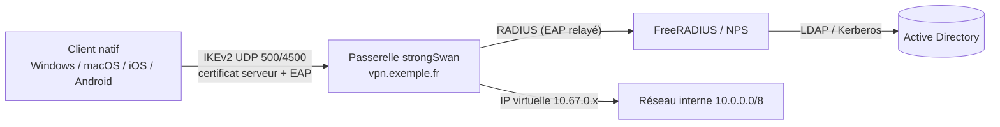

L'intérêt majeur d'IKEv2 : **aucun logiciel à installer** sur Windows, macOS et iOS. La passerelle s'authentifie par **certificat**, l'utilisateur par **EAP** (mot de passe ou certificat), éventuellement délégué à un serveur **RADIUS**.



## Prérequis : certificat de la passerelle

| Exigence | Raison |
| --- | --- |
| SAN `DNS:vpn.exemple.fr` identique à l'adresse saisie dans le client | Windows et Apple vérifient le nom |
| EKU **serverAuth** (et **ikeIntermediate** pour les anciens macOS) | Exigé par Windows |
| AC de confiance installée sur les clients (magasin **Ordinateur** sous Windows) | Sinon erreur 13801 |

Génération : voir [[05-pki-certificats]] (AC interne) — un certificat **public** (Let's Encrypt) convient aussi pour l'authentification EAP par mot de passe.

## EAP-MSCHAPv2 avec comptes locaux

```swanctl /etc/swanctl/conf.d/rw-eap.conf
connections {
    rw-eap {
        version = 2
        local_addrs = 203.0.113.10
        pools = pool-vpn-v4
        # Ordre de préférence ; la 2e proposition couvre les clients Windows durcis par Set-VpnConnectionIPsecConfiguration
        proposals = aes256gcm16-prfsha384-ecp384, aes256-sha256-ecp384, aes256-sha256-modp2048
        send_certreq = no
        unique = replace                 # une seule session par utilisateur
        dpd_delay = 60s
        local {
            auth = pubkey
            certs = vpn.exemple.fr.crt
            id = vpn.exemple.fr
        }
        remote {
            auth = eap-mschapv2
            eap_id = %any                # demander l'identité EAP au client
        }
        children {
            rw {
                local_ts = 10.0.0.0/8                 # split tunneling ; 0.0.0.0/0 pour un tunnel complet
                esp_proposals = aes256gcm16-ecp384, aes256gcm16, aes256-sha256-ecp384, aes256-sha256
                dpd_action = clear
            }
        }
    }
}

pools {
    pool-vpn-v4 {
        addrs = 10.67.0.0/24
        dns = 10.0.10.53, 10.0.10.54
    }
}

secrets {
    eap-alice {
        id = alice
        secret = "MotDePasseLong"
    }
}
```

```bash
sudo swanctl --load-all
sudo swanctl --list-pools --leases
```

Le réseau `10.67.0.0/24` doit être **routé** vers la passerelle dans le réseau interne (ou masqué par NAT sur la passerelle).

> [!NOTE]
> EAP-MSCHAPv2 est faible seul, mais il circule ici **dans la SA IKE chiffrée**, après authentification du serveur par certificat. La sécurité repose donc sur la **validation stricte du certificat** par le client.

## Délégation à RADIUS (FreeRADIUS, NPS)

strongSwan relaie l'EAP vers le serveur RADIUS, qui vérifie l'utilisateur dans l'annuaire.

```text /etc/strongswan.d/charon/eap-radius.conf
eap-radius {
    load = yes
    accounting = yes
    class_group = yes                  # attribut Class = groupe (filtrage par profil)
    servers {
        radius1 {
            address = 10.0.10.20
            secret = SecretPartageRadius
            auth_port = 1812
            acct_port = 1813
        }
        radius2 {
            address = 10.0.10.21
            secret = SecretPartageRadius
        }
    }
    dae {
        enable = yes                   # déconnexion à la demande (RFC 5176, CoA/Disconnect)
        listen = 10.0.10.1
        secret = SecretDae
    }
}
```

```swanctl
connections {
    rw-radius {
        # … mêmes paramètres que rw-eap …
        pools = radius, pool-vpn-v4        # Framed-IP-Address si fourni, sinon le pool local
        remote {
            auth = eap-radius
            eap_id = %any
        }
    }
}
```

| Serveur RADIUS | Configuration |
| --- | --- |
| **FreeRADIUS** | Déclarer la passerelle comme client, module `eap` avec `mschapv2` (et `tls` pour EAP-TLS), authentification AD via `ntlm_auth` — voir [[01-freeradius/07-eap-peap-tls\|EAP]] et [[01-freeradius/06-ldap-active-directory\|LDAP / AD]] |
| **NPS** (Windows) | Client RADIUS = passerelle ; stratégie réseau : groupe AD, méthode *EAP-MSCHAP v2* (ou *Carte à puce ou autre certificat* pour EAP-TLS) |

### Profils par groupe

Avec `class_group = yes`, l'attribut `Class` renvoyé par le serveur RADIUS sert de groupe : on peut définir plusieurs connexions (`remote { groups = vpn-admins }`) donnant des pools et des sélecteurs différents (administrateurs : tout le réseau ; prestataires : quelques serveurs).

## EAP-TLS et certificats utilisateurs

```swanctl
remote {
    auth = eap-tls              # ou « pubkey » : certificat IKE natif (sans EAP)
    eap_id = %any
    cacerts = ac-vpn.crt        # accepter uniquement les certificats de l'AC VPN
}
```

Les certificats utilisateurs ou machines (EKU clientAuth) sont distribués par la PKI d'entreprise ([[01-active-directory/10-adcs-pki\|AD CS]] avec auto-enrôlement, Intune/SCEP). Avec `auth = eap-radius`, l'EAP-TLS peut aussi être traité par le serveur RADIUS.

## Clients Windows

```powershell
# Importer l'AC dans le magasin Ordinateur (si AC interne)
Import-Certificate -FilePath .\ac-vpn.crt -CertStoreLocation Cert:\LocalMachine\Root

Add-VpnConnection -Name "VPN Entreprise" -ServerAddress vpn.exemple.fr `
    -TunnelType Ikev2 -AuthenticationMethod Eap -EncryptionLevel Required `
    -SplitTunneling -RememberCredential -PassThru
# (EAP par défaut = EAP-MSCHAPv2 ; -AllUserConnection pour tous les utilisateurs)

# Imposer des algorithmes robustes (sinon Windows propose 3DES/SHA-1/DH2 par défaut)
Set-VpnConnectionIPsecConfiguration -ConnectionName "VPN Entreprise" `
    -EncryptionMethod AES256 -IntegrityCheckMethod SHA256 -DHGroup ECP384 `
    -CipherTransformConstants GCMAES256 -AuthenticationTransformConstants GCMAES256 `
    -PfsGroup ECP384 -Force

# Routes du split tunneling
Add-VpnConnectionRoute -ConnectionName "VPN Entreprise" -DestinationPrefix 10.0.0.0/8
# Suffixe DNS / résolution des noms internes
Set-VpnConnection -Name "VPN Entreprise" -DnsSuffix corp.exemple.fr
Add-VpnConnectionTriggerDnsConfiguration -ConnectionName "VPN Entreprise" `
    -DnsSuffix corp.exemple.fr -DnsIPAddress 10.0.10.53 -Force
```

| Correspondance | Windows | strongSwan |
| --- | --- | --- |
| IKE | `AES256` + `SHA256` + `ECP384` | `aes256-sha256-ecp384` |
| ESP | `GCMAES256` + PFS `ECP384` | `aes256gcm16-ecp384` |

> [!TIP]
> Pour un déploiement d'entreprise, **Always On VPN** (profil `ProfileXML` poussé par Intune ou script) gère connexion automatique, tunnel machine (*device tunnel*, certificat machine) et tunnel utilisateur ; une passerelle strongSwan IKEv2 convient comme serveur.

Pour les postes non gérés, la clé de registre `HKLM\SYSTEM\CurrentControlSet\Services\RasMan\Parameters\NegotiateDH2048_AES256 = 2` (DWORD) force AES-256 + DH 2048 pour toutes les connexions IKEv2 → proposition `aes256-sha256-modp2048` côté passerelle.

## Clients macOS et iOS : profil mobileconfig

```xml VPN-Entreprise.mobileconfig
<?xml version="1.0" encoding="UTF-8"?>
<!DOCTYPE plist PUBLIC "-//Apple//DTD PLIST 1.0//EN" "http://www.apple.com/DTDs/PropertyList-1.0.dtd">
<plist version="1.0">
<dict>
  <key>PayloadContent</key>
  <array>
    <dict>
      <key>PayloadType</key><string>com.apple.vpn.managed</string>
      <key>PayloadIdentifier</key><string>fr.exemple.vpn.ikev2</string>
      <key>PayloadUUID</key><string>6C1A3E52-2F4B-4E59-9D8A-1B2C3D4E5F60</string>
      <key>PayloadVersion</key><integer>1</integer>
      <key>UserDefinedName</key><string>VPN Entreprise</string>
      <key>VPNType</key><string>IKEv2</string>
      <key>IKEv2</key>
      <dict>
        <key>RemoteAddress</key><string>vpn.exemple.fr</string>
        <key>RemoteIdentifier</key><string>vpn.exemple.fr</string>
        <key>LocalIdentifier</key><string>alice</string>
        <key>AuthenticationMethod</key><string>None</string>
        <key>ExtendedAuthEnabled</key><integer>1</integer>
        <key>AuthName</key><string>alice</string>
        <key>DeadPeerDetectionRate</key><string>Medium</string>
        <key>EnablePFS</key><integer>1</integer>
        <key>IKESecurityAssociationParameters</key>
        <dict>
          <key>EncryptionAlgorithm</key><string>AES-256-GCM</string>
          <key>IntegrityAlgorithm</key><string>SHA2-384</string>
          <key>DiffieHellmanGroup</key><integer>20</integer>
        </dict>
        <key>ChildSecurityAssociationParameters</key>
        <dict>
          <key>EncryptionAlgorithm</key><string>AES-256-GCM</string>
          <key>IntegrityAlgorithm</key><string>SHA2-384</string>
          <key>DiffieHellmanGroup</key><integer>20</integer>
        </dict>
      </dict>
    </dict>
  </array>
  <key>PayloadType</key><string>Configuration</string>
  <key>PayloadIdentifier</key><string>fr.exemple.vpn</string>
  <key>PayloadUUID</key><string>0B8E7A6C-5D4F-4A3B-8C2D-1E0F9A8B7C6D</string>
  <key>PayloadVersion</key><integer>1</integer>
  <key>PayloadDisplayName</key><string>VPN Entreprise (IKEv2)</string>
</dict>
</plist>
```

- `AuthenticationMethod = None` + `ExtendedAuthEnabled = 1` : serveur authentifié par certificat, utilisateur par EAP.
- Pour un certificat utilisateur : `AuthenticationMethod = Certificate` et une charge utile `com.apple.security.pkcs12` (ou SCEP/ACME via MDM).
- Déploiement par MDM (Intune, Jamf) ou double-clic ; `OnDemandEnabled` + `OnDemandRules` pour une connexion automatique.

## Android et Linux

| Client | Configuration |
| --- | --- |
| **strongSwan VPN Client** (Android) | Type *IKEv2 EAP (nom d'utilisateur/mot de passe)* ou *IKEv2 Certificat* ; AC prise dans le magasin système ou importée ; profils `.sswan` (JSON) distribuables |
| Client natif Android 11+ | *IKEv2/IPSec MSCHAPv2* ou *IKEv2/IPSec RSA* |
| **NetworkManager** (Linux) | Greffon `network-manager-strongswan` : *IPsec/IKEv2 (strongswan)*, EAP ou certificat |

## MFA

| Méthode | Mise en œuvre |
| --- | --- |
| **EAP-TLS** + certificat sur carte à puce / TPM (Windows Hello Entreprise) | Facteur « possession » fort, sans saisie |
| RADIUS + OTP | Serveur RADIUS avec module OTP (privacyIDEA, LinOTP) ; client compatible EAP-GTC (strongSwan Android, Linux) |
| **Extension NPS pour Microsoft Entra MFA** | NPS valide le mot de passe AD puis déclenche une **notification push** ; compatible EAP-MSCHAPv2 des clients natifs |
| Proxy RADIUS d'un fournisseur MFA (Duo, etc.) | Même principe, push ou appel |

## Tunnel complet et accès Internet

Pour faire sortir tout le trafic des clients par la passerelle :

```swanctl
children { rw { local_ts = 0.0.0.0/0, ::/0 } }
```

```bash
sudo nft add rule ip nat postrouting ip saddr 10.67.0.0/24 oifname "ens192" masquerade
```

Côté Windows, retirer `-SplitTunneling` (« utiliser la passerelle par défaut du réseau distant »).
