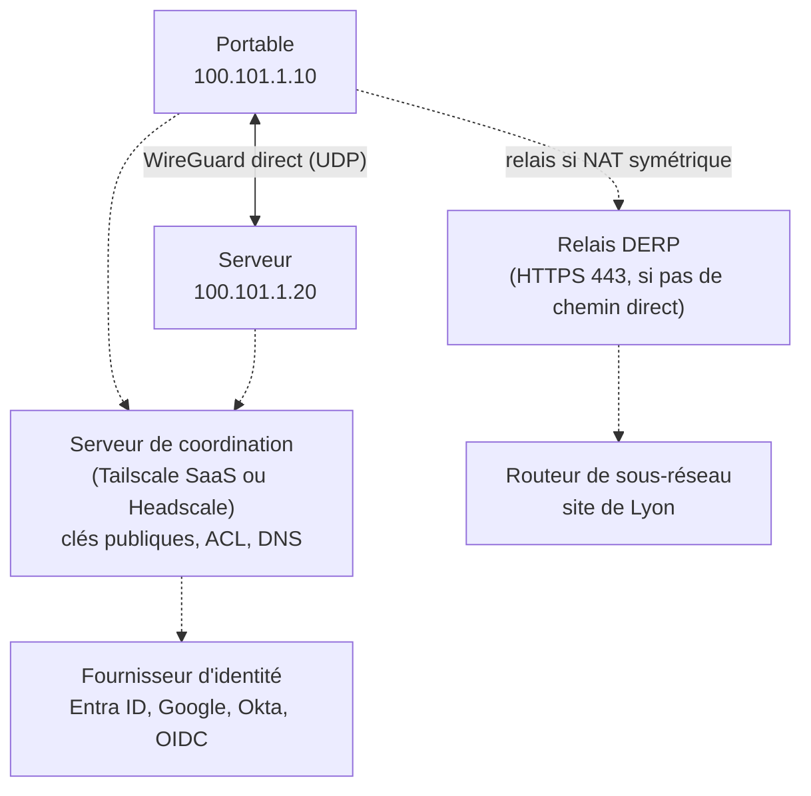

**Tailscale** construit un **réseau maillé chiffré** (*tailnet*) entre vos appareils, serveurs et sites, au-dessus de **WireGuard**. Il ajoute ce que WireGuard ne fait pas : distribution automatique des clés, **traversée de NAT**, authentification des utilisateurs par **SSO**, **ACL** centralisées et DNS (MagicDNS). **Headscale** est une implémentation open source et **auto-hébergée** du serveur de coordination, compatible avec les clients Tailscale officiels.

## Architecture



| Composant | Rôle |
| --- | --- |
| **Plan de contrôle** (coordination) | Inscrit les nœuds, distribue les clés publiques, la politique d'accès et le DNS. **Ne voit pas** le trafic |
| **Plan de données** | Tunnels WireGuard **directs** entre nœuds (pair à pair) |
| **Traversée de NAT** | STUN + perçage UDP ; fonctionne derrière la plupart des NAT et pare-feu sans ouvrir de port |
| **DERP** | Relais chiffrés (HTTPS) quand aucun chemin direct n'est possible (NAT symétrique, UDP bloqué) |
| **Tailnet** | Réseau privé d'une organisation ; adresses dans `100.64.0.0/10` (CGNAT) et `fd7a:115c:a1e0::/48` |
| **Nœud** | Appareil inscrit (utilisateur ou étiqueté `tag:…` pour les serveurs) |

## Fonctions principales

| Fonction | Usage |
| --- | --- |
| **Subnet router** | Un nœud annonce un réseau local (ex. `10.0.0.0/16`) : accès à des équipements sans client Tailscale |
| **Exit node** | Un nœud sert de sortie Internet pour les autres |
| **MagicDNS** / split DNS | Noms des nœuds (`serveur.tailnet.ts.net`) et transfert des domaines internes vers vos DNS |
| **ACL / grants** | Politique centralisée « qui peut joindre quoi » |
| **Tailscale SSH** | SSH authentifié par l'identité tailnet, contrôlé par la politique |
| Serve / Funnel | Publier un service dans le tailnet / sur Internet |
| App connectors | Accès à des applications SaaS par domaine, via une IP de sortie fixe |

Détails : [[02-fonctionnalites]].

## Tailscale, Headscale et alternatives

| Solution | Plan de contrôle | Points forts | Limites |
| --- | --- | --- | --- |
| **Tailscale** | SaaS | Très simple, toutes plates-formes, SSO/MFA, journaux, fonctions avancées | Dépendance à un service tiers ; tarification par utilisateur au-delà de l'offre gratuite |
| **Headscale** | Auto-hébergé, open source | Souveraineté, gratuité, clients officiels | Un seul tailnet, fonctions avancées absentes (Funnel, journaux de flux…), projet communautaire |
| **NetBird** | SaaS ou auto-hébergé (open source) | Interface web complète, SSO, politiques | Écosystème plus jeune |
| [[06-zerotier/01-presentation-installation\|ZeroTier]] | SaaS ou contrôleur auto-hébergé | Réseau **niveau 2**, règles de flux | Protocole propre (non WireGuard) |
| [[03-wireguard/01-presentation-installation\|WireGuard]] seul | Aucun | Contrôle total, performances | Gestion des clés, NAT et ACL à votre charge |

## Ports et flux

| Flux | Port | Remarque |
| --- | --- | --- |
| Plan de contrôle | TCP 443 sortant | `controlplane.tailscale.com` ou votre Headscale |
| WireGuard direct | UDP **41641** (par défaut, ou port aléatoire) | Ouvrir en entrée sur les serveurs/routeurs améliore les connexions directes |
| STUN | UDP 3478 sortant | Découverte de l'adresse publique |
| DERP | TCP 443 sortant | Relais de secours |

## Installation

### Linux

```bash
curl -fsSL https://tailscale.com/install.sh | sh        # détecte la distribution et ajoute le dépôt officiel
# ou manuellement (Debian 12) :
curl -fsSL https://pkgs.tailscale.com/stable/debian/bookworm.noarmor.gpg | sudo tee /usr/share/keyrings/tailscale-archive-keyring.gpg >/dev/null
curl -fsSL https://pkgs.tailscale.com/stable/debian/bookworm.tailscale-keyring.list | sudo tee /etc/apt/sources.list.d/tailscale.list
sudo apt update && sudo apt install tailscale

sudo systemctl enable --now tailscaled
sudo tailscale up                                      # affiche une URL d'authentification SSO
sudo tailscale up --auth-key=tskey-auth-XXXX --advertise-tags=tag:serveur   # serveur, sans interaction
```

RHEL/Rocky : `sudo dnf config-manager --add-repo https://pkgs.tailscale.com/stable/rhel/9/tailscale.repo && sudo dnf install tailscale`.

### Windows

```powershell
winget install --id tailscale.tailscale -e
# ou MSI pour un déploiement (Intune/GPO) :
msiexec /i tailscale-setup-latest-amd64.msi /quiet TS_UNATTENDEDMODE=always
& "C:\Program Files\Tailscale\tailscale.exe" up --auth-key=tskey-auth-XXXX --unattended
& "C:\Program Files\Tailscale\tailscale.exe" status
```

Les **politiques système** (registre `HKLM\SOFTWARE\Policies\Tailscale`, ADMX) permettent d'imposer le serveur de coordination (`LoginURL`), le tailnet, le mode sans surveillance, l'exit node, etc.

### macOS

| Variante | Installation | Remarque |
| --- | --- | --- |
| App Store | Mac App Store | Extension réseau sandboxée |
| **Standalone** | Paquet `.pkg` (site Tailscale) | Recommandé en entreprise (MDM, fonctions complètes) |
| Open source | `brew install tailscale` puis `sudo brew services start tailscale` | CLI uniquement (`tailscaled` en démon) |

Profils de configuration MDM (domaine `io.tailscale.ipn.macsys`) pour imposer les paramètres.

## Commandes de base

| Commande | Rôle |
| --- | --- |
| `tailscale up` / `tailscale down` | Connecter / déconnecter |
| `tailscale set --…` | Modifier un paramètre sans tout ressaisir (routes, exit node, SSH…) |
| `tailscale status` | Nœuds du tailnet, état, connexion directe ou relayée |
| `tailscale ip -4` | Adresse tailnet du nœud |
| `tailscale ping serveur` | Test de bout en bout (indique `via DERP` ou direct) |
| `tailscale netcheck` | Diagnostic NAT, latence DERP, UDP |
| `tailscale whois 100.101.1.20` | Utilisateur / nœud derrière une adresse |
| `tailscale logout` | Désinscrire le nœud |

## Suite du parcours

1. [[02-fonctionnalites|Subnet routers, exit nodes, DNS, ACL, SSH]]
2. [[03-headscale|Headscale : serveur de coordination auto-hébergé]]
3. [[04-securite-exploitation|Sécurité, exploitation et dépannage]]
