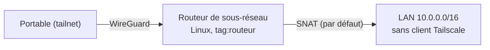

## Routeur de sous-réseau (*subnet router*)

Donne accès à un réseau local (serveurs, imprimantes, équipements réseau) sans installer Tailscale sur chaque machine.



```bash
# Sur le routeur (Linux)
echo 'net.ipv4.ip_forward = 1' | sudo tee /etc/sysctl.d/99-tailscale.conf
echo 'net.ipv6.conf.all.forwarding = 1' | sudo tee -a /etc/sysctl.d/99-tailscale.conf
sudo sysctl -p /etc/sysctl.d/99-tailscale.conf

sudo tailscale set --advertise-routes=10.0.0.0/16,192.168.50.0/24
# Puis approuver les routes dans la console d'administration (ou autoApprovers)
```

| Option | Effet |
| --- | --- |
| `--snat-subnet-routes=true` (défaut) | Les machines du LAN voient l'IP du routeur : aucune route de retour nécessaire |
| `--snat-subnet-routes=false` | Adresses tailnet d'origine conservées (traçabilité) : ajouter une route `100.64.0.0/10 → routeur` dans le LAN |
| `--accept-routes` | **Clients Linux** : utiliser les routes annoncées (activé par défaut sur Windows, macOS, mobiles) |

> [!TIP]
> **Haute disponibilité** : annoncez la même route depuis deux routeurs. Tailscale en choisit un comme principal et bascule automatiquement s'il disparaît.

> [!WARNING]
> Un client dont le réseau local utilise **la même plage** qu'une route annoncée (ex. `192.168.1.0/24` à la maison et au bureau) risque des conflits. Évitez d'annoncer des plages domestiques courantes ; préférez des plages d'entreprise spécifiques.

Sous Windows Server, un nœud peut aussi annoncer des routes (`tailscale set --advertise-routes=…`), mais un routeur Linux reste le choix le plus courant.

## Exit node

```bash
# Nœud de sortie
sudo tailscale set --advertise-exit-node          # puis approbation (console ou autoApprovers)
# Client
sudo tailscale set --exit-node=sortie-paris --exit-node-allow-lan-access=true
sudo tailscale set --exit-node=                   # désactiver
```

Usages : Wi-Fi publics, sortie Internet par une IP fixe de l'entreprise (filtrage, listes blanches de fournisseurs).

## DNS

| Fonction | Configuration (console *DNS*) |
| --- | --- |
| **MagicDNS** | Noms `machine.<tailnet>.ts.net` résolus via `100.100.100.100` |
| **Split DNS** | Serveur de noms « restreint au domaine » `corp.exemple.fr` → `10.0.10.53` (joignable via un subnet router) |
| Serveurs globaux | DNS utilisé pour tout le reste (option *Override local DNS*) |
| Certificats HTTPS | `tailscale cert serveur.<tailnet>.ts.net` : certificat Let's Encrypt pour le nom MagicDNS |

## Politique d'accès

Par défaut, un tailnet autorise **tout le monde à joindre tout**. La politique (HuJSON : JSON avec commentaires et virgules finales) restreint les flux.

```json Politique du tailnet (console : Access controls)
{
  // Groupes d'utilisateurs (ou synchronisés depuis le fournisseur d'identité)
  "groups": {
    "group:admins-reseau": ["alice@exemple.fr", "bob@exemple.fr"],
    "group:dev":           ["carla@exemple.fr"],
  },
  // Qui peut appliquer quelles étiquettes aux nœuds
  "tagOwners": {
    "tag:routeur": ["group:admins-reseau"],
    "tag:serveur": ["group:admins-reseau"],
    "tag:ci":      ["group:admins-reseau"],
  },
  "acls": [
    // Administrateurs : tout
    {"action": "accept", "src": ["group:admins-reseau"], "dst": ["*:*"]},
    // Développeurs : HTTPS et SSH vers les serveurs, un sous-réseau applicatif
    {"action": "accept", "src": ["group:dev"], "dst": ["tag:serveur:22,443", "10.0.20.0/24:443"]},
    // Tous les membres : DNS interne
    {"action": "accept", "src": ["autogroup:member"], "dst": ["10.0.10.53:53"]},
  ],
  // Approbation automatique des routes et exit nodes annoncés par des nœuds étiquetés
  "autoApprovers": {
    "routes":   {"10.0.0.0/16": ["tag:routeur"]},
    "exitNode": ["tag:routeur"],
  },
  // Tailscale SSH
  "ssh": [
    {"action": "check", "src": ["group:admins-reseau"], "dst": ["tag:serveur"], "users": ["root", "autogroup:nonroot"]},
  ],
  // Tests exécutés à chaque modification de la politique
  "tests": [
    {"src": "carla@exemple.fr", "accept": ["tag:serveur:443"], "deny": ["10.0.10.1:22"]},
  ],
}
```

| Élément | Signification |
| --- | --- |
| `autogroup:member` | Tous les utilisateurs du tailnet |
| `autogroup:self` | Les appareils de l'utilisateur lui-même |
| `tag:…` | Identité d'un nœud **serveur** (ne dépend plus d'un utilisateur, pas d'expiration de clé par défaut) |
| `dst` | `cible:ports` — nœud, tag, groupe, IP ou CIDR (routes annoncées) |
| `"action": "check"` (SSH) | Réauthentification SSO récente exigée (MFA du fournisseur d'identité) |

La syntaxe plus récente **grants** (`{"src": […], "dst": […], "ip": ["tcp:443"]}`) remplace progressivement `acls` et permet aussi de transmettre des capacités applicatives.

## Tailscale SSH

```bash
sudo tailscale set --ssh            # sur le serveur : tailscaled répond au SSH sur l'IP tailnet
ssh root@serveur                    # depuis un nœud autorisé : pas de clé SSH à gérer
```

L'autorisation vient de la section `ssh` de la politique, avec enregistrement des sessions possible (*session recording*). Le serveur [[01-openssh/01-presentation|OpenSSH]] reste disponible en parallèle.

## Clés d'authentification

| Type | Usage |
| --- | --- |
| Réutilisable | Inscrire plusieurs serveurs (images, Ansible) |
| **Éphémère** | Conteneurs, CI : le nœud disparaît après déconnexion |
| Pré-approuvée | Contourne l'approbation des appareils |
| Avec tags | Le nœud reçoit directement `tag:…` |

```bash
sudo tailscale up --auth-key=tskey-auth-XXXX --advertise-tags=tag:ci --hostname=runner-01
```

Pour l'automatisation, préférez des **clients OAuth** (portée limitée, génèrent des clés à la demande) plutôt que des clés API personnelles.

## Serve et Funnel

```bash
tailscale serve --bg 3000          # publier http://localhost:3000 en HTTPS dans le tailnet
tailscale funnel --bg 3000         # … et sur Internet (https://machine.<tailnet>.ts.net)
tailscale serve status
tailscale serve reset
```

## Automatisation : API et Terraform

```bash
# Lister les nœuds (clé API ou jeton OAuth)
curl -s -H "Authorization: Bearer $TS_API_KEY" \
  https://api.tailscale.com/api/v2/tailnet/-/devices | jq '.devices[] | {name, addresses, lastSeen}'
```

```hcl
terraform {
  required_providers {
    tailscale = { source = "tailscale/tailscale" }
  }
}

resource "tailscale_acl" "politique" {
  acl = file("${path.module}/politique.hujson")
}

resource "tailscale_tailnet_key" "serveurs" {
  reusable      = true
  ephemeral     = false
  preauthorized = true
  tags          = ["tag:serveur"]
  expiry        = 7776000          # 90 jours
}

resource "tailscale_dns_split_nameservers" "corp" {
  domain      = "corp.exemple.fr"
  nameservers = ["10.0.10.53"]
}
```

Versionner la politique dans Git et l'appliquer par CI (Terraform ou l'action GitHub `tailscale/gitops-acl-action`) donne revue, historique et retour arrière.
