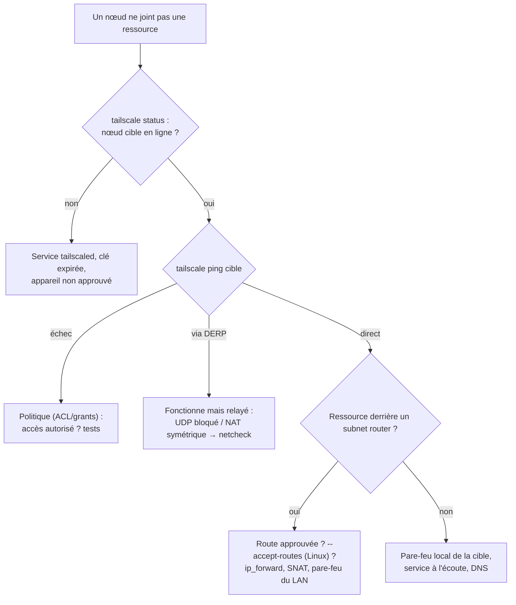

## Sécurité du tailnet

| Mesure | Détail |
| --- | --- |
| **Politique restrictive** | Remplacer la politique par défaut (tout autorisé) par des règles par groupe et tag ; tests dans la politique |
| **Approbation des appareils** | Tout nouvel appareil doit être approuvé par un administrateur |
| **Expiration des clés** | Réauthentification SSO périodique (180 jours par défaut, réductible) ; désactiver l'expiration seulement pour les serveurs étiquetés |
| **Tags pour les serveurs** | Un serveur n'appartient pas à un utilisateur : son départ ne casse rien et ses droits sont ceux du tag |
| **SSO + MFA** | Imposés par le fournisseur d'identité (accès conditionnel, conformité de l'appareil) |
| **Tailnet Lock** | Les nouveaux nœuds doivent être **signés** par des nœuds de confiance : même une compromission du plan de contrôle ne permet pas d'injecter un nœud |
| Clés d'authentification | Courtes, à usage unique ou éphémères ; clients OAuth à portée limitée pour l'automatisation |
| Journaux | Journaux d'audit de configuration ; journaux de flux réseau (offres payantes) vers un SIEM |
| Posture des appareils | Conditions d'accès selon l'OS, la version, l'intégration MDM/EDR (offres payantes) |

```bash
# Tailnet Lock
tailscale lock init --gen-disablements 3 --confirm tlpub:<clé-nœud-1> tlpub:<clé-nœud-2>
tailscale lock status
tailscale lock sign nodekey:<clé-nouveau-nœud>
```

> [!WARNING]
> Un **subnet router** ou un **exit node** expose des réseaux entiers : restreignez dans la politique **qui** peut joindre **quelles** plages, protégez le nœud comme un équipement d'infrastructure et désactivez l'expiration uniquement s'il est étiqueté.

## Intégration au réseau d'entreprise

| Sujet | Recommandation |
| --- | --- |
| Pare-feu périmétrique | Autoriser TCP 443 sortant (contrôle, DERP), UDP 3478 sortant ; UDP 41641 entrant vers les routeurs/serveurs pour des connexions directes |
| Port fixe | `tailscaled --port=41641` (Linux : `/etc/default/tailscaled`, variable `PORT`) pour écrire des règles précises |
| Pare-feu local Linux | `--netfilter-mode=on` (défaut) : tailscaled gère ses règles ; `off` si vous gérez nftables vous-même |
| Plage 100.64.0.0/10 | Chevauchement possible avec un CGNAT d'opérateur ou un usage interne : plage personnalisée (pool d'adresses du tailnet chez Tailscale, `prefixes` dans Headscale) |
| Proxy HTTP sortant | Variables `HTTPS_PROXY` pour `tailscaled` ; la connexion directe UDP reste préférable |
| Relais DERP privés | Héberger vos propres DERP (ou utiliser celui de Headscale) pour garder les relais en interne |

## Supervision

| Source | Données |
| --- | --- |
| `tailscale status --json` | État des pairs, connexion directe ou relayée, dernière activité |
| Métriques client | `tailscale metrics print` (ou `--debug=` sur un port local pour Prometheus) : octets, chemins, routes |
| API Tailscale | Appareils, `lastSeen`, version du client, expiration des clés : alertes sur les nœuds critiques hors ligne |
| Headscale | Métriques Prometheus sur `metrics_listen_addr` (`:9090/metrics`) |

```bash
# Routeur de sous-réseau joignable et en connexion directe ?
tailscale ping -c 3 routeur-paris
tailscale status --json | jq '.Peer[] | {HostName, Online, CurAddr, Relay}'
```

## Diagnostic



```bash
tailscale netcheck            # UDP, type de NAT, latence vers chaque DERP
tailscale debug derp-map
tailscale bugreport           # identifiant à fournir au support
journalctl -u tailscaled -f
```

## Problèmes fréquents

| Symptôme | Cause | Solution |
| --- | --- | --- |
| Connexion lente, `tailscale ping` indique `via DERP` | UDP sortant bloqué ou NAT symétrique des deux côtés | Ouvrir UDP 41641 vers un côté, autoriser UDP sortant, DERP proche |
| Réseau d'un subnet router injoignable depuis Linux | `--accept-routes` absent sur le client | `tailscale set --accept-routes` |
| Route annoncée mais inactive | Non approuvée | Console ou `headscale nodes approve-routes`, ou `autoApprovers` |
| Le LAN répond mais pas au retour (SNAT désactivé) | Pas de route vers `100.64.0.0/10` dans le LAN | Ajouter la route ou réactiver le SNAT |
| Noms internes non résolus | Split DNS absent, DNS interne non autorisé par la politique ou injoignable | Ajouter le domaine restreint, règle vers `DNS:53`, route vers le DNS |
| Résolution DNS locale perturbée (Linux) | Conflit avec `systemd-resolved` / `resolv.conf` géré | `tailscale set --accept-dns=false` sur les serveurs, ou intégrer resolved |
| Nœud déconnecté après quelques mois | Expiration de la clé | Réauthentifier ; désactiver l'expiration pour les serveurs étiquetés |
| `tailscale up` refuse : « changing settings requires mentioning all non-default flags » | `up` exige de reprendre toutes les options | Utiliser `tailscale set` pour une modification ponctuelle |
| Conflit avec un autre VPN | Routes ou DNS concurrents (VPN d'entreprise, WireGuard) | Plages distinctes, désactiver `--accept-routes` / `--accept-dns` sur l'un des deux |
| Windows : ressources du tailnet bloquées | Pare-feu Windows / profil réseau | Vérifier le profil de l'interface Tailscale et les règles entrantes |
| Headscale : clients bloqués à « connecting » | Reverse proxy sans mise à niveau de connexion, `server_url` incorrecte | Vérifier la configuration du proxy (Upgrade, pas de buffering) et `server_url` |
