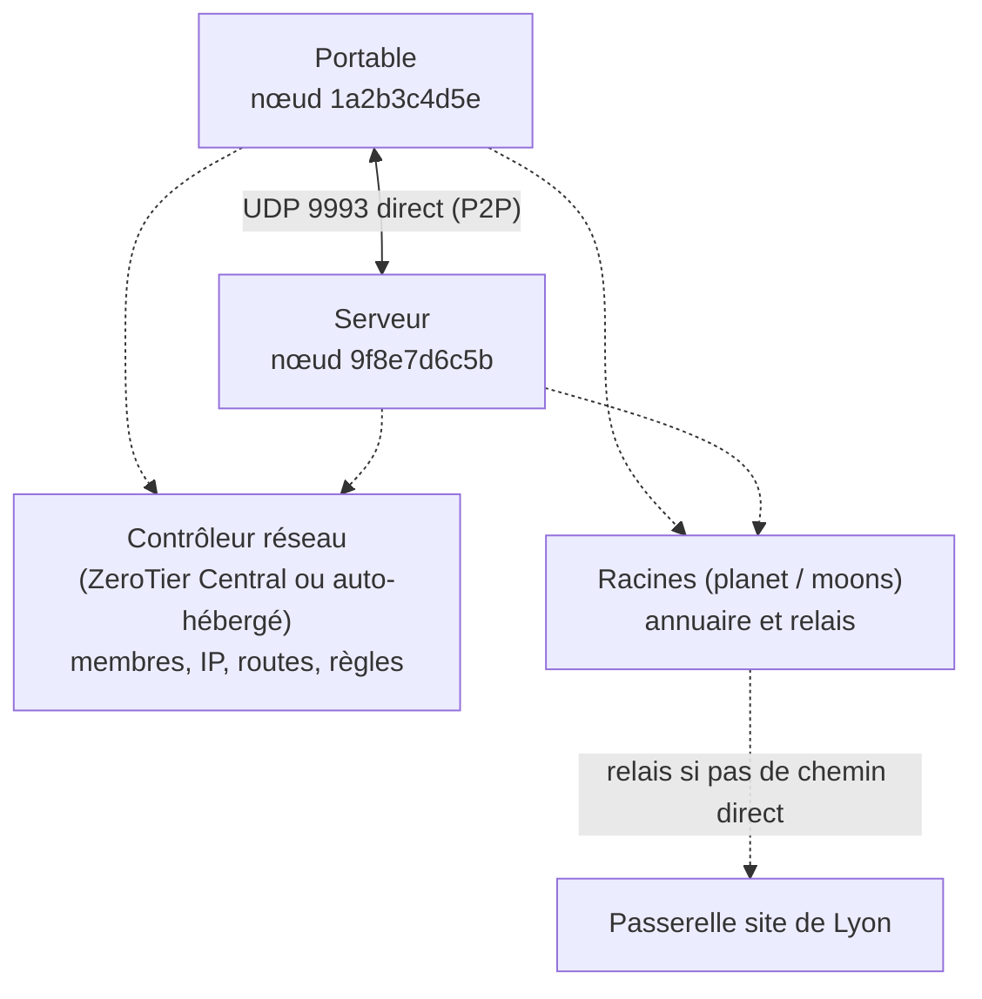

**ZeroTier** crée des **réseaux Ethernet virtuels** (niveau 2) chiffrés entre des appareils où qu'ils soient : postes, serveurs, conteneurs, équipements embarqués. Chaque réseau se comporte comme un commutateur virtuel mondial : ARP, multicast, IPv4/IPv6 et même protocoles non IP circulent entre les membres.

## Architecture



| Notion | Description |
| --- | --- |
| **Nœud** | Instance `zerotier-one` ; identité = adresse de **10 caractères hexadécimaux** (ex. `1a2b3c4d5e`) dérivée de sa clé publique |
| **Réseau** | Identifiant de **16 caractères** : les 10 premiers = adresse du **contrôleur**, les 6 derniers = numéro du réseau |
| **Contrôleur** | Distribue la configuration aux membres : autorisation, adresses IP, routes, règles de flux, DNS |
| **Racines** (*planet*) | Serveurs d'annuaire publics de ZeroTier : mise en relation des nœuds et relais de secours |
| **Moon** | Racine privée que vous hébergez (résilience, latence, réseaux isolés) |
| Chemin direct / relayé | Connexion pair à pair par perçage UDP ; sinon relais via les racines (plus lent) |

Les membres d'un réseau **privé** doivent être **autorisés** par l'administrateur du contrôleur avant de recevoir une configuration.

## ZeroTier Central ou contrôleur auto-hébergé

| Option | Description |
| --- | --- |
| **ZeroTier Central** | Contrôleur SaaS avec interface web et API ; offre gratuite limitée en nombre d'appareils, offres payantes (SSO, plus de membres, support) |
| **Contrôleur intégré** | Chaque `zerotier-one` contient un contrôleur, piloté par son **API locale** (voir [[02-configuration-reseaux]]) |
| **ztncui**, ZeroUI | Interfaces web open source pour un contrôleur auto-hébergé |

> [!NOTE]
> Le code de ZeroTier est publié sous une licence « source disponible » (BSL) avec des conditions particulières pour le contrôleur et l'usage commercial : vérifiez la licence en vigueur avant d'héberger un contrôleur pour un usage professionnel ou de l'intégrer à un produit.

## Ports et flux

| Flux | Port |
| --- | --- |
| Trafic ZeroTier (P2P, racines) | UDP **9993** (+ ports secondaires aléatoires) |
| Repli TCP (si UDP bloqué) | TCP 443 vers les relais ZeroTier (débit réduit) |
| API locale du service | TCP 9993 sur `127.0.0.1` (jeton `authtoken.secret`) |

## ZeroTier, Tailscale ou WireGuard ?

| Critère | ZeroTier | [[05-tailscale-headscale/01-presentation-installation\|Tailscale]] | [[03-wireguard/01-presentation-installation\|WireGuard]] |
| --- | --- | --- | --- |
| Couche | **2** (Ethernet) et 3 | 3 | 3 |
| Protocole | Propre (Salsa20/Poly1305, AES-GMAC-SIV) | WireGuard | WireGuard |
| Multicast, broadcast, protocoles non IP | **Oui** | Non | Non |
| Identité utilisateur / SSO | Offres payantes de Central | Natif | Non |
| Pont vers un LAN physique (bridging) | **Oui** | Non (subnet router en L3) | Non |
| Auto-hébergement | Contrôleur intégré, moons | Headscale | Natif |

Usages typiques de ZeroTier : accès à des équipements industriels ou IoT, jeux et applications reposant sur le broadcast, interconnexion de sites en L2, laboratoires.

## Installation

### Linux

```bash
curl -s https://install.zerotier.com | sudo bash     # dépôt officiel (Debian, Ubuntu, RHEL…)
# vérification de la signature recommandée : voir la page de téléchargement (version GPG du script)
sudo systemctl enable --now zerotier-one
sudo zerotier-cli info                                # 200 info 1a2b3c4d5e 1.14.x ONLINE
```

### Windows

```powershell
winget install --id ZeroTier.ZeroTierOne -e
# ou MSI : msiexec /i ZeroTierOne.msi /qn
& "C:\Program Files (x86)\ZeroTier\One\zerotier-cli.bat" info
```

L'application ajoute une icône dans la zone de notification (rejoindre un réseau, état) et un adaptateur réseau virtuel *ZeroTier Virtual Port*.

### macOS

```bash
brew install --cask zerotier-one        # ou paquet .pkg officiel
sudo zerotier-cli info
```

## Rejoindre et autoriser un réseau

```bash
sudo zerotier-cli join 8056c2e21c000001          # identifiant du réseau (exemple)
sudo zerotier-cli listnetworks
# 200 listnetworks 8056c2e21c000001 reseau-corp 5e:… ACCESS_DENIED PRIVATE ztabcdef12 -
```

Dans ZeroTier Central (ou via l'API), **autoriser** le membre (`1a2b3c4d5e`), lui donner un nom et éventuellement une IP fixe. Le statut passe à `OK` et l'interface (`zt…` sous Linux) reçoit son adresse.

```bash
ip -br addr show | grep zt
sudo zerotier-cli peers          # pairs : DIRECT ou RELAY, latence
sudo zerotier-cli leave 8056c2e21c000001
```

## Suite du parcours

1. [[02-configuration-reseaux|Configuration des réseaux : IP, routes, règles, pont, DNS, contrôleur, moons]]
2. [[03-exploitation-depannage|Exploitation et dépannage]]
