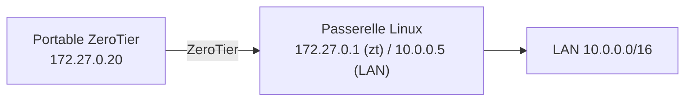

## Adresses IP

| Paramètre (Central → *Settings*) | Rôle |
| --- | --- |
| **IPv4 Auto-Assign** | Pool d'adresses attribuées automatiquement aux membres autorisés (ex. `172.27.0.0/16`) |
| Adresse manuelle | IP fixe par membre (serveurs, passerelles) |
| **IPv6 RFC 4193** | Adresse IPv6 unique dérivée du réseau et du nœud |
| **IPv6 6PLANE** | Un préfixe /80 par nœud (utile pour des conteneurs derrière un nœud) |

Choisissez une plage qui ne chevauche **aucun** réseau local de vos sites ni des réseaux domestiques courants.

## Accès à un LAN : routes gérées et passerelle



1. Dans Central, **Managed Routes** : `10.0.0.0/16` *via* `172.27.0.1` (adresse ZeroTier de la passerelle).
2. Sur la passerelle :

```bash
echo 'net.ipv4.ip_forward = 1' | sudo tee /etc/sysctl.d/90-zerotier.conf && sudo sysctl --system
ZT=$(ip -br link | awk '/^zt/ {print $1; exit}')
# Option A : NAT (aucune modification du LAN)
sudo nft add table ip nat
sudo nft add chain ip nat postrouting '{ type nat hook postrouting priority 100; }'
sudo nft add rule ip nat postrouting ip saddr 172.27.0.0/16 oifname "ens192" masquerade
# Option B : routage (traçabilité) — route 172.27.0.0/16 → 10.0.0.5 sur le routeur du LAN
sudo nft add rule inet filter forward iifname "$ZT" oifname "ens192" ip daddr 10.0.0.0/16 accept
sudo nft add rule inet filter forward ct state established,related accept
```

3. Sur les clients, accepter les routes gérées (`allowManaged=1`, activé par défaut).

Une route `0.0.0.0/0` via une passerelle (option *Default Route*) fait passer **tout le trafic** des clients ayant activé `allowDefault=1`.

## Pont Ethernet (bridging)

Pour étendre un réseau physique en **niveau 2** (même sous-réseau, DHCP, broadcast) :

1. Central → membre de la passerelle → cocher **Allow Ethernet Bridging** (et *Do Not Auto-Assign IPs*).
2. Sur la passerelle Linux, créer un pont entre l'interface ZeroTier et l'interface LAN :

```ini /etc/systemd/network/25-br0.netdev
[NetDev]
Name=br0
Kind=bridge
```

```ini /etc/systemd/network/25-br0-membres.network
[Match]
Name=ens224 zt*

[Network]
Bridge=br0
```

```ini /etc/systemd/network/25-br0.network
[Match]
Name=br0

[Network]
Address=10.0.50.2/24
Gateway=10.0.50.1
```

> [!WARNING]
> Le pont L2 transporte **tout** le broadcast et le multicast sur Internet : réservez-le aux cas qui l'exigent (équipements non routables, protocoles L2) et limitez-le par des règles de flux. Pour un simple accès à des serveurs, la route gérée (L3) est préférable.

## Règles de flux

Les **flow rules** sont évaluées par chaque membre (émetteur et récepteur) ; elles sont **sans état** (les ports de retour doivent être autorisés) et s'écrivent dans Central (*Flow Rules*) ou dans la configuration du contrôleur.

```text Règles de flux (exemple)
# N'autoriser que IPv4, ARP et IPv6
drop
  not ethertype ipv4
  and not ethertype arp
  and not ethertype ipv6
;

# Interdire SSH sauf depuis le sous-réseau d'administration
drop
  ipprotocol tcp
  and dport 22
  and not ipsrc 172.27.0.0/28
;

# Interdire SMB entre les membres
drop
  ipprotocol tcp
  and dport 445
;

# Tout le reste est accepté
accept;
```

| Élément | Exemple |
| --- | --- |
| Actions | `accept`, `drop`, `break`, `tee <longueur> <nœud>` (copie), `redirect <nœud>`, `watch` |
| Correspondances | `ethertype`, `ipsrc`, `ipdest`, `ipprotocol`, `sport`, `dport`, `chr` (caractéristiques TCP), `ztsrc`, `ztdest` |
| **Tags et capacités** | Attributs posés par membre (ex. `department`) et règles qui s'en servent (`tand`, `teq`…) : micro-segmentation |

Ce modèle convient à une segmentation simple ; pour un contrôle fin, combinez-le avec le pare-feu des hôtes.

## DNS

Central → **DNS** : domaine de recherche (`corp.exemple.fr`) et serveur (`10.0.0.53`). Les clients l'appliquent s'ils l'autorisent :

```bash
sudo zerotier-cli set 8056c2e21c000001 allowDNS=1
```

## Options côté client

| Option (`zerotier-cli set <réseau> …`) | Défaut | Effet |
| --- | --- | --- |
| `allowManaged` | 1 | Accepter IP et routes attribuées par le contrôleur |
| `allowGlobal` | 0 | Autoriser des routes/IP publiques (sinon seulement des plages privées) |
| `allowDefault` | 0 | Accepter une route par défaut (tout le trafic via ZeroTier) |
| `allowDNS` | 0 | Appliquer le DNS poussé |

Sous Windows et macOS, ces options sont aussi dans le menu de l'application (par réseau).

## Fichier local.conf

```json /var/lib/zerotier-one/local.conf
{
  "settings": {
    "primaryPort": 9993,
    "allowTcpFallbackRelay": true,
    "interfacePrefixBlacklist": ["docker", "veth", "br-", "tailscale", "wg"],
    "allowManagementFrom": ["127.0.0.1/32"]
  }
}
```

| Système | Emplacement |
| --- | --- |
| Linux | `/var/lib/zerotier-one/` |
| Windows | `C:\ProgramData\ZeroTier\One\` |
| macOS | `/Library/Application Support/ZeroTier/One/` |

`interfacePrefixBlacklist` évite que ZeroTier tente de passer par les interfaces d'autres VPN ou de conteneurs ; redémarrer le service après modification.

## API ZeroTier Central

```bash
TOKEN=xxxxxxxx                           # jeton d'API (compte Central)
NWID=8056c2e21c000001
# Lister les membres
curl -s -H "Authorization: token $TOKEN" https://api.zerotier.com/api/v1/network/$NWID/member \
  | jq '.[] | {nodeId, name, authorized: .config.authorized, ips: .config.ipAssignments}'
# Autoriser et nommer un membre
curl -s -X POST -H "Authorization: token $TOKEN" \
  -d '{"name": "srv-lyon-01", "config": {"authorized": true, "ipAssignments": ["172.27.0.30"]}}' \
  https://api.zerotier.com/api/v1/network/$NWID/member/1a2b3c4d5e
```

Utile pour l'auto-enrôlement (cloud-init, Ansible, provisionnement d'équipements) et la désautorisation automatique lors d'un départ. Un fournisseur Terraform existe aussi.

## Contrôleur auto-hébergé

Le service local sert de contrôleur pour les réseaux dont l'identifiant commence par **son** adresse de nœud.

```bash
TOKEN=$(sudo cat /var/lib/zerotier-one/authtoken.secret)
NODE=$(sudo zerotier-cli info | awk '{print $3}')
# Créer un réseau (l'API génère les 6 derniers caractères)
curl -s -X POST -H "X-ZT1-AUTH: $TOKEN" -d '{}' "http://localhost:9993/controller/network/${NODE}______"
NWID=${NODE}xxxxxx                       # identifiant renvoyé
# Configurer : nom, privé, pool IP, route
curl -s -X POST -H "X-ZT1-AUTH: $TOKEN" "http://localhost:9993/controller/network/$NWID" -d '{
  "name": "reseau-corp", "private": true,
  "ipAssignmentPools": [{"ipRangeStart": "172.27.0.10", "ipRangeEnd": "172.27.0.250"}],
  "routes": [{"target": "172.27.0.0/16", "via": null}, {"target": "10.0.0.0/16", "via": "172.27.0.1"}],
  "v4AssignMode": {"zt": true}
}'
# Autoriser un membre
curl -s -X POST -H "X-ZT1-AUTH: $TOKEN" -d '{"authorized": true}' \
  "http://localhost:9993/controller/network/$NWID/member/1a2b3c4d5e"
```

> [!IMPORTANT]
> Le contrôleur doit rester **joignable** par les membres (UDP 9993) pour qu'ils obtiennent et renouvellent leur configuration. Sauvegardez `/var/lib/zerotier-one/` (identité `identity.secret` et base `controller.d/`) : perdre l'identité, c'est perdre le contrôle des réseaux.

## Moons (racines privées)

```bash
cd /var/lib/zerotier-one
sudo zerotier-idtool initmoon identity.public | sudo tee moon.json
# Éditer moon.json : "stableEndpoints": ["203.0.113.50/9993"]
sudo zerotier-idtool genmoon moon.json            # produit 000000<id>.moon
sudo mkdir -p moons.d && sudo mv 000000*.moon moons.d/
sudo systemctl restart zerotier-one
# Sur les membres :
sudo zerotier-cli orbit <id-du-moon> <id-du-moon>
sudo zerotier-cli listmoons
```

Une moon accélère la mise en relation et sert de relais proche ; elle ne remplace pas le contrôleur.
