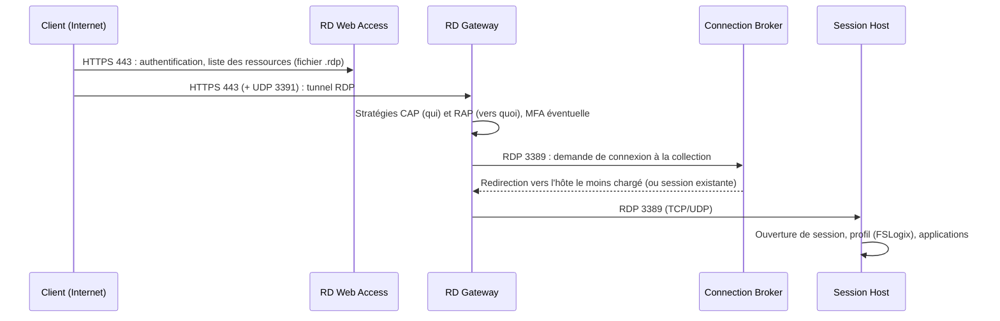

Les **Services Bureau à distance** (RDS) publient des **bureaux** et des **applications** (RemoteApp) Windows exécutés sur des serveurs, accessibles depuis n'importe quel poste (client Bureau à distance Windows, macOS, iOS, Android, navigateur HTML5). Usages : applications métier lourdes au plus près des données, accès des prestataires, postes légers, continuité d'activité.

## Rôles

| Rôle | Fonction |
| --- | --- |
| **Service Broker pour les connexions Bureau à distance** (*RD Connection Broker*) | Répartit les utilisateurs entre les hôtes, reconnecte aux sessions existantes, gère le déploiement |
| **Hôte de session Bureau à distance** (*RD Session Host*) | Exécute les sessions multi-utilisateurs |
| **Accès Bureau à distance par le Web** (*RD Web Access*) | Portail et flux (*feed*) des ressources publiées, client HTML5 |
| **Passerelle des services Bureau à distance** (*RD Gateway*) | Encapsule RDP dans **HTTPS** pour l'accès depuis Internet, avec stratégies d'autorisation |
| **Gestionnaire de licences des services Bureau à distance** (*RD Licensing*) | Distribue les **licences d'accès client (CAL) RDS** |
| Hôte de virtualisation (*RD Virtualization Host*) | VDI sur Hyper-V (pools de VM) — peu utilisé aujourd'hui |

## Flux d'une connexion



## Collections

| Type | Contenu |
| --- | --- |
| **Collection de sessions** | Groupe d'hôtes de session identiques ; bureaux complets **ou** applications RemoteApp |
| Collection de bureaux virtuels | Pool de VM (VDI) |

Chaque collection a ses paramètres : groupes d'utilisateurs autorisés, délais de session, redirections (presse-papiers, lecteurs, imprimantes), disques de profil utilisateur (UPD, déconseillés au profit de **FSLogix**), sécurité.

## Ports

| Port | Usage |
| --- | --- |
| 443/TCP | RD Web Access et RD Gateway (HTTPS, transport RDP) |
| **3391/UDP** | Transport UDP de la passerelle (meilleure fluidité) |
| 3389/TCP et UDP | RDP interne (passerelle/broker → hôtes) |
| 5504/TCP | Broker ↔ Web Access (RemoteApp et bureaux) |
| 135, 49152–65535 | Gestion (RPC) entre les rôles |

> [!WARNING]
> N'exposez **jamais** 3389 directement sur Internet : les serveurs RDP exposés sont la première porte d'entrée des rançongiciels (force brute, vulnérabilités). L'accès externe passe par la **passerelle** avec MFA, ou par un VPN/ZTNA.

## Dimensionnement indicatif

| Usage | Utilisateurs par vCPU | RAM par utilisateur |
| --- | --- | --- |
| Bureautique légère | 4–6 | 2–3 Go |
| Applications métier, navigateur moderne | 2–3 | 3–4 Go |
| Applications lourdes (CAO, rendu) | 1 ou GPU | 6 Go et plus |

Testez avec la charge réelle (navigateurs et Teams consomment beaucoup) et prévoyez une marge N+1 hôte.

## Profils : FSLogix

**FSLogix** (gratuit pour les licences Microsoft éligibles) place le profil de chaque utilisateur dans un **VHDX** monté à l'ouverture de session depuis un partage SMB : ouverture rapide, profils itinérants fiables, cache Outlook/OneDrive/Teams conservé.

```text Registre HKLM\SOFTWARE\FSLogix\Profiles (par GPO)
Enabled = 1
VHDLocations = \\srv-fic-01\ProfilsRDS$
SizeInMBs = 30000
IsDynamic = 1
VolumeType = VHDX
DeleteLocalProfileWhenVHDShouldApply = 1
FlipFlopProfileDirectoryName = 1
```

Le partage doit être rapide (SSD), hautement disponible, avec des droits NTFS qui empêchent un utilisateur de lire le profil d'un autre.

## RDS, Azure Virtual Desktop, Windows 365

| Solution | Points clés |
| --- | --- |
| **RDS** sur site | Maîtrise totale, licences CAL RDS, infrastructure à maintenir |
| **Azure Virtual Desktop** | Plan de contrôle géré par Microsoft, sessions multi-utilisateurs Windows 11, hôtes dans Azure (ou sur site avec Azure Local) |
| Windows 365 | PC cloud par utilisateur, prix fixe |

Suite : [[02-deploiement-passerelle|déploiement et passerelle]].
