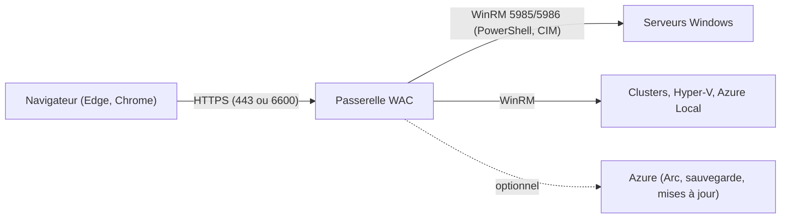

**Windows Admin Center** (WAC) est une console **web** gratuite qui remplace une grande partie des consoles MMC et du Gestionnaire de serveur : vue d'ensemble, services, événements, pare-feu, rôles et fonctionnalités, stockage, mises à jour, certificats, Hyper-V, clusters, PowerShell et Bureau à distance dans le navigateur. Il **n'installe rien** sur les serveurs gérés : la passerelle WAC exécute des commandes PowerShell à distance via **WinRM** ([[09-winrm/01-presentation-configuration|WinRM]]).



## Installation

| Mode | Usage |
| --- | --- |
| **Passerelle sur un serveur** (recommandé) | Un serveur dédié d'administration (dans le niveau de confiance des serveurs gérés), accès depuis les postes d'administration |
| Poste Windows 11 | Usage individuel |
| Haute disponibilité | Passerelle en cluster de basculement (partage de configuration) |
| Dans Azure | WAC intégré au portail pour les VM Azure et serveurs Arc |

```powershell
# Installation silencieuse (paquet .exe de la version modernisée ; ancienne version : .msi)
.\WindowsAdminCenter.exe /VERYSILENT /SUPPRESSMSGBOXES
# Ancienne version MSI :
# msiexec /i WindowsAdminCenter.msi /qn /L*v wac.log SME_PORT=443 SSL_CERTIFICATE_OPTION=installed SME_THUMBPRINT=<empreinte>
```

La **version modernisée** (2024–2025) repose sur .NET récent, améliore les performances et se configure avec le module PowerShell `Microsoft.WindowsAdminCenter.Configuration` (port, certificat, mode d'authentification). Utilisez un **certificat** délivré par l'AC interne au nom de la passerelle (`wac.corp.exemple.fr`), pas le certificat autosigné (valable 60 jours en mode test).

## Accès et authentification

| Niveau | Contrôle |
| --- | --- |
| **Accès à la passerelle** | *Paramètres → Accès* : groupes **Utilisateurs de la passerelle** et **Administrateurs de la passerelle** (groupes AD) ; authentification Windows ou **Microsoft Entra ID** (accès conditionnel, MFA) |
| Accès aux serveurs | Les identifiants de l'utilisateur (Kerberos) ou des identifiants spécifiés ; WAC n'élève pas les droits |
| **RBAC sur les cibles** | Rôles WAC (*Administrateurs*, *Lecteurs*, *Administrateurs Hyper-V*) déployés sur les serveurs sous forme de points de terminaison **JEA** (voir [[09-winrm/02-jea-securite-depannage\|JEA]]) |
| Délégation Kerberos | La passerelle doit être autorisée à déléguer vers les serveurs (délégation contrainte basée sur les ressources) si l'authentification unique est souhaitée |

```powershell
# Autoriser la passerelle à présenter les identifiants des utilisateurs aux serveurs gérés (SSO Kerberos)
$passerelle = Get-ADComputer srv-wac-01
Get-ADComputer -Filter * -SearchBase "OU=Serveurs,DC=corp,DC=exemple,DC=fr" | Set-ADComputer -PrincipalsAllowedToDelegateToAccount $passerelle
```

## Extensions

*Paramètres → Extensions* : extensions Microsoft (Active Directory, DNS, DHCP, mises à jour, sécurité, Storage Migration Service — voir [[13-serveur-fichiers-windows/02-securite-migration-depannage|migration de serveurs de fichiers]]) et des constructeurs (Dell OpenManage, HPE, Lenovo XClarity…) pour le matériel. Installez uniquement les extensions nécessaires et de sources de confiance (le flux par défaut est celui de Microsoft).

## Sécurité

- [ ] Passerelle sur un serveur **dédié**, traité comme un actif du même niveau que les serveurs gérés (tier 0 si des DC sont gérés)
- [ ] Accès à la passerelle restreint au réseau / postes d'administration, MFA via Entra ID si possible
- [ ] Certificat valide, TLS 1.2+
- [ ] Groupes d'accès explicites (pas *Utilisateurs authentifiés*)
- [ ] Journaux de la passerelle (*Microsoft-ServerManagementExperience*) et des cibles (PowerShell 4104, WinRM) envoyés au SIEM
- [ ] WAC à jour (correctifs de sécurité)

## Dépannage

| Symptôme | Cause | Solution |
| --- | --- | --- |
| « Impossible de se connecter » à un serveur | WinRM, pare-feu, nom | `Test-WSMan srv` depuis la passerelle, FQDN |
| Demande d'identifiants à chaque serveur | Délégation Kerberos absente | Délégation contrainte basée sur les ressources vers la passerelle |
| Avertissement de certificat | Certificat autosigné ou nom différent | Certificat de l'AC interne au bon nom |
| Outils manquants pour un serveur | Rôle ou module absent sur la cible, extension non installée | Installer la fonctionnalité / l'extension |
| Lenteur | Passerelle sous-dimensionnée, nombreuses connexions | 4 vCPU / 8 Go pour un usage d'équipe, version modernisée |
| Journaux | *Journaux des applications et des services → Microsoft-ServerManagementExperience* ; dossier de journaux de la passerelle | Analyse des erreurs PowerShell renvoyées |
