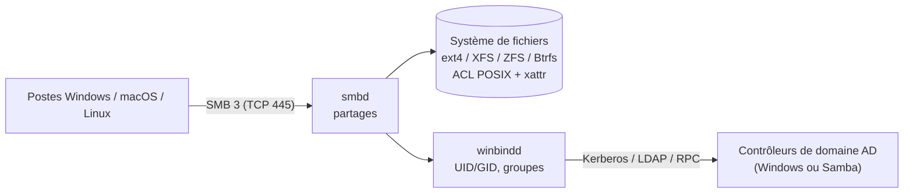

**Samba** implémente sous Linux et Unix le protocole **SMB** (*Server Message Block*) utilisé par Windows pour le partage de fichiers et d'imprimantes, ainsi que les services d'annuaire de Microsoft. Il permet :

- de servir des **partages** à des postes Windows, macOS et Linux ;
- de rejoindre un domaine **Active Directory** comme serveur membre (authentification des utilisateurs du domaine, ACL Windows) ;
- d'être lui-même un **contrôleur de domaine Active Directory** compatible avec les postes et outils Windows.

## Le protocole SMB

| Version | Introduite avec | Apports | Statut |
| --- | --- | --- | --- |
| SMB1 / CIFS | Windows NT, 2000 | Protocole bavard, NetBIOS | **Obsolète et dangereux** (WannaCry) : désactivé par défaut partout |
| SMB 2.0.2 / 2.1 | Vista / 7, 2008 R2 | Moins d'échanges, crédits, *leases* | Minimum acceptable |
| SMB 3.0 / 3.0.2 | Windows 8 / 2012, 8.1 / 2012 R2 | **Chiffrement** AES-CCM, **multicanal**, basculement transparent | Recommandé |
| **SMB 3.1.1** | Windows 10 / 2016 | Intégrité de pré-authentification, AES-GCM, compression (2022) | Standard actuel |

| Mécanisme | Rôle |
| --- | --- |
| **Signature** | Intégrité et authenticité des paquets (empêche le relais NTLM et l'altération) ; exigée par défaut par Windows 11 24H2 |
| **Chiffrement** | Confidentialité de bout en bout, par partage ou pour tout le serveur |
| **Multicanal** | Plusieurs connexions TCP par session (plusieurs cartes, RSS) : débit et résilience |
| *Oplocks* / *leases* | Cache côté client des fichiers ouverts |
| DFS | Espace de noms unifié qui redirige vers plusieurs serveurs |

## Rôles de Samba

| Rôle (`server role`) | Usage | Authentification |
| --- | --- | --- |
| `standalone server` | Serveur de fichiers isolé (PME, NAS, laboratoire) | Comptes locaux Samba (`smbpasswd`) |
| `member server` (`security = ADS`) | Serveur de fichiers dans un domaine AD | Kerberos / NTLM via les DC, **winbind** |
| `active directory domain controller` | Contrôleur de domaine AD (LDAP, Kerberos, DNS, GPO) | Base AD interne de Samba |
| `classic primary domain controller` | Domaine NT4 hérité | À ne plus déployer |

## Démons

| Démon | Rôle |
| --- | --- |
| **smbd** | Service SMB : partages, authentification, verrous |
| **nmbd** | NetBIOS (nom, navigation réseau historique) : inutile si NetBIOS est désactivé |
| **winbindd** | Intégration au domaine : résolution des utilisateurs/groupes AD en UID/GID, authentification, tickets |
| **samba** | Démon unique du **contrôleur de domaine AD** (lance ses propres smbd/winbindd, LDAP, KDC, DNS) |

## Ports

| Port | Protocole | Usage |
| --- | --- | --- |
| **445/TCP** | SMB direct | Seul port nécessaire pour SMB 2/3 |
| 139/TCP | SMB sur NetBIOS | Hérité |
| 137-138/UDP | Noms et datagrammes NetBIOS | Navigation réseau héritée |
| 88, 389, 636, 464, 53, 135, 49152-65535 | Kerberos, LDAP, DNS, RPC | Rôle contrôleur de domaine (voir [[01-active-directory/01-presentation\|ports AD]]) |

## Versions

| Branche | Exemples de distributions | Remarques |
| --- | --- | --- |
| 4.17 | Debian 12 | Encore largement déployée |
| 4.19 – 4.20 | Ubuntu 24.04, RHEL 9 | Niveau fonctionnel AD 2012 R2/2016 (option) |
| 4.21 – 4.22 et suivantes | Debian 13, Fedora | Améliorations AD (claims, comptes de service), SMB3 |

Samba maintient trois branches à la fois (deux en correctifs, une en sécurité seulement) : suivez les versions de votre distribution ou les paquets d'un dépôt maintenu (SerNet, backports).

## Samba, Windows ou NFS ?

| Critère | Samba | Serveur de fichiers Windows | [[02-nfs/01-presentation\|NFS]] |
| --- | --- | --- | --- |
| Clients Windows | Natif | Natif | Client NFS optionnel, intégration faible |
| Clients Linux / macOS | Bon (cifs, Finder) | Bon | Natif, performant |
| ACL Windows, AD | Oui (membre de domaine) | Oui | NFSv4 ACL, Kerberos |
| DFS-R, déduplication, FSRM | Non (DFS-N oui) | Oui | Non |
| Coût de licence | Aucun | Licences Windows Server + CAL | Aucun |
| Instantanés « Versions précédentes » | Oui (ZFS, Btrfs, LVM) | VSS | Selon le stockage |

## Suite du parcours

1. [[02-installation|Installation (Linux, macOS, clients Windows)]]
2. [[03-partages-autonome|Serveur autonome : partages et utilisateurs]]
3. [[04-membre-domaine-ad|Serveur membre d'un domaine Active Directory]]
4. [[05-permissions-acl|Permissions, ACL Windows et POSIX]]
5. [[06-controleur-domaine-ad|Samba contrôleur de domaine AD]]
6. [[07-fonctions-avancees|Corbeille, versions précédentes, macOS, DFS, CTDB]]
7. [[08-securite-performances|Sécurité et performances]]
8. [[09-exploitation-depannage|Exploitation et dépannage]]
