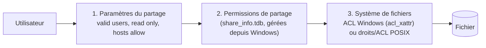

## Trois niveaux de contrôle



L'accès effectif est le **plus restrictif** des trois niveaux, comme sous Windows (permissions de partage ∩ NTFS).

## ACL POSIX

Sans `acl_xattr`, Samba convertit les ACL Windows en **ACL POSIX** (conversion partielle : pas de « refuser », droits moins fins).

```bash
sudo setfacl -m g:compta:rwx /srv/samba/projets              # droits pour un groupe
sudo setfacl -d -m g:compta:rwx /srv/samba/projets           # ACL par défaut (héritée par les nouveaux éléments)
sudo setfacl -R -m g:direction:rx /srv/samba/projets         # récursif
getfacl /srv/samba/projets
```

```smb
[projets]
   path = /srv/samba/projets
   read only = no
   inherit acls = yes            # appliquer les ACL par défaut du parent
   inherit permissions = yes     # reprendre les droits du dossier parent
```

## ACL Windows avec vfs_acl_xattr

Avec `vfs objects = acl_xattr`, Samba stocke l'**ACL Windows complète** (y compris les entrées « refuser », l'héritage et les droits spéciaux) dans l'attribut étendu `security.NTACL`, et applique en parallèle des droits POSIX équivalents.

```smb
[global]
   vfs objects = acl_xattr
   map acl inherit = yes
   store dos attributes = yes
   acl_xattr:ignore system acls = no   # « yes » : seule l'ACL Windows compte (accès Unix direct déconseillé)
```

| Prérequis | Détail |
| --- | --- |
| Système de fichiers | ext4, XFS, Btrfs, ZFS (`xattr=sa`, `acltype=posixacl`) avec attributs étendus |
| Rôle | Membre de domaine (ou autonome) avec `winbind` pour les SID du domaine |
| Gestion | Depuis Windows (Explorateur, `icacls`, PowerShell `Get-Acl`/`Set-Acl`) ou `smbcacls` |

> [!IMPORTANT]
> Une fois les ACL Windows en place, **gérez les droits uniquement depuis Windows** (ou `smbcacls`). Un `chmod`/`setfacl` direct désynchronise l'ACL Windows stockée et les droits POSIX.

### Outils

```powershell
icacls \\fs01\donnees\Compta
icacls \\fs01\donnees\Compta /grant "CORP\GG_Compta_RW:(OI)(CI)M" /inheritance:r
icacls \\fs01\donnees\Compta /grant "CORP\GG_Direction_RO:(OI)(CI)RX"
```

```bash
smbcacls //fs01/donnees Compta -k                               # afficher (ticket Kerberos)
smbcacls //fs01/donnees Compta -k -a "ACL:CORP\GG_Audit:ALLOWED/OI|CI/READ"
smbcacls //fs01/donnees Compta -k --propagate-inheritance -a "ACL:CORP\GG_Audit:ALLOWED/OI|CI/READ"
```

## Permissions de partage

Gérées depuis Windows (*Gestion de l'ordinateur → Dossiers partagés → Partages → Propriétés → Autorisations du partage*) une fois le privilège `SeDiskOperatorPrivilege` accordé ([[04-membre-domaine-ad]]). Elles sont stockées dans `/var/lib/samba/share_info.tdb`.

```bash
sudo sharesec donnees --view
sudo sharesec donnees --replace 'S-1-1-0:ALLOWED/0x0/FULL'     # Tout le monde : contrôle total (droits gérés en NTFS)
```

## Modèle de droits recommandé

| Niveau | Réglage |
| --- | --- |
| Partage (`smb.conf`) | `read only = no`, éventuellement `valid users = @"utilisateurs du domaine"` |
| Permissions de partage | *Utilisateurs authentifiés* : Modifier (ou Contrôle total) |
| ACL du dossier racine | Administrateurs, SYSTÈME, `CREATOR OWNER` ; pas de droits utilisateurs à la racine |
| Sous-dossiers métiers | **Groupes de domaine local / globaux** dédiés (`GG_Compta_RW`, `GG_Compta_RO`) — jamais des utilisateurs nommés |
| Héritage | Activé ; casser l'héritage seulement aux points d'entrée métiers |

Voir aussi la méthode AGDLP dans [[01-active-directory/04-utilisateurs-groupes-ou|Utilisateurs, groupes et OU]].

## Propriétaire et prise de possession

```smb
[donnees]
   inherit owner = windows and unix      # le propriétaire hérite du dossier parent (évite les fichiers « orphelins »)
```

Un administrateur peut prendre possession depuis Windows si son groupe possède `SeTakeOwnershipPrivilege` / `SeRestorePrivilege` (`net rpc rights grant …`).

## Sauvegarder et restaurer les ACL

```bash
# Copie en conservant xattr (NTACL), ACL POSIX et propriétaires
sudo rsync -aAXH /srv/samba/ /sauvegarde/samba/
sudo tar --xattrs --xattrs-include='*' --acls -czpf donnees.tgz -C /srv/samba donnees
# Exporter les ACL POSIX seules
sudo getfacl -R -p /srv/samba > acl-samba.txt     # restauration : setfacl --restore=acl-samba.txt
```

Un outil de sauvegarde qui ignore les **attributs étendus** perd les ACL Windows (`security.NTACL`) : vérifiez-le par un test de restauration.
