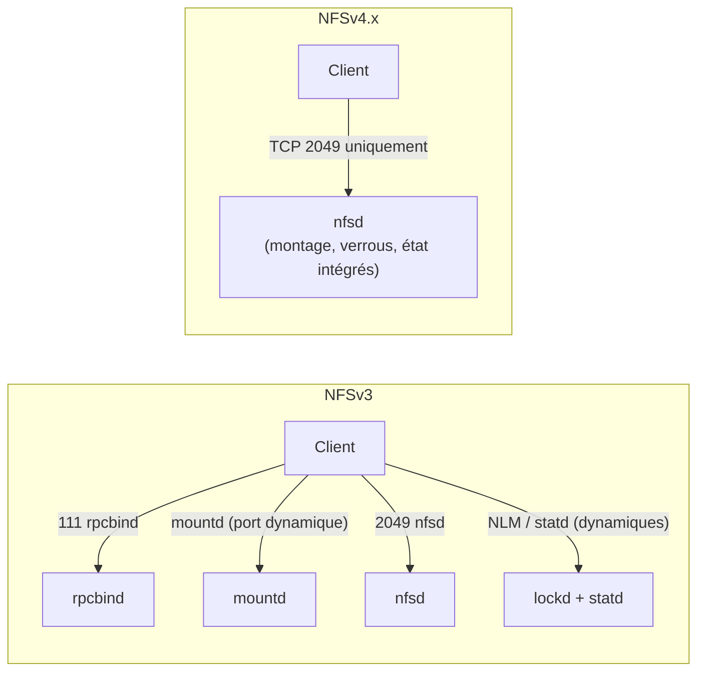

**NFS** est le protocole de partage de fichiers natif du monde Unix/Linux. Un **serveur** exporte des répertoires, que des **clients** montent dans leur arborescence comme un disque local. Il est omniprésent pour les dossiers personnels Linux, les fermes de calcul, la virtualisation (datastores VMware, Proxmox), Kubernetes (volumes persistants) et les NAS.

## Versions

| Version | Caractéristiques | Usage aujourd'hui |
| --- | --- | --- |
| NFSv3 (1995) | Sans état, UDP ou TCP, services annexes RPC (mountd, NLM pour les verrous, statd), ports dynamiques | Encore très répandu (hyperviseurs, NAS, clients Windows) |
| **NFSv4.0** | **Port unique TCP 2049**, avec état, verrous intégrés, délégations, ACL, identités par nom (`user@domaine`), pseudo-système de fichiers | Standard |
| **NFSv4.1** | Sessions, *exactly-once*, **pNFS** (accès parallèle direct aux données), trunking | Recommandé |
| **NFSv4.2** | Copie côté serveur, fichiers creux, `fallocate`, étiquettes SELinux | Version par défaut des clients Linux récents |

## Sécurité : qui est l'utilisateur ?

| Mode (`sec=`) | Principe | Niveau |
| --- | --- | --- |
| **sys** (AUTH_SYS, défaut) | Le client **affirme** l'UID/GID de l'utilisateur ; le serveur le croit | Confiance dans le client (et son administrateur root) |
| **krb5** | Authentification Kerberos de l'utilisateur | Identité vérifiée |
| **krb5i** | + intégrité des échanges | Contre l'altération |
| **krb5p** | + chiffrement | Contre l'écoute |
| RPC-over-TLS (`xprtsec=tls` / `mtls`) | Chiffrement TLS du transport (noyaux Linux récents, `tlshd`) | Chiffrement sans Kerberos ; mTLS authentifie les clients |

> [!WARNING]
> Avec `sec=sys`, quiconque est root sur une machine autorisée peut **se faire passer pour n'importe quel utilisateur** (sauf root, s'il est « écrasé »). Limitez les exports aux machines gérées, ou passez à Kerberos.

## Identités

- Les droits sont des **UID/GID numériques** : ils doivent être **identiques** sur le serveur et les clients (annuaire LDAP/AD, FreeIPA, SSSD).
- NFSv4 transmet les propriétaires sous forme de **noms** (`alice@corp.exemple.fr`) : le **domaine idmap** doit être le même partout, sinon les fichiers apparaissent comme appartenant à `nobody`.
- **root_squash** (par défaut) : root sur le client devient `nobody` sur le serveur.

## Ports

| Port | Service | Version |
| --- | --- | --- |
| **2049/TCP** | nfsd | v3 et v4 (seul port en v4) |
| 111/TCP+UDP | rpcbind (portmapper) | v3 |
| 20048 (à fixer) | mountd | v3 |
| à fixer | statd, lockd (NLM) | v3 |
| 20049 | NFS sur RDMA | option |

## Implémentations

| Plate-forme | Serveur | Client |
| --- | --- | --- |
| Linux | `nfsd` noyau (`nfs-kernel-server` / `nfs-utils`) ; **NFS-Ganesha** en espace utilisateur (Ceph, GlusterFS) | Natif (v3, v4.x) |
| Windows Server | Rôle **Serveur pour NFS** (v2, v3, v4.1) | Client pour NFS (**v3 seulement**) |
| macOS | `nfsd` intégré (v3, exports BSD) | Natif (v3, v4.0) |
| NAS / stockage | NetApp, Synology, TrueNAS, PowerScale… | — |

## NFS ou SMB ?

| Critère | NFS | [[01-samba/01-presentation\|SMB (Samba)]] |
| --- | --- | --- |
| Clients Linux/Unix | Natif, très performant, sémantique POSIX | Bon (cifs), quelques limites POSIX |
| Clients Windows | Faible (v3, mapping d'UID) | Natif |
| Authentification | UID (sys) ou Kerberos | Utilisateur (NTLM/Kerberos) |
| Virtualisation, Kubernetes | Très répandu | Possible (Hyper-V : SMB3) |
| Chiffrement | krb5p, TLS | SMB3 |

## Suite du parcours

1. [[02-installation|Installation (Linux, Windows, macOS)]]
2. [[03-exports-montages|Exports, montages, autofs]]
3. [[04-nfsv4-kerberos-idmap|NFSv4, Kerberos et identités]]
4. [[05-performances-haute-disponibilite|Performances et haute disponibilité]]
5. [[06-exploitation-depannage|Exploitation et dépannage]]
