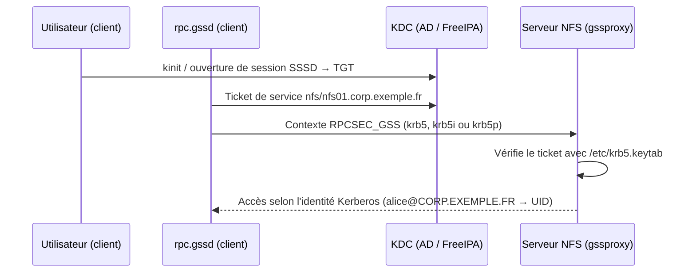

## Cohérence des identités

Prérequis numéro un : un utilisateur doit avoir **le même UID** et un groupe **le même GID** sur le serveur et sur tous les clients.

| Source d'identités | Remarque |
| --- | --- |
| **AD + SSSD** avec attributs POSIX (`uidNumber`, `gidNumber`) | `ldap_id_mapping = false` : UID gérés dans AD, identiques partout |
| AD + SSSD avec mappage automatique | `ldap_id_mapping = true` : algorithme déterministe, identique sur tous les clients **SSSD** (mais différent de winbind `rid`) |
| **FreeIPA** / IdM | UID/GID gérés centralement, Kerberos et cartes automount intégrés |
| Fichiers locaux | Uniquement pour quelques machines, synchronisation manuelle |

## Domaine idmap NFSv4

```idmapd /etc/idmapd.conf
[General]
Domain = corp.exemple.fr

[Mapping]
Nobody-User = nobody
Nobody-Group = nogroup
```

```bash
sudo nfsidmap -c                    # vider le cache (client)
sudo systemctl restart nfs-idmapd   # serveur
```

- Le **même domaine** doit être configuré sur le serveur et les clients (par défaut : domaine DNS de la machine).
- Avec `sec=sys`, les clients Linux envoient des identifiants **numériques** (`nfs4_disable_idmapping`), mais l'affichage des propriétaires passe par idmap : un domaine différent fait apparaître `nobody`.
- Avec Kerberos, l'idmap par nom est indispensable.

## Kerberos : principe



| Machine | Principal requis dans `/etc/krb5.keytab` |
| --- | --- |
| Serveur | `nfs/nfs01.corp.exemple.fr@CORP.EXEMPLE.FR` |
| Client | `host/client.corp.exemple.fr@…` (ou `nfs/…`) : utilisé pour les opérations de root et le montage |

## Intégration Active Directory

```bash
# Serveur (joint au domaine par realmd/SSSD)
sudo realm join corp.exemple.fr -U administrateur
sudo adcli update --domain=corp.exemple.fr --add-service-principal=nfs/nfs01.corp.exemple.fr
sudo klist -k /etc/krb5.keytab | grep nfs/

# Variante winbind (Samba)
sudo net ads keytab add nfs -U administrateur
```

```bash
# Client : jonction au domaine (principal host/), puis démon gssd
sudo realm join corp.exemple.fr -U administrateur
sudo systemctl enable --now rpc-gssd       # souvent démarré automatiquement par nfs-client.target
```

Les types de chiffrement doivent être **AES** (AES256-CTS par défaut) : vérifiez que le compte machine AD n'est pas restreint à RC4.

## Exports et montages Kerberos

```exports /etc/exports.d/secure.exports
/srv/nfs/home      10.0.0.0/8(rw,sync,sec=krb5p,no_subtree_check)
/srv/nfs/projets   10.0.20.0/24(rw,sync,sec=krb5i:krb5p,no_subtree_check)
```

```bash
sudo mount -t nfs4 -o sec=krb5p,vers=4.2 nfs01.corp.exemple.fr:/srv/nfs/home /home/ad
kinit alice@CORP.EXEMPLE.FR       # inutile si la session est ouverte via SSSD (ticket automatique)
ls /home/ad/alice
klist                             # ticket nfs/nfs01… obtenu
```

| Mode | Coût | Usage |
| --- | --- | --- |
| `krb5` | Faible | Authentification des utilisateurs, réseau de confiance |
| `krb5i` | Moyen | + intégrité |
| `krb5p` | Plus élevé (chiffrement) | Dossiers personnels, données sensibles, réseaux non maîtrisés |

> [!NOTE]
> Sans ticket valide, l'utilisateur reçoit `Permission denied` : prévoyez le **renouvellement** des tickets (SSSD le fait pendant la session) et pensez aux tâches planifiées (keytab de service, `k5start`, `gssproxy` côté client pour les services).

## ACL NFSv4

```bash
sudo apt install nfs4-acl-tools
nfs4_getfacl /mnt/projets/compta
nfs4_setfacl -a "A:fdg:compta@corp.exemple.fr:RWX" /mnt/projets/compta    # groupe (g), héritage fichiers/dossiers (fd)
```

Le serveur Linux convertit les ACL NFSv4 en ACL POSIX (`setfacl` côté serveur reste possible). Les NAS (NetApp, TrueNAS/ZFS) stockent des ACL NFSv4 natives, plus proches des ACL Windows.

## Chiffrement RPC-over-TLS

Sur les noyaux Linux récents (≥ 6.5) avec `ktls-utils` (démon `tlshd`) :

```exports
/srv/nfs/projets  10.0.0.0/8(rw,sync,xprtsec=tls:mtls)
```

```bash
sudo systemctl enable --now tlshd
sudo mount -t nfs -o vers=4.2,xprtsec=tls nfs01.corp.exemple.fr:/srv/nfs/projets /mnt/projets
```

Le serveur présente un certificat X.509 (configuré dans `/etc/tlshd.conf`) ; `mtls` exige aussi un certificat client. Fonction récente : vérifiez la prise en charge par toutes vos distributions avant de l'imposer.
