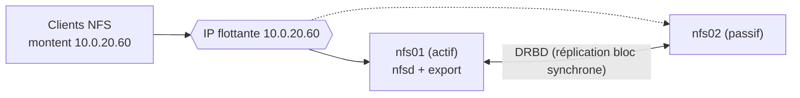

## Côté serveur

| Réglage | Recommandation |
| --- | --- |
| Threads nfsd | `[nfsd] threads = 32` à 64 pour de nombreux clients ; surveiller `/proc/net/rpc/nfsd` (ligne `th`) |
| Stockage | Le facteur limitant est souvent le disque : SSD/NVMe, RAID 10, ZFS avec SLOG pour les écritures synchrones |
| `sync` | Conserver `sync` ; `async` seulement pour des données reconstituables (caches, builds) |
| Réseau | 10/25 GbE, trames jumbo (MTU 9000 de bout en bout), RSS, profil `tuned-adm profile throughput-performance` |
| Version | NFSv4.2 ; v3 reste parfois plus rapide pour certaines charges (VMware) |

```bash
cat /proc/fs/nfsd/threads
sudo nfsconf --set nfsd threads 32 && sudo systemctl restart nfs-server
```

## Côté client

| Option | Effet |
| --- | --- |
| `rsize=1048576,wsize=1048576` | Taille des blocs (négociée automatiquement au maximum supporté, généralement 1 Mio) |
| `nconnect=4` à `16` | Plusieurs connexions TCP vers le serveur : meilleur débit sur liens rapides |
| `actimeo=60` / `noac` | Cache des attributs : plus long = moins de requêtes ; `noac` pour une cohérence stricte (lent) |
| `lookupcache=positive` | Cache des recherches de noms |
| `fsc` + `cachefilesd` | **FS-Cache** : cache local sur disque des fichiers lus (lecture répétée, WAN) |
| `noatime,nodiratime` | Moins de mises à jour de métadonnées |

```bash
nfsiostat 5                      # débit et latence par montage
mountstats /mnt/projets          # statistiques détaillées par opération (RTT, retransmissions)
```

## NFS sur RDMA et pNFS

| Technologie | Principe |
| --- | --- |
| **NFS/RDMA** (`proto=rdma`, port 20049) | Transfert direct mémoire à mémoire (InfiniBand, RoCE) : latence très faible, CPU déchargé — calcul haute performance, stockage |
| **pNFS** (NFSv4.1+) | Le serveur de métadonnées indique aux clients où lire/écrire directement les données (plusieurs serveurs de données) : débit qui croît avec le nombre de nœuds |

## Haute disponibilité



| Solution | Principe | Remarque |
| --- | --- | --- |
| **Pacemaker + DRBD** | Réplication bloc synchrone, ressources `Filesystem`, `nfsserver`, `exportfs`, IP flottante | Classique, actif/passif ; l'état NFSv4 (`/var/lib/nfs`) doit être sur le volume répliqué |
| Pacemaker + stockage partagé (SAN) | Même principe avec un LUN partagé | Pas de réplication à gérer |
| **NFS-Ganesha** | Serveur NFS en espace utilisateur sur CephFS, GlusterFS, etc., en actif/actif | Intégré à Ceph (`ceph nfs cluster create`) |
| NAS d'entreprise | Contrôleurs redondants, basculement transparent | NetApp, PowerScale, TrueNAS HA |

```bash
# Exemple Pacemaker (pcs)
sudo pcs resource create nfs_fs Filesystem device=/dev/drbd0 directory=/srv/nfs fstype=xfs --group nfsgroup
sudo pcs resource create nfs_state nfsserver nfs_shared_infodir=/srv/nfs/nfsinfo --group nfsgroup
sudo pcs resource create nfs_export exportfs clientspec=10.0.20.0/24 options=rw,sync,no_root_squash directory=/srv/nfs/projets fsid=1 --group nfsgroup
sudo pcs resource create nfs_ip IPaddr2 ip=10.0.20.60 cidr_netmask=24 --group nfsgroup
```

> [!NOTE]
> Après un basculement, le serveur NFSv4 entre en **période de grâce** (`grace-time`, 90 s par défaut) pendant laquelle les clients récupèrent leurs verrous ; les nouvelles ouvertures sont retardées. Montages `hard` côté client : les applications patientent puis reprennent.

## Usages courants

| Plate-forme | Recommandations |
| --- | --- |
| **VMware ESXi** | Datastore NFS 3 (`no_root_squash`, réseau VMkernel dédié) ou NFS 4.1 (multipathing, Kerberos) ; une même version par datastore pour tous les hôtes |
| **Proxmox VE** | Stockage NFS pour images, sauvegardes, ISO (`pvesm add nfs`) |
| **Kubernetes** | Pilote CSI `nfs.csi.k8s.io` (provisionnement dynamique de sous-répertoires) ; éviter `no_root_squash` si possible ; pas de verrous fiables pour certaines bases de données |
| Dossiers personnels Linux | autofs + Kerberos (`sec=krb5p`) |
| Sauvegardes | Cible NFS dédiée, compte de service, export accessible seulement par le serveur de sauvegarde |
