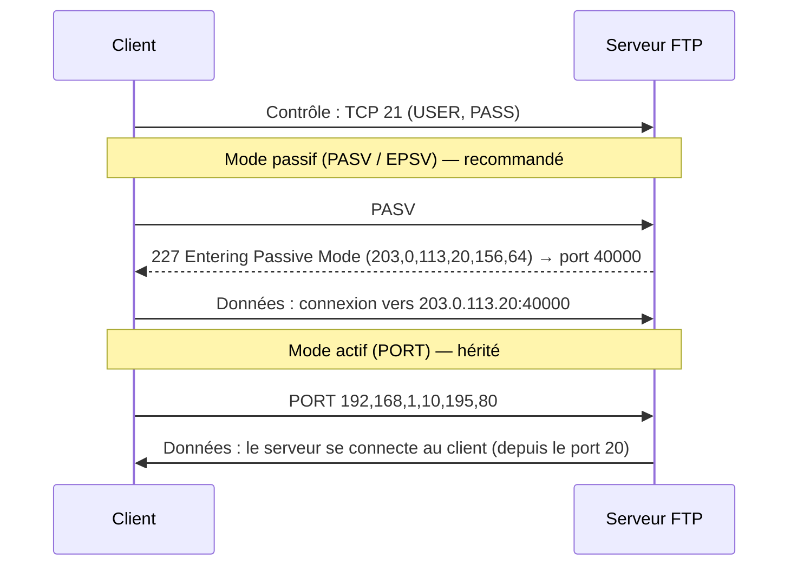

## Le protocole FTP

FTP utilise **deux connexions TCP** : une connexion de **contrôle** (port 21, commandes `USER`, `PASS`, `LIST`, `RETR`, `STOR`…) et une connexion de **données** par transfert ou listage.



| Mode | Qui ouvre la connexion de données | Contraintes |
| --- | --- | --- |
| **Passif** (PASV/EPSV) | Le client, vers une plage de ports du serveur | Ouvrir la plage passive sur le pare-feu du serveur ; annoncer l'IP publique derrière un NAT |
| Actif (PORT/EPRT) | Le serveur, vers le client | Bloqué par les NAT et pare-feu des clients : à éviter |

## Variantes sécurisées

| Protocole | Principe | Port |
| --- | --- | --- |
| FTP | Tout en clair, **mots de passe compris** | 21 |
| **FTPS explicite** | FTP + `AUTH TLS` sur le port 21 : contrôle et données chiffrés | 21 + plage passive |
| FTPS implicite | TLS dès la connexion (ancien) | 990 + plage passive |
| **SFTP** | Protocole différent, sous-système de **SSH** : une seule connexion | 22 |

> [!TIP]
> Pour un nouvel usage, préférez **SFTP** ([[01-openssh/06-sftp-chroot|SFTP chrooté avec OpenSSH]]) : un seul port, authentification par clés, pas de plage passive ni de NAT à gérer. Réservez FTPS aux partenaires ou équipements qui l'exigent, et n'exposez **jamais** de FTP en clair sur Internet.

## Pare-feu et NAT

- Ouvrir le port 21 et la **plage passive** configurée (ex. 40000-40100/TCP).
- Le module d'aide `nf_conntrack_ftp` (pare-feu Linux) lit les réponses `PASV` pour ouvrir dynamiquement les ports : **il ne fonctionne pas avec FTPS** (contrôle chiffré) → ouvrir explicitement la plage.
- Derrière un NAT, le serveur doit annoncer son **adresse publique** dans la réponse `PASV` (`pasv_address`, `MasqueradeAddress`, `ForcePassiveIP`).

## Choisir un serveur

| Serveur | Points forts | Configuration |
| --- | --- | --- |
| **vsftpd** | Très sûr, léger, performant ; par défaut sur RHEL | Fichier `clé=valeur` simple |
| [[04-proftpd/01-presentation-installation\|ProFTPD]] | Très modulaire : SQL, LDAP, quotas, **SFTP intégré**, hôtes virtuels | Style Apache |
| [[05-pure-ftpd/01-presentation-installation\|Pure-FTPd]] | Simple, utilisateurs virtuels intégrés (PureDB), quotas et débits par utilisateur | Options en ligne de commande / un fichier par option (Debian) |
| [[01-iis/01-presentation\|IIS FTP]] | Windows, intégration AD et isolation des utilisateurs | Gestionnaire IIS |
| FileZilla Server | Windows, interface graphique | Console d'administration |

## Installation de vsftpd

```bash
# Debian / Ubuntu
sudo apt install vsftpd
# RHEL / Rocky / Alma
sudo dnf install vsftpd

sudo systemctl enable --now vsftpd
vsftpd -v 0>&-                   # version (vsftpd l'écrit sur le descripteur 0, d'où la redirection)
```

| Distribution | Fichier de configuration |
| --- | --- |
| Debian / Ubuntu | `/etc/vsftpd.conf` |
| RHEL | `/etc/vsftpd/vsftpd.conf` (+ `/etc/vsftpd/user_list`, `/etc/vsftpd/ftpusers`) |

```bash
# Pare-feu
sudo firewall-cmd --permanent --add-service=ftp
sudo firewall-cmd --permanent --add-port=40000-40100/tcp
sudo firewall-cmd --reload
# SELinux (RHEL) : accès en écriture aux dossiers des utilisateurs
sudo setsebool -P ftpd_full_access on
```

### Windows et macOS

vsftpd est conçu pour Linux/Unix. Sous **Windows**, utilisez le service FTP d'[[01-iis/01-presentation|IIS]] ou FileZilla Server ; sous **macOS** (qui ne fournit plus de serveur FTP), installez Pure-FTPd ou ProFTPD via Homebrew, ou activez plutôt la connexion à distance (SFTP).

## Suite du parcours

1. [[02-configuration|Configuration : utilisateurs locaux, chroot, utilisateurs virtuels]]
2. [[03-ftps-securite|FTPS et sécurité]]
3. [[04-exploitation-depannage|Exploitation et dépannage]]
