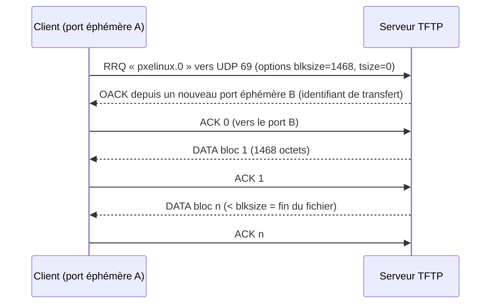

**TFTP** (*Trivial File Transfer Protocol*, RFC 1350) est un protocole de transfert de fichiers minimaliste sur **UDP**, **sans authentification ni chiffrement**. Sa simplicité le rend implémentable dans un micrologiciel : c'est lui qu'utilisent le **démarrage PXE**, les **commutateurs et routeurs** (sauvegarde de configuration, mise à jour de firmware) et les **téléphones IP** (provisionnement).

## Fonctionnement



| Élément | Détail |
| --- | --- |
| Port | Requête vers **UDP 69**, puis échange entre deux ports éphémères |
| Requêtes | `RRQ` (lecture), `WRQ` (écriture) |
| Blocs | 512 octets par défaut, un acquittement par bloc (lent sur les liaisons à latence élevée) |
| `blksize` (RFC 2348) | Blocs plus grands (ex. 1468 pour tenir dans une trame Ethernet) |
| `tsize` (RFC 2349) | Taille du fichier annoncée |
| `windowsize` (RFC 7440) | Plusieurs blocs avant acquittement : débit nettement supérieur |
| Taille maximale | 32 Mio avec des blocs de 512 octets sans « rebouclage » du compteur ; plus avec `blksize` |

## Usages et alternatives

| Usage | Remarque |
| --- | --- |
| **PXE** (BIOS et UEFI) | Chargeur (`pxelinux.0`, `grubx64.efi`, `ipxe.efi`) puis noyau/initrd — voir [[03-dnsmasq/04-pxe-tftp\|PXE avec dnsmasq]] et [[01-isc-dhcp/01-presentation\|ISC DHCP]] |
| Équipements réseau | Sauvegarde/restauration de configuration, images IOS/firmware |
| Téléphonie IP | Fichiers de provisionnement (souvent remplacés par HTTP(S)) |
| Alternatives plus sûres | **SCP/SFTP** pour les équipements, **HTTP(S)** pour le démarrage (iPXE, UEFI HTTP Boot), outils de sauvegarde de configuration (Oxidized, RANCID) |

## Linux : tftpd-hpa (Debian / Ubuntu)

```bash
sudo apt install tftpd-hpa tftp-hpa          # serveur + client
```

```text /etc/default/tftpd-hpa
TFTP_USERNAME="tftp"
TFTP_DIRECTORY="/srv/tftp"
TFTP_ADDRESS="0.0.0.0:69"
TFTP_OPTIONS="--secure --verbose"
```

```bash
sudo systemctl restart tftpd-hpa
echo test | sudo tee /srv/tftp/test.txt
tftp 127.0.0.1 -c get test.txt && cat test.txt
```

## Linux : RHEL / Rocky / Alma

```bash
sudo dnf install tftp-server tftp
sudo systemctl enable --now tftp.socket       # activation par socket ; racine /var/lib/tftpboot
sudo firewall-cmd --permanent --add-service=tftp && sudo firewall-cmd --reload
```

Pour modifier les options : `sudo systemctl edit tftp.service` puis surcharger `ExecStart` :

```ini /etc/systemd/system/tftp.service.d/override.conf
[Service]
ExecStart=
ExecStart=/usr/sbin/in.tftpd -s /var/lib/tftpboot -v
```

## macOS

macOS intègre un serveur TFTP (racine `/private/tftpboot`), désactivé par défaut :

```bash
sudo launchctl load -F /System/Library/LaunchDaemons/tftp.plist
sudo launchctl start com.apple.tftpd
sudo chmod 777 /private/tftpboot             # si des équipements doivent y déposer des fichiers
# Arrêt : sudo launchctl unload -F /System/Library/LaunchDaemons/tftp.plist
```

Pratique pour une intervention ponctuelle (sauvegarde d'une configuration de commutateur depuis un portable).

## Windows

| Outil | Usage |
| --- | --- |
| **Tftpd64** (libre) | Serveur et client TFTP, serveur DHCP/syslog intégrés : l'outil de terrain classique des administrateurs réseau |
| Client TFTP intégré | Fonctionnalité facultative : `tftp -i 10.0.0.5 get fichier.bin` |
| WDS | Serveur TFTP intégré aux services de déploiement Windows (PXE) |
| Serveurs commerciaux | SolarWinds TFTP Server et équivalents |

```powershell
Enable-WindowsOptionalFeature -Online -FeatureName TFTP     # client TFTP
tftp -i 10.0.0.5 PUT C:\temp\config.txt config.txt
```

## Suite du parcours

1. [[02-configuration-usages|Configuration et usages (PXE, équipements réseau)]]
2. [[03-securite-depannage|Sécurité, pare-feu et dépannage]]
