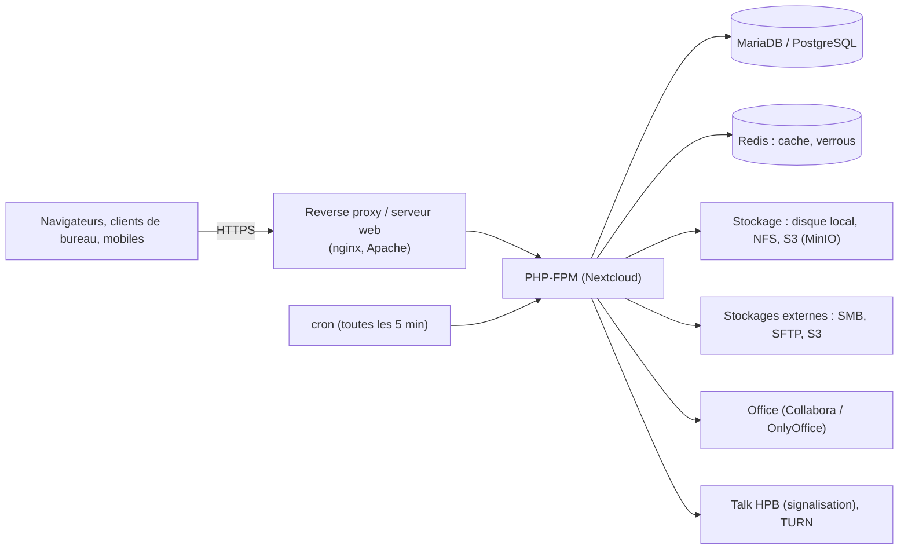

**Nextcloud** (AGPL, fork d'ownCloud créé en 2016) offre un « cloud privé » : synchronisation et partage de fichiers, calendrier et contacts (CalDAV/CardDAV), visioconférence **Talk**, suites bureautiques intégrées (Nextcloud Office/Collabora, OnlyOffice), formulaires, tâches… L'accès aux fichiers se fait par le web, les **clients de synchronisation** (Windows, macOS, Linux), les applications mobiles et **WebDAV**.

## Architecture



| Élément | Recommandation |
| --- | --- |
| Base de données | MariaDB 10.6+ ou PostgreSQL ; pas SQLite en production |
| Cache | **APCu** (cache local) + **Redis** (verrouillage de fichiers transactionnel, cache distribué) |
| Tâches de fond | **cron** système toutes les 5 minutes (pas AJAX) |
| Stockage principal | Disque local/NFS, ou stockage objet **S3** (MinIO, Ceph) pour les gros volumes |
| Support | Communauté (gratuit) ou **Nextcloud Enterprise** (abonnement, correctifs étendus, support) |

## Installation : Nextcloud All-in-One (recommandé)

**AIO** déploie et maintient automatiquement les conteneurs (Nextcloud, base, Redis, Office, Talk, sauvegarde BorgBackup, ClamAV, Imaginary) depuis une interface d'administration.

```bash
sudo docker run -d --init --sig-proxy=false --name nextcloud-aio-mastercontainer --restart always \
  --publish 8080:8080 \
  --env APACHE_PORT=11000 --env APACHE_IP_BINDING=127.0.0.1 \
  --volume nextcloud_aio_mastercontainer:/mnt/docker-aio-config \
  --volume /var/run/docker.sock:/var/run/docker.sock:ro \
  ghcr.io/nextcloud-releases/all-in-one:latest
# Interface AIO : https://<serveur>:8080 — choix du domaine, des options, lancement des conteneurs
```

`APACHE_PORT` et `APACHE_IP_BINDING` servent quand un reverse proxy existant ([[03-nginx/05-reverse-proxy-repartition|nginx]], Caddy, HAProxy) termine TLS devant AIO. Sans proxy, AIO obtient lui-même un certificat (ports 80/443 ouverts).

## Installation manuelle (Debian/Ubuntu)

```bash
sudo apt install nginx mariadb-server redis-server php-fpm php-mysql php-redis php-apcu php-gd php-curl \
  php-mbstring php-intl php-gmp php-bcmath php-xml php-zip php-imagick php-bz2 unzip
sudo mysql -e "CREATE DATABASE nextcloud CHARACTER SET utf8mb4 COLLATE utf8mb4_general_ci;
  CREATE USER 'nextcloud'@'localhost' IDENTIFIED BY 'MotDePasseBdd';
  GRANT ALL ON nextcloud.* TO 'nextcloud'@'localhost';"
wget https://download.nextcloud.com/server/releases/latest.zip
sudo unzip latest.zip -d /var/www/ && sudo chown -R www-data: /var/www/nextcloud
sudo mkdir -p /srv/nextcloud-donnees && sudo chown www-data: /srv/nextcloud-donnees

sudo -u www-data php /var/www/nextcloud/occ maintenance:install \
  --database mysql --database-name nextcloud --database-user nextcloud --database-pass 'MotDePasseBdd' \
  --admin-user admin --admin-pass 'MotDePasseAdmin' --data-dir /srv/nextcloud-donnees
```

```php /var/www/nextcloud/config/config.php (ajouts)
  'trusted_domains' => [ 0 => 'cloud.corp.exemple.fr' ],
  'overwrite.cli.url' => 'https://cloud.corp.exemple.fr',
  'overwriteprotocol' => 'https',
  'trusted_proxies' => [ '10.0.10.40' ],
  'default_phone_region' => 'FR',
  'memcache.local' => '\OC\Memcache\APCu',
  'memcache.distributed' => '\OC\Memcache\Redis',
  'memcache.locking' => '\OC\Memcache\Redis',
  'redis' => [ 'host' => '/run/redis/redis-server.sock', 'port' => 0 ],
  'maintenance_window_start' => 1,
```

```bash
# Tâches de fond
sudo -u www-data php /var/www/nextcloud/occ background:cron
echo '*/5 * * * * php -f /var/www/nextcloud/cron.php' | sudo crontab -u www-data -
```

La configuration nginx de référence (en-têtes, `.well-known`, `client_max_body_size`, blocage des répertoires sensibles) est publiée dans le manuel d'administration Nextcloud : reprenez-la telle quelle. Réglages PHP : `memory_limit = 512M`, `upload_max_filesize`/`post_max_size` adaptés, **OPcache** activé.

## Clients

| Plateforme | Client |
| --- | --- |
| Windows, macOS, Linux | **Nextcloud Desktop** : synchronisation, fichiers virtuels à la demande (Windows, macOS) |
| iOS, Android | Applications Nextcloud, Talk, Notes, Deck |
| Montage réseau | WebDAV : `https://cloud.corp.exemple.fr/remote.php/dav/files/<utilisateur>/` (voir [[12-webdav/02-clients-securite-depannage\|clients WebDAV]]) |
| Agendas, contacts | CalDAV/CardDAV : `https://cloud.corp.exemple.fr/remote.php/dav/` |

Déploiement Windows en masse : MSI `msiexec /i Nextcloud-x64.msi /qn SKIPAUTOUPDATE=1`, configuration par registre ou fichier `nextcloud.cfg`.

## occ

```bash
alias occ='sudo -u www-data php /var/www/nextcloud/occ'
occ status
occ app:list
occ app:install calendar && occ app:enable calendar
occ user:add --display-name "Alice Martin" --group "Compta" alice
occ files:scan --all                  # réindexer après modification directe du stockage
occ maintenance:mode --on
occ db:add-missing-indices
occ setupchecks                       # vérifications de la page d'administration
```

Avec AIO : `sudo docker exec --user www-data -it nextcloud-aio-nextcloud php occ status`.

Suite : [[02-identite-stockage-securite|identité, stockage externe et sécurité]].
