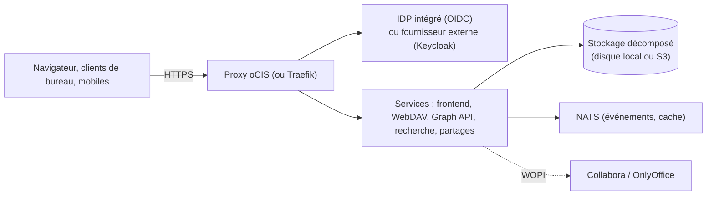

**ownCloud** a popularisé le cloud privé de fichiers (2010). L'entreprise a été rachetée par **Kiteworks** fin 2023. Deux produits coexistent :

| Produit | Technologie | Statut |
| --- | --- | --- |
| **ownCloud Classic** (Server 10) | PHP + base SQL (très proche de Nextcloud des débuts) | Maintenance, migrations vers oCIS conseillées |
| **ownCloud Infinite Scale (oCIS)** | **Go**, microservices, **pas de base SQL** (métadonnées dans le stockage), web en Vue.js | Produit actuel |

Forks à connaître : **Nextcloud** (fork d'ownCloud Classic en 2016, voir [[08-nextcloud/01-presentation-installation|Nextcloud]]) et **OpenCloud** (fork d'oCIS lancé en 2025 par d'anciens développeurs, soutenu par Heinlein) — même architecture et mêmes concepts que ci-dessous.

## Architecture d'oCIS



| Notion | Description |
| --- | --- |
| **Espaces** (*Spaces*) | Espace personnel + **espaces projets** partagés avec gestionnaires, éditeurs, lecteurs, quotas propres |
| Stockage décomposé (*decomposedfs*) | Fichiers et métadonnées dans des fichiers/attributs étendus ; variante **S3** (blobs dans un compartiment) |
| IDP | Fournisseur OpenID Connect intégré (LibreGraph Connect) + annuaire **LDAP intégré** ; ou OIDC externe + LDAP/AD |
| API | WebDAV, **LibreGraph** (API proche de Microsoft Graph), OCS |

Pas de base PostgreSQL/MySQL à gérer : la sauvegarde se résume au répertoire de données et à la configuration.

## Installation par binaire (test, petit déploiement)

```bash
curl -L https://download.owncloud.com/ocis/ocis/stable/<version>/ocis-<version>-linux-amd64 -o /usr/local/bin/ocis
chmod +x /usr/local/bin/ocis
export OCIS_CONFIG_DIR=/etc/ocis OCIS_BASE_DATA_PATH=/var/lib/ocis
ocis init --insecure false                    # génère la configuration et le mot de passe admin
OCIS_URL=https://cloud.corp.exemple.fr PROXY_HTTP_ADDR=0.0.0.0:9200 ocis server
```

Créez une unité systemd avec ces variables (`EnvironmentFile=/etc/ocis/ocis.env`) et placez un reverse proxy TLS devant le port 9200 (ou laissez oCIS gérer TLS avec vos certificats : `PROXY_TRANSPORT_TLS_CERT`, `PROXY_TRANSPORT_TLS_KEY`).

## Installation par Docker Compose

Le dépôt ownCloud fournit des exemples Compose (oCIS + Traefik + Let's Encrypt, avec ou sans Collabora/Keycloak). L'essentiel :

```yaml compose.yaml (simplifié)
services:
  ocis:
    image: owncloud/ocis:7
    entrypoint: [ "/bin/sh", "-c", "ocis init || true; ocis server" ]
    environment:
      OCIS_URL: https://cloud.corp.exemple.fr
      OCIS_LOG_LEVEL: warn
      PROXY_TLS: "false"                 # TLS terminé par le reverse proxy
      PROXY_HTTP_ADDR: 0.0.0.0:9200
      IDM_ADMIN_PASSWORD: ${ADMIN_MDP}   # mot de passe admin initial
    volumes:
      - ./config:/etc/ocis
      - ./donnees:/var/lib/ocis
    restart: always
  # + reverse proxy (Traefik, Caddy, nginx) publiant cloud.corp.exemple.fr → ocis:9200
```

## Réglages de base

| Variable | Rôle |
| --- | --- |
| `OCIS_URL` | URL publique (doit correspondre exactement à celle des clients) |
| `OCIS_INSECURE` | `false` en production (vérification des certificats entre services) |
| `STORAGE_USERS_DRIVER` | `decomposed` (local, défaut) ou `decomposeds3` (S3) |
| `OCIS_LDAP_*`, `OCIS_OIDC_ISSUER` | Annuaire et IDP externes |
| `FRONTEND_ARCHIVER_MAX_SIZE`, `OCIS_SPACES_MAX_QUOTA` | Limites |

## Clients

Les **clients ownCloud Desktop** (Windows, macOS, Linux, avec fichiers virtuels) et mobiles prennent en charge les espaces ; l'accès WebDAV reste possible (`https://cloud…/dav/spaces/<id-espace>`).

Suite : [[02-identite-exploitation|identité, sauvegarde et exploitation]].
