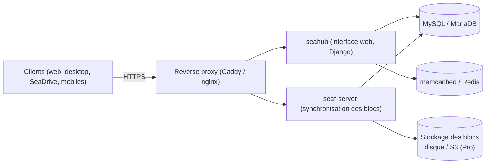

**Seafile** (Seafile Ltd., édition Community sous AGPL/GPL) se concentre sur la **synchronisation de fichiers** rapide et fiable. Les fichiers sont organisés en **bibliothèques** (*libraries*), découpées en **blocs** dédupliqués et versionnés à la manière de Git : synchronisation différentielle efficace, historique complet, corbeille par bibliothèque.

## Notions

| Notion | Description |
| --- | --- |
| **Bibliothèque** | Unité de synchronisation, de partage, de versionnage et de chiffrement |
| Blocs | Fichiers découpés (taille variable), dédupliqués ; stockage disque, S3, Ceph, Swift (Pro) |
| **Bibliothèque chiffrée** | Chiffrement côté **client** (AES-256) avec un mot de passe : le serveur ne voit pas le contenu (mais les noms de fichiers et la structure restent visibles) |
| Historique | Instantanés par bibliothèque, durée de conservation configurable |
| Groupes, départements | Partage à des groupes ; départements (Pro) |

| Édition | Points clés |
| --- | --- |
| **Community** | Gratuite, fonctions essentielles, LDAP basique |
| **Professional** | Gratuite jusqu'à 3 utilisateurs, puis licence : recherche plein texte, stockage S3, antivirus, audit, SAML/OIDC avancés, cluster, synchronisation LDAP |

## Architecture



## Installation par Docker Compose

Seafile 12+ est distribué en **Docker** (installation binaire possible mais moins documentée). Récupérez les fichiers `seafile-server.yml`, `caddy.yml` et `.env` du manuel officiel, puis :

```ini .env (extrait)
COMPOSE_FILE='seafile-server.yml,caddy.yml'
SEAFILE_VOLUME=/opt/seafile-data
SEAFILE_MYSQL_VOLUME=/opt/seafile-mysql/db
SEAFILE_CADDY_VOLUME=/opt/seafile-caddy
SEAFILE_SERVER_HOSTNAME=fichiers.corp.exemple.fr
SEAFILE_SERVER_PROTOCOL=https
TIME_ZONE=Europe/Paris
JWT_PRIVATE_KEY=ChaineAleatoireDe40CaracteresMinimum
INIT_SEAFILE_MYSQL_ROOT_PASSWORD=MotDePasseRootBdd
SEAFILE_MYSQL_DB_PASSWORD=MotDePasseBddSeafile
INIT_SEAFILE_ADMIN_EMAIL=admin@corp.exemple.fr
INIT_SEAFILE_ADMIN_PASSWORD=MotDePasseAdminInitial
```

```bash
mkdir -p /opt/seafile && cd /opt/seafile
# (placer .env, seafile-server.yml, caddy.yml)
docker compose up -d
docker compose logs -f seafile
# Interface : https://fichiers.corp.exemple.fr
```

Le conteneur **Caddy** fourni obtient un certificat automatiquement ; pour un certificat interne ou un reverse proxy existant, retirez `caddy.yml` et publiez le port 80 du conteneur Seafile derrière votre proxy (en transmettant `X-Forwarded-Proto`). Composants optionnels : **SeaDoc** (édition collaborative), notification server, OnlyOffice/Collabora, ClamAV (Pro).

## Fichiers de configuration

| Fichier (dans `/opt/seafile-data/seafile/conf/`) | Rôle |
| --- | --- |
| `seahub_settings.py` | Interface web : SSO, courriel, limites, sécurité des mots de passe |
| `seafile.conf` | Serveur de fichiers : quotas, historique, taille de blocs, stockage |
| `seafevents.conf` | Événements, audit, recherche (Pro) |
| `gunicorn.conf.py` | Processus web |

```seafile seafile.conf (extrait)
[quota]
default = 50

[history]
keep_days = 90

[fileserver]
max_upload_size = 10000
max_download_dir_size = 2000
```

```bash
docker compose restart
```

## Clients

| Client | Usage |
| --- | --- |
| **Seafile Desktop** (Windows, macOS, Linux) | Synchronisation complète de bibliothèques choisies |
| **SeaDrive** (Windows, macOS) | Lecteur virtuel : fichiers téléchargés à la demande, toutes les bibliothèques visibles |
| Mobiles (iOS, Android) | Accès, envoi automatique de photos |
| WebDAV (SeafDAV) | À activer dans `seafdav.conf` ; utile pour des outils tiers |

Déploiement Windows : MSI silencieux (`msiexec /i seafile-x64.msi /qn`), préconfiguration du serveur par registre (`HKLM\SOFTWARE\Seafile` → `PreconfigureServerAddr`).

Suite : [[02-configuration-exploitation|annuaire, sauvegarde et exploitation]].
