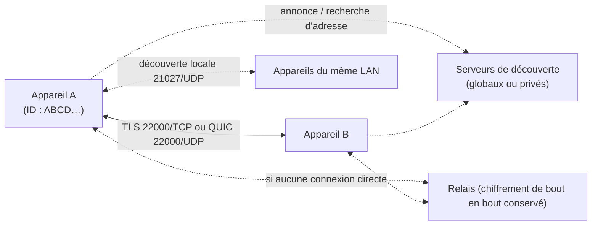

**Syncthing** (MPL 2.0) synchronise des dossiers **directement entre appareils**, sans serveur central ni compte en ligne. Chaque appareil possède un **identifiant** (empreinte de son certificat) ; deux appareils ne communiquent que s'ils se sont mutuellement **approuvés**. Les échanges sont chiffrés (TLS 1.3) et authentifiés.

Usages typiques en infrastructure : réplication de dossiers entre sites ou serveurs sans VPN dédié, synchronisation de configurations, de scripts ou de documentation entre postes d'administration, copie hors ligne vers un serveur de sauvegarde.

## Fonctionnement



| Port | Usage |
| --- | --- |
| **22000/TCP et UDP** | Synchronisation (TCP et QUIC) |
| **21027/UDP** | Découverte locale (diffusion) |
| **8384/TCP** | Interface web et API (localhost par défaut) |
| 443/TCP sortant | Découverte globale, relais publics |

### Types de dossiers

| Type | Comportement |
| --- | --- |
| Envoi et réception | Synchronisation bidirectionnelle |
| **Envoi seul** | L'appareil est la référence ; les modifications distantes sont ignorées (peuvent être « écrasées » localement) |
| **Réception seule** | Miroir : les modifications locales ne partent pas |
| **Réception chiffrée** | Pour un appareil **non approuvé** (serveur tiers) : il stocke les données **chiffrées** sans pouvoir les lire |

## Installation

```bash
# Debian / Ubuntu (dépôt officiel)
sudo mkdir -p /etc/apt/keyrings
sudo curl -L -o /etc/apt/keyrings/syncthing-archive-keyring.gpg https://syncthing.net/release-key.gpg
echo "deb [signed-by=/etc/apt/keyrings/syncthing-archive-keyring.gpg] https://apt.syncthing.net/ syncthing stable" | sudo tee /etc/apt/sources.list.d/syncthing.list
sudo apt update && sudo apt install syncthing

# RHEL / Fedora : paquet syncthing (EPEL / Fedora)
sudo dnf install syncthing

# Service : un utilisateur dédié sur un serveur
sudo useradd -r -m -d /srv/syncthing syncthing
sudo systemctl enable --now syncthing@syncthing
```

```powershell
winget install Syncthing.Syncthing        # Windows (lancer au démarrage : tâche planifiée ou SyncTrayzor)
```

macOS : application **Syncthing for macOS** (`brew install --cask syncthing`) ; mobiles : application Android (« Syncthing-Fork »), Möbius Sync sur iOS (tiers).

## Interface web

L'interface écoute sur `127.0.0.1:8384`. Sur un serveur sans interface graphique :

```bash
ssh -L 8384:127.0.0.1:8384 admin@srv-sync-01       # tunnel puis http://localhost:8384
```

À la première ouverture : définir un **identifiant et un mot de passe** pour l'interface, vérifier les paramètres de découverte et de relais.

## Appareils et dossiers

```bash
syncthing --device-id                     # ID de l'appareil local
# ou via l'API / la CLI intégrée
syncthing cli show system | jq .myID
syncthing cli config devices add --device-id ABCD123-… --name srv-sync-02 --addresses tcp://srv-sync-02.corp.exemple.fr:22000
syncthing cli config folders add --id docs-reseau --label "Documentation réseau" --path /srv/syncthing/docs-reseau
syncthing cli config folders docs-reseau devices add --device-id ABCD123-…
```

Dans l'interface : *Ajouter un appareil* (ID + adresses), puis partager un dossier avec lui ; l'autre appareil accepte l'appareil puis le dossier. Les **adresses statiques** (`tcp://hôte:22000`) évitent de dépendre de la découverte.

Suite : [[02-configuration-securite-exploitation|configuration, sécurité et exploitation]].
