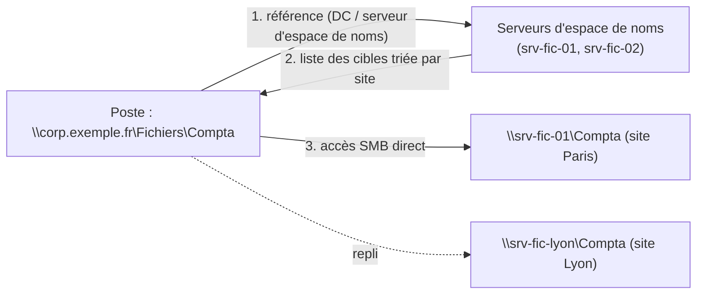

Un **espace de noms DFS** (DFS-N) présente aux utilisateurs une arborescence **unique** — par exemple `\\corp.exemple.fr\Fichiers\Compta` — dont les dossiers pointent vers des partages situés sur un ou plusieurs serveurs (**cibles**). Les postes ne connaissent plus les noms des serveurs : migrations, ajouts de capacité et bascules deviennent transparents.



## Types d'espaces de noms

| Type | Chemin | Remarques |
| --- | --- | --- |
| **Domaine** (mode Windows Server 2008) | `\\corp.exemple.fr\Fichiers` | Stocké dans AD, plusieurs serveurs d'espace de noms (haute disponibilité), ABE, > 5 000 dossiers — **recommandé** |
| Autonome | `\\srv-fic-01\Fichiers` | Sans AD ou en cluster ; un seul serveur (sauf cluster) |

## Création

```powershell
Install-WindowsFeature FS-DFS-Namespace -IncludeManagementTools

# Partage racine (vide) sur chaque serveur d'espace de noms
New-Item -ItemType Directory D:\DFSRoots\Fichiers
New-SmbShare -Name Fichiers -Path D:\DFSRoots\Fichiers -ReadAccess "Utilisateurs authentifiés" -FullAccess "Administrateurs"

New-DfsnRoot -Path \\corp.exemple.fr\Fichiers -TargetPath \\srv-fic-01\Fichiers -Type DomainV2 -EnableAccessBasedEnumeration $true
New-DfsnRootTarget -Path \\corp.exemple.fr\Fichiers -TargetPath \\srv-fic-02\Fichiers

# Dossiers et cibles
New-DfsnFolder -Path \\corp.exemple.fr\Fichiers\Compta -TargetPath \\srv-fic-01\Compta
New-DfsnFolderTarget -Path \\corp.exemple.fr\Fichiers\Compta -TargetPath \\srv-fic-lyon\Compta -State Online
Get-DfsnFolderTarget -Path \\corp.exemple.fr\Fichiers\Compta
```

## Références et sites

Le client reçoit une **liste de cibles** ordonnée : d'abord celles de **son site AD**, puis les autres selon le coût des liens de sites (option *Trier par coût le plus bas*). Il conserve la référence en cache (durée configurable, 300 s pour les racines, 1 800 s pour les dossiers par défaut).

| Réglage | Usage |
| --- | --- |
| *Exclure les cibles hors du site du client* | Interdire l'accès aux cibles distantes |
| Priorité de cible (*Premier parmi tous*, *Dernier parmi tous*) | Cible de secours explicite |
| **Restauration automatique** (*failback*) | Revenir sur la cible préférée quand elle redevient disponible |
| `State Offline` | Retirer temporairement une cible (maintenance, bascule) |

```powershell
Set-DfsnFolder -Path \\corp.exemple.fr\Fichiers\Compta -EnableTargetFailback $true -TimeToLiveSec 600
Set-DfsnFolderTarget -Path \\corp.exemple.fr\Fichiers\Compta -TargetPath \\srv-fic-lyon\Compta -ReferralPriorityClass GlobalLow
Set-DfsnFolderTarget -Path \\corp.exemple.fr\Fichiers\Compta -TargetPath \\srv-fic-01\Compta -State Offline   # maintenance
```

> [!WARNING]
> Plusieurs **cibles actives** pour un dossier dont les données sont modifiées par les utilisateurs, combinées à DFS-R, provoquent des **conflits** (deux personnes modifient le même fichier sur deux serveurs). Pour les données collaboratives : une seule cible active, l'autre en secours (désactivée ou priorité basse), voir [[02-replication-dfsr|DFS-R]].

## Migration avec DFS-N

1. Copier les données vers le nouveau serveur (robocopy, voir [[13-serveur-fichiers-windows/02-securite-migration-depannage|migration]]).
2. Ajouter la nouvelle cible au dossier DFS (hors ligne), dernière synchronisation pendant la fenêtre.
3. Passer la nouvelle cible **en ligne**, l'ancienne **hors ligne** ; les clients basculent à l'expiration du cache (`dfsutil cache referral flush` pour forcer).

## Diagnostic

```powershell
dfsutil /pktinfo                                  # cache des références du client
dfsutil cache referral flush
dfsdiag /testdcs /domain:corp.exemple.fr
dfsdiag /testreferral /dfspath:\\corp.exemple.fr\Fichiers\Compta /full
Get-DfsnRoot -Domain corp.exemple.fr
```

| Symptôme | Cause | Solution |
| --- | --- | --- |
| `\\corp.exemple.fr\Fichiers` inaccessible | Service DFS arrêté sur les serveurs d'espace de noms, DC injoignable | Service `Dfs`, `dfsdiag /testdcs` |
| Clients servis par la cible distante | Sous-réseau du client non associé à un site AD | Déclarer les sous-réseaux dans *Sites et services* |
| Changement de cible non pris en compte | Cache des références | Attendre le TTL ou `dfsutil cache referral flush` |
| Dossiers visibles mais inaccessibles | ABE non activé sur l'espace de noms ou droits | `-EnableAccessBasedEnumeration`, ACL sur les dossiers DFS |
