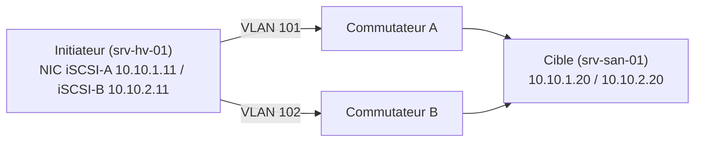

**iSCSI** transporte des commandes SCSI sur TCP/IP (port **3260**) : un serveur (**initiateur**) voit un disque distant (**LUN**) exposé par une **cible** comme un disque local, en accès **bloc**. C'est le SAN le plus simple à mettre en œuvre sur un réseau Ethernet.

| Terme | Signification |
| --- | --- |
| **Initiateur** | Client qui consomme le stockage (serveur Hyper-V, nœud de cluster, serveur SQL) |
| **Cible** | Serveur ou baie qui présente les LUN |
| **IQN** | Nom iSCSI unique : `iqn.1991-05.com.microsoft:srv-hv-01.corp.exemple.fr` |
| Portail | Adresse IP + port 3260 de la cible |
| LUN | Unité logique (disque) présentée |

## Conception réseau

- **Réseaux dédiés** au stockage (VLAN ou commutateurs séparés), **non routés**, sans passerelle par défaut sur les interfaces iSCSI
- **Deux chemins** indépendants (deux cartes, deux sous-réseaux, deux commutateurs) + [[02-initiateur-mpio|MPIO]] côté initiateur
- **Pas de NIC Teaming / LACP** pour iSCSI : la redondance et la répartition se font par MPIO
- **Trames étendues** (MTU 9000) de bout en bout si tous les éléments les gèrent ; contrôle de flux selon les recommandations du fabricant
- 10 Gbit/s minimum pour la virtualisation ; latence surveillée



## Serveur cible iSCSI (Windows)

Windows Server peut **être** une cible iSCSI (rôle *Serveur cible iSCSI*) : stockage de laboratoire, disque témoin de cluster, petits clusters. Pour la production critique, une baie dédiée est préférable.

```powershell
Install-WindowsFeature FS-iSCSITarget-Server -IncludeManagementTools

# Disque virtuel (fichier VHDX) et cible restreinte à des initiateurs
New-IscsiVirtualDisk -Path E:\iSCSI\cluster-donnees.vhdx -SizeBytes 2TB
New-IscsiServerTarget -TargetName "cluster-hv" -InitiatorIds @(
  "IQN:iqn.1991-05.com.microsoft:srv-hv-01.corp.exemple.fr",
  "IQN:iqn.1991-05.com.microsoft:srv-hv-02.corp.exemple.fr")
Add-IscsiVirtualDiskTargetMapping -TargetName "cluster-hv" -Path E:\iSCSI\cluster-donnees.vhdx

# Écouter seulement sur les interfaces de stockage
Get-IscsiTargetServerSetting
Set-IscsiTargetServerSetting -IP 10.10.1.20 -Enable $true
Set-IscsiTargetServerSetting -IP 10.0.20.30 -Enable $false     # interface de gestion

Get-IscsiServerTarget | Format-Table TargetName, Status, InitiatorIds
```

### CHAP

```powershell
# CHAP : l'initiateur s'authentifie auprès de la cible (secret 12 à 16 caractères)
Set-IscsiServerTarget -TargetName "cluster-hv" -EnableChap $true -Chap (New-Object PSCredential("chap-cluster", (ConvertTo-SecureString "SecretChap16Car!" -AsPlainText -Force)))
# CHAP mutuel : la cible s'authentifie aussi auprès de l'initiateur (EnableReverseChap / ReverseChap)
```

CHAP authentifie mais **ne chiffre pas** : l'isolation du réseau de stockage reste la protection principale (IPsec possible mais coûteux en performances).

### Instantanés et haute disponibilité

- `Checkpoint-IscsiVirtualDisk` crée un instantané VSS du disque virtuel (cohérence côté cible).
- Cible iSCSI hautement disponible : rôle *Serveur cible iSCSI* en **cluster de basculement** sur stockage partagé (voir [[05-clustering/01-cluster-basculement|clustering]]).

Suite : [[02-initiateur-mpio|initiateur iSCSI et MPIO]].
