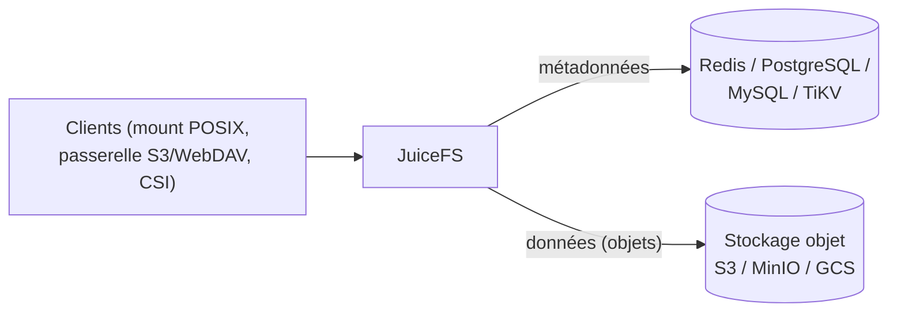

**JuiceFS** présente un **système de fichiers POSIX** classique (monté comme un disque) dont les **données** sont découpées en objets sur un **stockage objet** ([[07-minio/01-presentation-installation|MinIO]], S3, GCS, Azure Blob…) et les **métadonnées** (arborescence, droits, verrous) dans une base rapide (**Redis**, PostgreSQL, MySQL, TiKV). On obtient un volume partagé, élastique et peu coûteux pour des sauvegardes, des données d'IA/analytique, des médias ou le partage entre serveurs et conteneurs.



## Installation

```bash
# Linux / macOS : script officiel (binaire unique « juicefs »)
curl -sSL https://d.juicefs.com/install | sh -
juicefs version
```

Windows : binaire `juicefs.exe` (avec WinFsp). Conteneurs : image `juicedata/mount`. Kubernetes : **pilote CSI** `juicefs-csi-driver` (Helm). Il existe une édition **Cloud/Enterprise** (métadonnées gérées) ; cette page couvre l'édition **communautaire**.

## Créer et monter un volume

```bash
# 1. Formater : associe une base de métadonnées et un bucket objet à un nom de volume
juicefs format \
  --storage s3 \
  --bucket https://donnees.s3.corp.exemple.fr \
  --access-key SAUVACCES --secret-key "$S3_SECRET" \
  "redis://:motdepasse@10.0.20.40:6379/1" \
  monvolume

# 2. Monter (premier plan avec -f, ou en arrière-plan ; -d pour un service)
sudo juicefs mount "redis://:motdepasse@10.0.20.40:6379/1" /mnt/jfs \
  --cache-dir /var/jfsCache --cache-size 102400 --writeback -d
df -h /mnt/jfs
```

| Élément | Rôle |
| --- | --- |
| Base de métadonnées | `redis://`, `postgres://`, `mysql://`, `tikv://`, `sqlite3://` (mono-machine) — **à sauvegarder absolument** |
| Stockage objet | `--storage` (`s3`, `minio`, `gcs`, `wasb`, `oss`, `file`…) + `--bucket` et clés |
| Cache local | `--cache-dir`, `--cache-size` (Mo) : accélère les lectures ; `--writeback` bufferise les écritures |
| Montage au démarrage | ligne `redis://… /mnt/jfs juicefs _netdev,…` dans `/etc/fstab`, ou unité systemd |

## Accès S3, WebDAV et plates-formes

```bash
juicefs gateway "redis://…@10.0.20.40:6379/1" 0.0.0.0:9005        # passerelle compatible S3
juicefs webdav  "redis://…@10.0.20.40:6379/1" 0.0.0.0:9007        # accès WebDAV
```

- **Kubernetes** : le pilote **CSI** fournit des `PersistentVolume` ReadWriteMany partagés entre pods.
- **Hadoop/Spark** : SDK Java (schéma `jfs://`) pour un usage HDFS.

## Commandes utiles

```bash
juicefs bench /mnt/jfs                       # test de performance
juicefs info /mnt/jfs/dossier                # détails d'un fichier/dossier (objets sous-jacents)
juicefs stats /mnt/jfs                        # statistiques en temps réel
juicefs warmup /mnt/jfs/projet                # précharger dans le cache
juicefs sync s3://ancien/ jfs://monvolume/    # migrer/copier entre stockages (multi-thread)
juicefs gc --delete "redis://…"               # nettoyer les objets orphelins
juicefs fsck "redis://…"                      # vérifier la cohérence données/métadonnées
juicefs config "redis://…" --trash-days 7     # corbeille : conserver 7 jours
juicefs destroy "redis://…" <UUID>            # détruire un volume (irréversible)
```

> [!WARNING]
> La base de **métadonnées est le point critique** : sa perte rend les données objet illisibles. Mettez Redis en persistance AOF + réplication (ou utilisez PostgreSQL/MySQL répliqué), et exportez régulièrement les métadonnées : `juicefs dump "redis://…" meta-$(date +%F).json.gz`. Le chiffrement au repos s'active au `format` (`--encrypt-rsa-key`).

Comparé à [[25-glusterfs/01-presentation-installation|GlusterFS]] ou [[24-ceph/01-presentation-installation|CephFS]], JuiceFS délègue le stockage brut à l'objet (simplicité, coût, élasticité) mais dépend d'une base de métadonnées externe. Suite : [[02-moosefs|MooseFS]].

Commandes : [[90-aide-memoire|aide-mémoire]].
