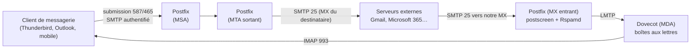
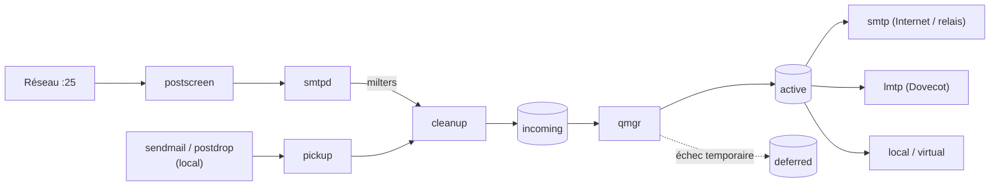

**Postfix** est le serveur de transport de messages (**MTA**) le plus répandu sous Linux. Il reçoit, relaie et achemine les courriels en SMTP, en s'appuyant sur des composants spécialisés : **Dovecot** pour les boîtes aux lettres et l'authentification, **Rspamd** pour le filtrage, un serveur DNS pour l'authentification des domaines.

## Architecture d'une messagerie

| Rôle | Description | Logiciel |
| --- | --- | --- |
| **MUA** | Client de messagerie | Thunderbird, Outlook, webmail (Roundcube) |
| **MSA** | Accepte les messages des utilisateurs **authentifiés** | Postfix (`submission`) |
| **MTA** | Transfère les messages entre serveurs | Postfix, Exim |
| **MDA** | Range les messages dans les boîtes, applique les filtres | Dovecot (LMTP + Sieve) |
| **MX** | Serveur désigné par le DNS pour recevoir le courrier d'un domaine | Postfix |
| Filtre | Anti-spam, antivirus, signature DKIM | Rspamd, SpamAssassin, ClamAV |

## Protocoles et ports

| Port | Protocole | Usage |
| --- | --- | --- |
| **25** | SMTP | Échanges entre serveurs (réception MX, envoi vers Internet) ; souvent **bloqué en sortie** chez les fournisseurs cloud et d'accès |
| **587** | Submission + STARTTLS | Envoi par les utilisateurs authentifiés |
| **465** | Submissions (TLS implicite) | Envoi authentifié, **recommandé** par la RFC 8314 |
| 143 / **993** | IMAP / IMAPS | Lecture des boîtes (Dovecot) |
| 110 / 995 | POP3 / POP3S | Rapatriement (Dovecot) |
| 24 ou socket | LMTP | Livraison locale Postfix → Dovecot |
| 4190 | ManageSieve | Gestion des filtres par les utilisateurs |

## DNS indispensable

| Enregistrement | Exemple | Rôle |
| --- | --- | --- |
| **MX** | `exemple.fr. MX 10 mx1.exemple.fr.` | Serveurs de réception du domaine |
| **A/AAAA** | `mx1.exemple.fr. A 203.0.113.25` | Adresse du serveur |
| **PTR** (DNS inverse) | `25.113.0.203.in-addr.arpa. PTR mx1.exemple.fr.` | Doit correspondre au nom annoncé (`HELO`) : sinon rejet par de nombreux serveurs |
| **SPF** | `exemple.fr. TXT "v=spf1 mx -all"` | Serveurs autorisés à envoyer pour le domaine |
| **DKIM** | `s2025._domainkey.exemple.fr. TXT "v=DKIM1; k=rsa; p=…"` | Clé publique de signature |
| **DMARC** | `_dmarc.exemple.fr. TXT "v=DMARC1; p=quarantine; rua=…"` | Politique en cas d'échec SPF/DKIM, rapports |
| MTA-STS / TLS-RPT | `_mta-sts`, `_smtp._tls` | TLS obligatoire en réception, rapports TLS |

Détails : [[06-spf-dkim-dmarc]] et [[05-tls-securite-transport]].

## Architecture interne de Postfix

| Composant | Rôle |
| --- | --- |
| `master` | Supervise tous les démons (`master.cf`) |
| `postscreen` | Filtre les robots avant `smtpd` (listes DNS, tests de protocole) |
| `smtpd` | Serveur SMTP : restrictions, TLS, SASL, milters |
| `cleanup` | Normalise les messages, réécritures, `header_checks` |
| `qmgr` | Gestionnaire de files : planifie les livraisons |
| `smtp` / `lmtp` | Clients SMTP/LMTP sortants |
| `local` / `virtual` | Livraison locale (comptes Unix) / boîtes virtuelles simples |
| `anvil`, `tlsmgr`, `postlogd` | Limites de débit, cache TLS, journalisation dans un fichier |

| File d'attente | Contenu |
| --- | --- |
| `maildrop` | Messages soumis localement |
| `incoming` | Messages reçus en attente d'entrée en file active |
| `active` | Messages en cours de livraison |
| `deferred` | Échecs temporaires, nouvelles tentatives (jusqu'à `maximal_queue_lifetime`, 5 jours) |
| `hold` | Messages suspendus par l'administrateur ou une règle |

## Versions

| Version | Distributions (exemples) | Apports |
| --- | --- | --- |
| 3.5 | RHEL 9 | `smtpd_tls_chain_files` (≥ 3.4), `compatibility_level` |
| 3.7 | Debian 12 | Syntaxe de protocoles `>=TLSv1.2` (≥ 3.6), sécurité TLS par défaut renforcée |
| 3.8 | Ubuntu 24.04 | Améliorations TLS et DNS ; correctifs contre le *SMTP smuggling* (3.8.5) |
| 3.9 / 3.10 | Distributions récentes | `smtpd_forbid_bare_newline` actif par défaut, retrait d'options obsolètes |

## Rôles types

| Rôle | Article |
| --- | --- |
| Serveur qui **envoie seulement** (applications, alertes) via un relais | [[03-configuration-base]] |
| **Relais interne** pour imprimantes, applications, serveurs | [[03-configuration-base]] |
| **Serveur de messagerie complet** (MX + boîtes Dovecot) | [[04-domaines-virtuels-dovecot]] |
| **Passerelle** anti-spam devant Exchange / Microsoft 365 | [[08-relais-routage-avance]] |

## Suite du parcours

1. [[02-installation|Installation (Linux, macOS, Windows)]]
2. [[03-configuration-base|Configuration de base : envoi, relais interne, smarthost]]
3. [[04-domaines-virtuels-dovecot|Domaines virtuels, Dovecot et submission]]
4. [[05-tls-securite-transport|TLS, DANE et MTA-STS]]
5. [[06-spf-dkim-dmarc|SPF, DKIM et DMARC]]
6. [[07-anti-spam-restrictions|Restrictions, postscreen et anti-spam]]
7. [[08-relais-routage-avance|Relais, routage et réécritures avancées]]
8. [[09-exploitation-depannage|Exploitation et dépannage]]
