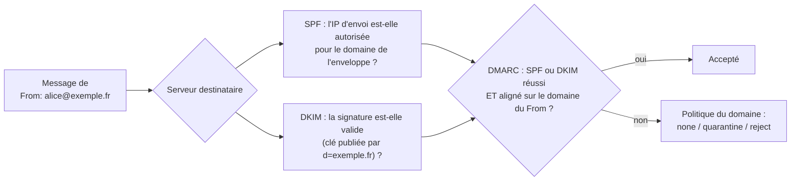

## Vue d'ensemble



## SPF

```dns
exemple.fr.  TXT "v=spf1 mx ip4:203.0.113.25 ip6:2001:db8:25::25 include:spf.protection.outlook.com include:_spf.fournisseur-newsletter.fr -all"
```

| Mécanisme | Signification |
| --- | --- |
| `mx`, `a` | Les serveurs MX / l'adresse du domaine |
| `ip4:` / `ip6:` | Adresses ou plages explicites |
| `include:` | Politique SPF d'un tiers (Microsoft 365, routeur d'e-mails) |
| `-all` | Tout le reste échoue (recommandé) |
| `~all` | Échec « doux » (période de transition) |

> [!WARNING]
> SPF est limité à **10 requêtes DNS** (`include`, `a`, `mx`, `exists`, `redirect`) : au-delà, le résultat est `permerror`. Comptez les `include` imbriqués et remplacez-les par des `ip4:` si nécessaire. Un domaine qui **n'envoie jamais** de courrier publie `v=spf1 -all`.

SPF vérifie le domaine de l'**enveloppe** (`MAIL FROM`, adresse de retour), pas celui du `From:` visible : c'est DMARC qui fait le lien.

## DKIM

Le serveur signe chaque message sortant avec une clé privée ; la clé publique est publiée sous `<sélecteur>._domainkey.<domaine>`.

### Avec Rspamd (recommandé)

La signature DKIM est intégrée à Rspamd, déjà utilisé comme filtre anti-spam : voir [[04-rspamd/02-configuration|configuration de Rspamd]] (module `dkim_signing`).

### Avec OpenDKIM

```bash
sudo apt install opendkim opendkim-tools
sudo mkdir -p /etc/opendkim/keys/exemple.fr
sudo opendkim-genkey -b 2048 -d exemple.fr -s s2025 -D /etc/opendkim/keys/exemple.fr
sudo chown -R opendkim: /etc/opendkim/keys
sudo cat /etc/opendkim/keys/exemple.fr/s2025.txt        # enregistrement DNS à publier
```

```opendkim /etc/opendkim.conf
Syslog              yes
Mode                sv
Canonicalization    relaxed/simple
Socket              inet:8891@localhost
KeyTable            /etc/opendkim/key.table
SigningTable        refile:/etc/opendkim/signing.table
InternalHosts       /etc/opendkim/trusted.hosts
OversignHeaders     From
```

```text /etc/opendkim/key.table
s2025._domainkey.exemple.fr  exemple.fr:s2025:/etc/opendkim/keys/exemple.fr/s2025.private
```

```text /etc/opendkim/signing.table
*@exemple.fr   s2025._domainkey.exemple.fr
```

```postfix /etc/postfix/main.cf
smtpd_milters = inet:localhost:8891
non_smtpd_milters = $smtpd_milters
milter_default_action = accept
```

```dns
s2025._domainkey.exemple.fr. TXT ( "v=DKIM1; k=rsa; "
    "p=MIIBIjANBgkqhkiG9w0BAQEFAAOCAQ8AMIIBCgKCAQEA…" )
```

OpenDKIM n'évolue plus guère : pour un nouveau déploiement, Rspamd regroupe signature, vérification et anti-spam.

### Rotation des clés

1. Générer une nouvelle clé avec un **nouveau sélecteur** (`s2026`) et publier son enregistrement DNS.
2. Attendre la propagation, puis basculer la signature sur le nouveau sélecteur.
3. Laisser l'ancien enregistrement quelques jours (messages en transit), puis le supprimer.

Rotation annuelle conseillée ; clés RSA 2048 bits (Ed25519 en complément, encore peu vérifié).

## DMARC

```dns
_dmarc.exemple.fr. TXT "v=DMARC1; p=quarantine; rua=mailto:dmarc-rapports@exemple.fr; adkim=s; aspf=r; pct=100; fo=1"
```

| Balise | Rôle |
| --- | --- |
| `p=` | Politique : `none` (observation), `quarantine` (indésirables), `reject` (rejet) |
| `sp=` | Politique des sous-domaines |
| `rua=` | Adresse des rapports agrégés (quotidiens, XML) |
| `adkim=` / `aspf=` | Alignement strict (`s`) ou relâché (`r`, sous-domaines acceptés) |
| `pct=` | Pourcentage de messages soumis à la politique (déploiement progressif) |

**Démarche** : `p=none` avec rapports → inventaire de tous les services qui envoient pour le domaine (CRM, newsletters, applications, Microsoft 365) → SPF/DKIM alignés pour chacun → `quarantine` → `reject`. Analysez les rapports avec un outil (parsedmarc, services en ligne).

## ARC et transferts

Les listes de diffusion et redirections cassent souvent SPF (nouvelle IP) et parfois DKIM (pied de page ajouté). **ARC** permet à un intermédiaire de confiance d'attester des résultats d'authentification d'origine ; Rspamd sait signer ARC. Pour les listes, voir aussi les options d'atténuation DMARC de [[06-mailman/02-configuration-listes|Mailman]].

## Exigences des grands fournisseurs

Depuis 2024, Gmail, Yahoo puis Microsoft (Outlook.com) exigent des expéditeurs en volume :

- SPF **et** DKIM valides, DMARC publié (au moins `p=none`) et **aligné** ;
- DNS inverse cohérent, TLS ;
- désinscription en un clic (`List-Unsubscribe-Post`) pour les envois marketing ;
- taux de plaintes pour spam faible (< 0,3 %).

## Vérification en réception

| Outil | Rôle |
| --- | --- |
| **Rspamd** | Vérifie SPF, DKIM, DMARC et ARC, ajuste le score, applique la politique DMARC |
| `postfix-policyd-spf-python` | Vérification SPF dans `smtpd_recipient_restrictions` (`check_policy_service unix:private/policyd-spf`) |
| OpenDMARC | Application de DMARC par milter |

```bash
# Contrôles rapides
dig +short TXT exemple.fr | grep spf
dig +short TXT s2025._domainkey.exemple.fr
dig +short TXT _dmarc.exemple.fr
```

Envoyez un message vers une adresse de test (ou un service comme mail-tester) et lisez l'en-tête `Authentication-Results`.
