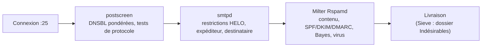

## Stratégie en couches



Le principe : rejeter le plus tôt possible ce qui est certainement du spam (coût minimal), et confier les cas douteux au filtre de contenu.

## postscreen

```mastercf /etc/postfix/master.cf (extrait)
#smtp      inet  n       -       y       -       -       smtpd
smtp      inet  n       -       y       -       1       postscreen
smtpd     pass  -       -       y       -       -       smtpd
dnsblog   unix  -       -       y       -       0       dnsblog
tlsproxy  unix  -       -       y       -       0       tlsproxy
```

```postfix /etc/postfix/main.cf
postscreen_access_list = permit_mynetworks, cidr:/etc/postfix/postscreen_acces.cidr
postscreen_denylist_action = drop          # « blacklist » avant Postfix 3.6
postscreen_greet_action = enforce
postscreen_dnsbl_action = enforce
postscreen_dnsbl_threshold = 3
postscreen_dnsbl_allowlist_threshold = -1
postscreen_dnsbl_sites =
    zen.spamhaus.org=127.0.0.[2..11]*3
    zen.spamhaus.org=127.0.0.[10;11]*-2
    bl.spamcop.net*2
    b.barracudacentral.org=127.0.0.2*2
    list.dnswl.org=127.0.[0..255].[1..3]*-2
# Tests « après accueil » (plus stricts ; retardent le premier message d'un nouveau client)
postscreen_pipelining_enable = yes
postscreen_non_smtp_command_enable = yes
postscreen_bare_newline_enable = yes
```

```text /etc/postfix/postscreen_acces.cidr
198.51.100.0/24   permit     # partenaire de confiance
192.0.2.66        reject
```

> [!IMPORTANT]
> Les listes DNS (Spamhaus notamment) **refusent les requêtes passant par des résolveurs publics** (8.8.8.8, 1.1.1.1) et imposent un accès commercial (DQS) au-delà d'un certain volume. Utilisez un **résolveur local** ([[02-unbound/01-presentation-installation|Unbound]]) et vérifiez les conditions d'usage de chaque liste.

## Restrictions smtpd

```postfix /etc/postfix/main.cf
smtpd_helo_required = yes
disable_vrfy_command = yes
smtpd_delay_reject = yes

smtpd_client_restrictions =
    permit_mynetworks,
    reject_unknown_reverse_client_hostname

smtpd_helo_restrictions =
    permit_mynetworks,
    reject_invalid_helo_hostname,
    reject_non_fqdn_helo_hostname

smtpd_sender_restrictions =
    reject_non_fqdn_sender,
    reject_unknown_sender_domain

# Relais : qui peut envoyer vers des domaines extérieurs
smtpd_relay_restrictions =
    permit_mynetworks,
    permit_sasl_authenticated,
    defer_unauth_destination

# Destinataires : appliqué au courrier entrant
smtpd_recipient_restrictions =
    reject_non_fqdn_recipient,
    reject_unknown_recipient_domain,
    reject_unauth_pipelining,
    reject_unlisted_recipient,
    check_policy_service unix:private/policyd-spf
```

| Restriction | Effet |
| --- | --- |
| `reject_unknown_reverse_client_hostname` | Rejette les clients sans DNS inverse (version stricte : `reject_unknown_client_hostname`, PTR et A cohérents) |
| `reject_invalid_helo_hostname` / `reject_non_fqdn_helo_hostname` | HELO syntaxiquement invalide / non qualifié |
| `reject_unknown_sender_domain` | Domaine expéditeur sans MX ni A |
| `defer_unauth_destination` | Refus temporaire de relayer pour un tiers (anti-relais ouvert) |
| `reject_unlisted_recipient` | Destinataire inexistant rejeté immédiatement |
| `reject_rbl_client <liste>` | DNSBL dans smtpd (préférer postscreen) |

> [!TIP]
> Testez de nouvelles restrictions avec `warn_if_reject reject_…` : Postfix journalise ce qu'il **aurait** rejeté sans rejeter. Ou temporairement `soft_bounce = yes` (rejets transformés en erreurs temporaires).

## Filtrage par Rspamd (milter)

```postfix /etc/postfix/main.cf
smtpd_milters = inet:127.0.0.1:11332
non_smtpd_milters = $smtpd_milters
milter_protocol = 6
milter_mail_macros = i {mail_addr} {client_addr} {client_name} {auth_authen}
milter_default_action = accept               # si Rspamd est indisponible, accepter (ou tempfail)
```

Rspamd décide d'accepter, d'ajouter un en-tête, de reporter (greylisting) ou de rejeter selon le score — voir [[04-rspamd/01-presentation-installation|Rspamd]]. L'alternative historique est SpamAssassin via Amavis ou `spamass-milter` ([[05-spamassassin/01-presentation-installation|SpamAssassin]]).

## Pièces jointes dangereuses

```postfix /etc/postfix/main.cf
mime_header_checks = pcre:/etc/postfix/mime_header_checks
```

```text /etc/postfix/mime_header_checks
/^\s*Content-(Disposition|Type).*name\s*=\s*"?([^"]*\.(exe|scr|com|bat|cmd|pif|vbs|vbe|js|jse|wsf|hta|jar|ps1|msi|iso|img|lnk))"?\s*(;|$)/x
    REJECT Type de pièce jointe interdit : $2
```

Rspamd sait aussi le faire (module `mime_types`) et inspecte les archives.

## Greylisting

Le greylisting reporte temporairement le premier message d'un couple inconnu (IP, expéditeur, destinataire) : les vrais serveurs réessaient, beaucoup de robots non. Rspamd l'intègre (selon le score) ; en autonome : `postgrey` (`check_policy_service inet:127.0.0.1:10023`). Inconvénient : retard de livraison de quelques minutes, problèmes avec les grandes plateformes à IP multiples.

## Limites de débit

```postfix
smtpd_client_connection_rate_limit = 30      # connexions / minute / client (anvil)
smtpd_client_message_rate_limit = 100
smtpd_client_recipient_rate_limit = 200
smtpd_error_sleep_time = 1s
smtpd_soft_error_limit = 10
smtpd_hard_error_limit = 20
anvil_rate_time_unit = 60s
```

Pour les comptes authentifiés (compte compromis qui envoie du spam), Rspamd (`ratelimit`) ou un service de politique (`policyd-rate-limit`) limitent les envois par utilisateur.

## Passerelle : vérifier les destinataires

Sur une passerelle devant Exchange/Microsoft 365, rejetez les destinataires inexistants **avant** d'accepter le message (sinon rétrodiffusion) :

```postfix
relay_recipient_maps = ldap:/etc/postfix/ldap-destinataires.cf     # liste issue de l'annuaire
# ou vérification dynamique auprès du serveur interne :
smtpd_recipient_restrictions = …, reject_unverified_recipient
```
