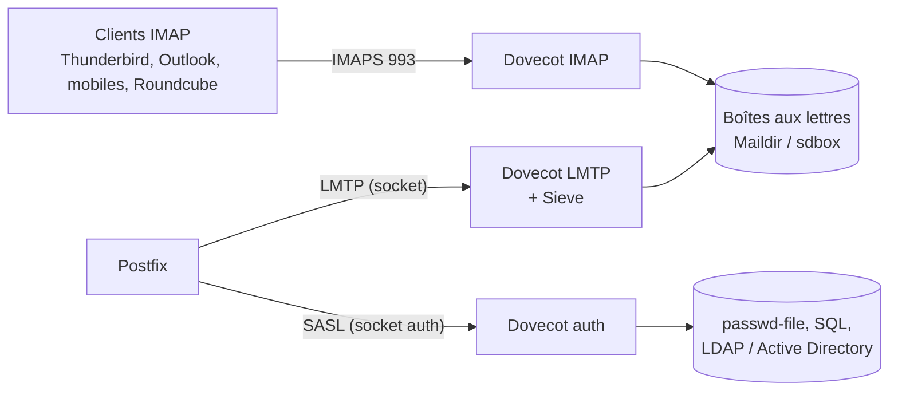

**Dovecot** est le serveur **IMAP/POP3** de référence. Dans une messagerie Linux, il assure aussi la **livraison** des messages (LMTP, appelé par Postfix), le **filtrage côté serveur** (Sieve) et l'**authentification** des utilisateurs pour l'envoi SMTP (SASL).



## Formats de stockage

| Format | Principe | Usage |
| --- | --- | --- |
| **Maildir** | Un fichier par message | Le plus courant, simple à sauvegarder et à inspecter |
| **sdbox** | Un fichier par message, format propre à Dovecot | Performances, index robustes |
| **mdbox** | Plusieurs messages par fichier | Grands volumes (nécessite `doveadm purge`) |
| mbox | Un fichier par dossier | Hérité, à éviter |

## Dovecot 2.3 ou 2.4

La branche **2.4** (2025) modifie profondément la syntaxe de configuration ; les exemples de ce wiki utilisent la syntaxe **2.3**, la plus déployée (Debian 12, Ubuntu 24.04, RHEL 9).

| Sujet | 2.3 | 2.4 |
| --- | --- | --- |
| En-tête obligatoire | — | `dovecot_config_version = 2.4.x` et `dovecot_storage_version = 2.4.x` |
| Emplacement des boîtes | `mail_location = maildir:~/Maildir` | `mail_driver = maildir` + `mail_path = ~/Maildir` |
| Certificats | `ssl_cert = </chemin` / `ssl_key = </chemin` | `ssl_server_cert_file = /chemin` / `ssl_server_key_file = /chemin` |
| Variables | `%u`, `%n`, `%d` | `%{user}`, `%{user \| username}`, `%{user \| domain}` |
| Sources d'authentification | `passdb { driver = ldap args = fichier }` | `passdb ldap { … }` avec paramètres LDAP intégrés (`ldap_uris`…) |
| Authentification en clair | `disable_plaintext_auth = yes` | `auth_allow_cleartext = no` |
| Réplication (`replicator`), director | Disponibles | **Retirés** de l'édition libre |

> [!WARNING]
> Une configuration 2.3 **ne démarre pas** en 2.4 : la mise à niveau (par exemple Debian 12 → 13) exige une réécriture guidée par la documentation de migration de Dovecot. Testez sur une copie avant de mettre à jour.

## Installation

### Debian / Ubuntu

```bash
sudo apt install dovecot-core dovecot-imapd dovecot-lmtpd dovecot-sieve dovecot-managesieved
# Selon les besoins : dovecot-pop3d dovecot-ldap dovecot-mysql dovecot-pgsql dovecot-solr
sudo systemctl enable --now dovecot
dovecot --version
```

### RHEL / Rocky / Alma

```bash
sudo dnf install dovecot dovecot-pigeonhole        # pigeonhole = Sieve / ManageSieve
sudo systemctl enable --now dovecot
sudo firewall-cmd --permanent --add-service={imaps,pop3s} && sudo firewall-cmd --permanent --add-port=4190/tcp
sudo firewall-cmd --reload
```

### macOS

```bash
brew install dovecot
# Configuration sous $(brew --prefix)/etc/dovecot/ ; démarrage : sudo brew services start dovecot
```

Utile pour des tests ou un serveur d'archives IMAP local. Windows n'a pas de version native : utilisez un serveur Linux (ou un conteneur).

## Structure de la configuration

| Fichier | Contenu |
| --- | --- |
| `/etc/dovecot/dovecot.conf` | Protocoles, écoute, inclusion de `conf.d/` |
| `conf.d/10-auth.conf` | Mécanismes et sources d'authentification |
| `conf.d/10-mail.conf` | Emplacement des boîtes, utilisateur système, espaces de noms |
| `conf.d/10-master.conf` | Services (ports, sockets pour Postfix) |
| `conf.d/10-ssl.conf` | TLS |
| `conf.d/15-mailboxes.conf` | Dossiers spéciaux (Envoyés, Corbeille, Indésirables) |
| `conf.d/20-imap.conf`, `20-lmtp.conf`, `20-managesieve.conf` | Options par protocole |
| `conf.d/90-sieve.conf`, `90-quota.conf` | Greffons |
| `conf.d/auth-*.conf.ext` | Sources d'authentification (passwd-file, SQL, LDAP) |

```bash
sudo doveconf -n                 # configuration effective (sans les valeurs par défaut)
sudo doveconf -a | grep mail_    # toutes les valeurs
sudo doveadm reload
sudo doveadm log errors          # dernières erreurs
```

## Ports

| Port | Service |
| --- | --- |
| 993 | IMAPS (recommandé) |
| 143 | IMAP + STARTTLS |
| 995 / 110 | POP3S / POP3 |
| 4190 | ManageSieve |
| sockets Unix | LMTP et authentification pour Postfix |

## Suite du parcours

1. [[02-configuration-base|Configuration de base : boîtes virtuelles, TLS, dossiers]]
2. [[03-authentification-ldap-sql|Authentification : fichiers, SQL, LDAP / Active Directory]]
3. [[04-lmtp-sieve-quotas|LMTP, Sieve, apprentissage anti-spam et quotas]]
4. [[05-exploitation-depannage|Exploitation, sauvegarde, haute disponibilité et dépannage]]
