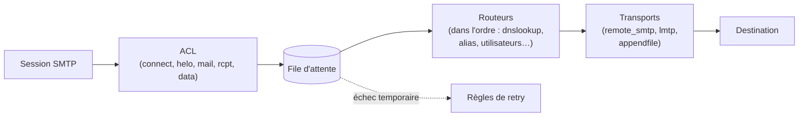

**Exim** est un MTA très configurable, installé par défaut sur **Debian** et utilisé par de nombreux hébergeurs (cPanel). Sa configuration est un véritable langage (expansions de chaînes, conditions, recherches) qui permet des politiques de routage très fines.

## Architecture



| Section | Rôle |
| --- | --- |
| *main* | Options globales : nom, domaines, réseaux de relais, TLS, ports |
| **ACL** | Décisions pendant la session SMTP (accepter, refuser, avertir, ajouter des en-têtes) |
| **Routeurs** | Déterminent **où** envoyer chaque adresse (premier routeur qui accepte l'adresse) |
| **Transports** | Déterminent **comment** livrer (SMTP distant, LMTP, fichier Maildir, programme) |
| *retry* | Politique de nouvelles tentatives |
| *rewrite* | Réécriture d'adresses |
| **Authentificateurs** | SMTP AUTH serveur (Dovecot, SASL) et client (smarthost) |

## Exim ou Postfix ?

| Critère | Exim | [[01-postfix/01-presentation\|Postfix]] |
| --- | --- | --- |
| Configuration | Langage très souple, un seul fichier logique | Paramètres + tables, plus simple à lire |
| Architecture | Processus monolithique (setuid root) | Démons séparés à privilèges minimaux |
| Sécurité | Plusieurs failles critiques par le passé : **mises à jour impératives** | Excellent historique |
| Filtrage de contenu | Intégré (`spam =`, `malware =`, DKIM) avec `exim4-daemon-heavy` | Milters (Rspamd) |
| Usage typique | Debian par défaut, hébergement mutualisé | Messagerie d'entreprise, MX |

> [!WARNING]
> Exim a connu des vulnérabilités d'exécution de code à distance largement exploitées (2019, 2020, 2023). Exposé sur Internet, il doit être **tenu à jour** en permanence (mises à jour de sécurité automatiques de la distribution).

## Installation sous Debian / Ubuntu

```bash
sudo apt install exim4-daemon-light            # installé par défaut sur Debian
# Version « heavy » : LDAP, SQL, analyse anti-spam/antivirus, SPF
sudo apt install exim4-daemon-heavy
sudo dpkg-reconfigure exim4-config
exim -bV | head -3
```

| Choix debconf | Usage |
| --- | --- |
| Site Internet (envoi et réception directs en SMTP) | MX ou serveur autonome |
| Envoi via un smarthost ; réception en SMTP ou fetchmail | Réception directe, envoi via relais |
| Envoi via un smarthost ; pas de courrier local | Serveur qui envoie ses alertes via un relais |
| Distribution locale seulement | Courrier entre comptes locaux |

### Fichiers Debian

| Fichier | Rôle |
| --- | --- |
| `/etc/exim4/update-exim4.conf.conf` | Réponses debconf (`dc_eximconfig_configtype`, `dc_smarthost`, `dc_relay_nets`…) |
| `/etc/exim4/conf.d/{main,acl,router,transport,retry,rewrite,auth}/` | Configuration **scindée** (`dc_use_split_config='true'`) |
| `/etc/exim4/exim4.conf.template` | Configuration **unique** (par défaut) |
| `/etc/exim4/conf.d/main/00_local_macros` ou `exim4.conf.localmacros` | Macros locales (TLS, DKIM…) sans modifier les fichiers du paquet |
| `/etc/exim4/passwd.client` | Identifiants pour le smarthost |
| `/var/lib/exim4/config.autogenerated` | Configuration finale générée |

```bash
sudo update-exim4.conf          # régénérer la configuration après modification
sudo exim -bV                   # vérifier la syntaxe
sudo systemctl restart exim4
```

```ini /etc/exim4/update-exim4.conf.conf (exemple : envoi via smarthost)
dc_eximconfig_configtype='smarthost'
dc_other_hostnames='srv-app01.corp.exemple.fr'
dc_local_interfaces='127.0.0.1 ; ::1'
dc_readhost='exemple.fr'
dc_relay_domains=''
dc_minimaldns='false'
dc_relay_nets=''
dc_smarthost='smtp.fournisseur.fr::587'
CFILEMODE='644'
dc_use_split_config='true'
dc_hide_mailname='true'
dc_mailname_in_oh='true'
dc_localdelivery='mail_spool'
```

```text /etc/exim4/passwd.client (chmod 640, root:Debian-exim)
smtp.fournisseur.fr:compte@exemple.fr:MotDePasse
```

Le double `::` sépare le port du nom d'hôte (syntaxe Exim pour éviter la confusion avec IPv6).

## RHEL et macOS

```bash
sudo dnf install epel-release && sudo dnf install exim      # /etc/exim/exim.conf (fichier unique)
sudo systemctl enable --now exim
brew install exim                                          # macOS (tests)
```

Windows : pas de version native.

## Suite du parcours

1. [[02-configuration-acl-routage|Configuration : ACL, routeurs, transports, TLS, DKIM]]
2. [[03-exploitation-depannage|Exploitation et dépannage]]
