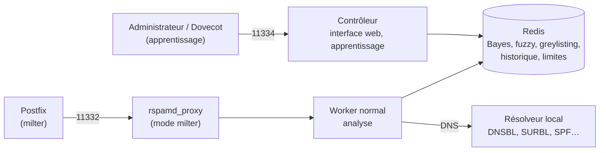

**Rspamd** analyse chaque message (en-têtes, contenu, URL, pièces jointes, réputation de l'IP, SPF/DKIM/DMARC, Bayes, réseaux de détection collaboratifs) et lui attribue un **score**. Selon ce score, il recommande une **action** que le MTA applique. Écrit en C et Lua, il est nettement plus rapide que SpamAssassin et regroupe aussi la **signature DKIM/ARC**, le **greylisting** et la **limitation de débit**.

## Architecture



| Worker | Port | Rôle |
| --- | --- | --- |
| `normal` | 11333 | Analyse (protocole HTTP Rspamd) |
| `rspamd_proxy` | 11332 | Interface **milter** pour Postfix/Sendmail, ou proxy |
| `controller` | 11334 | **Interface web**, statistiques, apprentissage, historique |
| `fuzzy` | 11335 (UDP) | Stockage de condensats flous (détection de variantes) |

## Symboles, scores et actions

Chaque test qui se déclenche produit un **symbole** pondéré (ex. `BAYES_SPAM 5.1`, `R_SPF_FAIL 1.0`, `DMARC_POLICY_REJECT 2.0`). La somme donne le score, comparé aux seuils d'action :

| Action | Seuil par défaut | Effet côté MTA |
| --- | --- | --- |
| `no action` | — | Livraison normale |
| `greylist` | 4 | Refus temporaire (le serveur légitime réessaie) |
| `add header` | 6 | En-tête `X-Spam: Yes` → classé en *Indésirables* par Sieve |
| `rewrite subject` | (désactivé) | Préfixe dans l'objet |
| `soft reject` | — | Refus temporaire |
| `reject` | 15 | Rejet SMTP (`554 5.7.1`) |

## Rspamd ou SpamAssassin ?

| Critère | Rspamd | [[05-spamassassin/01-presentation-installation\|SpamAssassin]] |
| --- | --- | --- |
| Performances | Très élevées (asynchrone, C) | Plus lent (Perl), processus spamd |
| Intégration | Milter natif, Exim (`variant=rspamd`) | spamass-milter, Amavis, Exim |
| Fonctions | DKIM/ARC, greylisting, ratelimit, Bayes Redis, réseaux neuronaux, interface web | Filtrage seul, Bayes, règles |
| Règles | Mises à jour avec les versions + cartes | `sa-update` quotidien |
| Recommandation | **Nouveaux déploiements** | Existants, besoins spécifiques |

## Installation

Le **dépôt officiel** fournit des versions plus récentes que les distributions (règles et détections évoluent vite).

### Debian / Ubuntu

```bash
sudo apt install -y lsb-release wget gpg redis-server
CODENAME=$(lsb_release -c -s)
sudo mkdir -p /etc/apt/keyrings
wget -qO- https://rspamd.com/apt-stable/gpg.key | gpg --dearmor | sudo tee /etc/apt/keyrings/rspamd.gpg >/dev/null
echo "deb [signed-by=/etc/apt/keyrings/rspamd.gpg] http://rspamd.com/apt-stable/ $CODENAME main" \
  | sudo tee /etc/apt/sources.list.d/rspamd.list
sudo apt update && sudo apt install -y rspamd
sudo systemctl enable --now rspamd redis-server
```

### RHEL / Rocky / Alma

```bash
sudo dnf install -y epel-release
sudo curl -o /etc/yum.repos.d/rspamd.repo https://rspamd.com/rpm-stable/centos-9/rspamd.repo
sudo dnf install -y rspamd redis
sudo systemctl enable --now rspamd redis
```

### macOS

```bash
brew install rspamd redis      # tests et développement de règles
```

Windows : pas de version native (conteneur Docker possible).

## Assistant et vérification

```bash
sudo rspamadm configwizard          # Redis, mot de passe du contrôleur, DKIM
sudo rspamadm configtest
rspamc stat
```

## Intégration au MTA

| MTA | Méthode |
| --- | --- |
| **Postfix** | `smtpd_milters = inet:127.0.0.1:11332` — voir [[01-postfix/07-anti-spam-restrictions\|Postfix : anti-spam]] |
| **Exim** | `spamd_address = 127.0.0.1 11333 variant=rspamd` — voir [[03-exim/02-configuration-acl-routage\|Exim : ACL]] |
| Dovecot | Apprentissage par déplacement de messages (IMAPSieve) — voir [[02-dovecot/04-lmtp-sieve-quotas\|Dovecot]] |

## Suite du parcours

1. [[02-configuration|Configuration : actions, Redis, Bayes, DKIM, listes, limites, antivirus]]
2. [[03-exploitation-depannage|Exploitation, apprentissage et dépannage]]
