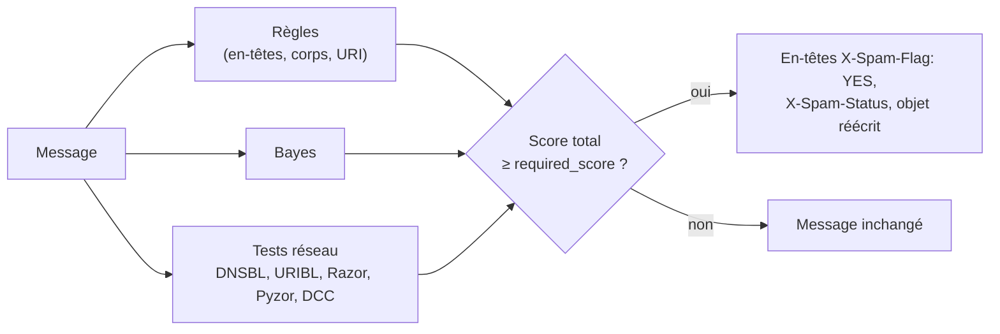

**Apache SpamAssassin** est le filtre anti-spam historique du logiciel libre. Il attribue un score à chaque message à partir de milliers de **règles** (en-têtes, corps, URL), d'un classifieur **Bayes**, et de **tests réseau** (listes DNS, signatures collaboratives). Au-delà du seuil (5 par défaut), le message est marqué comme spam.

Pour un nouveau déploiement, [[04-rspamd/01-presentation-installation|Rspamd]] est généralement préféré (performances, fonctions intégrées) ; SpamAssassin reste très répandu (hébergeurs, passerelles existantes, Amavis).

## Fonctionnement



| Composant | Rôle |
| --- | --- |
| `spamassassin` | Analyse en ligne de commande (Perl, lent : tests et diagnostic) |
| **spamd** | Démon qui garde les règles en mémoire |
| **spamc** | Client léger qui envoie le message à spamd |
| `sa-update` | Télécharge les mises à jour de règles |
| `sa-learn` | Apprentissage Bayes |
| `sa-compile` | Compile les règles en code natif (plus rapide) |

## Installation

### Debian / Ubuntu

```bash
sudo apt install spamassassin spamd spamc
sudo systemctl enable --now spamd
sudo sa-update && sudo systemctl reload spamd
spamassassin --version
```

La mise à jour quotidienne des règles est assurée par une tâche planifiée du paquet (timer systemd `spamassassin-maintenance` ou cron selon la version).

### RHEL / Rocky / Alma

```bash
sudo dnf install spamassassin
sudo systemctl enable --now spamassassin       # service spamd
sudo sa-update
```

### macOS

```bash
brew install spamassassin          # tests de règles, analyse de messages
```

Pas de version Windows native maintenue.

## Intégration

| MTA | Méthode | Remarque |
| --- | --- | --- |
| Postfix | **spamass-milter** | Analyse pendant la session SMTP : rejet possible au-delà d'un score |
| Postfix | **Amavis** (`content_filter`) | Antivirus + anti-spam, réinjection après analyse ; plus lourd |
| Exim | ACL `spam = …` (`spamd_address`) | Intégré à `exim4-daemon-heavy` |
| Dovecot / procmail | `spamc` en filtre de livraison | Marquage seul, après acceptation |

### Postfix avec spamass-milter

```bash
sudo apt install spamass-milter
```

```ini /etc/default/spamass-milter (Debian)
# Rejeter au-delà de 15 points, ignorer les messages des utilisateurs authentifiés
OPTIONS="-u spamass-milter -i 127.0.0.1 -r 15 -I"
```

```postfix /etc/postfix/main.cf
smtpd_milters = unix:/spamass/spamass.sock
milter_connect_macros = i j {daemon_name} v {if_name} _
milter_default_action = accept
```

Le socket se trouve dans la prison de Postfix (`/var/spool/postfix/spamass/`). Sieve range ensuite les messages marqués (`X-Spam-Flag: YES`) dans *Indésirables* ([[02-dovecot/04-lmtp-sieve-quotas|Dovecot Sieve]]).

## Suite

[[02-configuration-exploitation|Configuration, Bayes, règles personnalisées et dépannage]]
