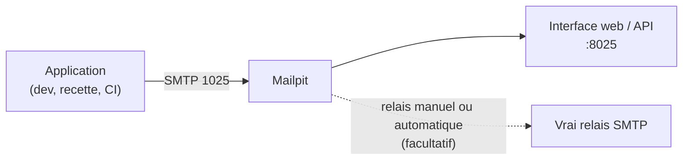

**Mailpit** est un faux serveur SMTP : il **accepte tous les messages** sans jamais les livrer et les affiche dans une interface web. Il permet de tester les envois d'une application (inscriptions, notifications, alertes de supervision) sans risquer d'écrire à de vrais destinataires. C'est le successeur moderne de **MailHog** (abandonné).



## Fonctions

| Fonction | Usage |
| --- | --- |
| Interface web | Lecture des messages (HTML, texte, source, en-têtes, pièces jointes) |
| **Contrôle HTML** | Compatibilité du code HTML avec les principaux clients de messagerie |
| Contrôle des liens | Liens morts dans les messages |
| Score anti-spam | Analyse par SpamAssassin (ou Postmark) si configurée |
| **API REST** | Tests automatisés : lister, rechercher, lire, supprimer des messages |
| POP3 | Consulter les messages capturés depuis un client de messagerie |
| Relais | Réexpédier un message vers une vraie adresse (manuellement ou par règle) |
| Étiquettes, recherche | Organiser de nombreux messages (`to:`, `subject:`, `tag:`) |
| Webhooks | Notifier un système à chaque message reçu |
| *Chaos* | Simuler des erreurs SMTP pour tester la robustesse de l'application |

## Installation

### Linux

```bash
# Script officiel : installe le binaire dans /usr/local/bin
sudo bash < <(curl -sL https://raw.githubusercontent.com/axllent/mailpit/develop/install.sh)
mailpit version
```

```ini /etc/systemd/system/mailpit.service
[Unit]
Description=Mailpit (serveur SMTP de test)
After=network.target

[Service]
User=mailpit
ExecStart=/usr/local/bin/mailpit --smtp 127.0.0.1:1025 --listen 127.0.0.1:8025 --database /var/lib/mailpit/mailpit.db --max 5000
Restart=on-failure

[Install]
WantedBy=multi-user.target
```

```bash
sudo useradd -r -d /var/lib/mailpit -s /usr/sbin/nologin mailpit && sudo mkdir -p /var/lib/mailpit && sudo chown mailpit: /var/lib/mailpit
sudo systemctl daemon-reload && sudo systemctl enable --now mailpit
```

### macOS

```bash
brew install mailpit
brew services start mailpit          # SMTP 1025, interface http://localhost:8025
```

### Windows

Téléchargez l'archive `mailpit-windows-amd64.zip` depuis les publications GitHub du projet, puis :

```powershell
.\mailpit.exe --smtp 127.0.0.1:1025 --listen 127.0.0.1:8025
# Service Windows : NSSM ou une tâche planifiée « au démarrage »
```

### Docker

```bash
docker run -d --name mailpit --restart unless-stopped \
  -p 8025:8025 -p 1025:1025 \
  -v mailpit-data:/data -e MP_DATABASE=/data/mailpit.db -e MP_MAX_MESSAGES=5000 \
  axllent/mailpit
```

```yaml docker-compose.yml (service de test)
services:
  mailpit:
    image: axllent/mailpit
    ports:
      - "8025:8025"
      - "1025:1025"
    environment:
      MP_SMTP_AUTH_ACCEPT_ANY: "1"
      MP_SMTP_AUTH_ALLOW_INSECURE: "1"
```

## Options principales

| Option (variable d'environnement) | Effet |
| --- | --- |
| `--smtp` (`MP_SMTP_BIND_ADDR`) | Adresse SMTP (défaut `0.0.0.0:1025`) |
| `--listen` (`MP_UI_BIND_ADDR`) | Interface web et API (défaut `0.0.0.0:8025`) |
| `--database` (`MP_DATABASE`) | Fichier SQLite persistant (sinon stockage temporaire) |
| `--max` (`MP_MAX_MESSAGES`) | Nombre maximal de messages conservés (défaut 500) |
| `--smtp-auth-accept-any` / `--smtp-auth-allow-insecure` | Accepter toute authentification, y compris sans TLS (applications qui exigent AUTH) |
| `--smtp-tls-cert` / `--smtp-tls-key` | STARTTLS sur le port SMTP |
| `--ui-auth-file` | Protéger l'interface par mot de passe (fichier htpasswd) |
| `--webroot /mailpit/` | Publication sous un sous-chemin (reverse proxy) |
| `--smtp-relay-config` | Configuration du relais vers un vrai serveur |
| `--enable-spamassassin hôte:port` | Score anti-spam des messages |

> [!WARNING]
> Mailpit stocke en clair tout ce que les applications envoient (données personnelles de test, jetons de réinitialisation…). Écoutez sur `127.0.0.1` ou un réseau de recette, protégez l'interface (`--ui-auth-file`, reverse proxy authentifié) et ne l'exposez jamais sur Internet.

## Suite

[[02-utilisation-api|Raccorder les applications, API et intégration continue]]
