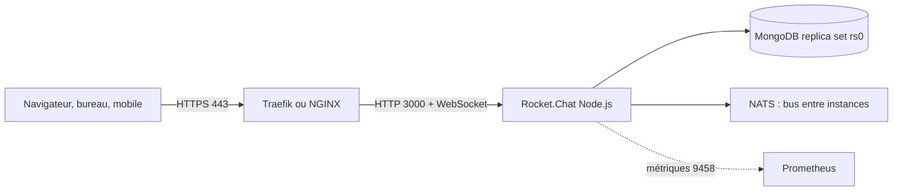

**Rocket.Chat** est une plateforme de messagerie d'équipe libre (MIT pour le cœur) : canaux publics et privés, messages directs, **discussions** et fils, partage de fichiers, appels vidéo (Jitsi ou Pexip intégrés), **Omnichannel** (chat sur site web, WhatsApp, courriel, file d'attente d'agents de support) et **applications** du Marketplace. Elle sait se **fédérer** avec [[11-matrix/01-synapse-ess|Matrix]]. Alternatives : [[12-mattermost/01-presentation-installation|Mattermost]], [[14-zulip/01-presentation-installation|Zulip]].

> [!NOTE]
> L'édition gratuite (« Starter » / communautaire) impose des limites (nombre d'utilisateurs actifs, d'applications et d'agents Omnichannel) ; au-delà, une licence Pro ou Enterprise est nécessaire. Vérifier les conditions de la version installée dans *Administration → Workspace → Subscription*.

## Architecture et ports



| Port | Rôle |
| --- | --- |
| 3000/tcp | Application (HTTP + WebSocket) |
| 27017/tcp | MongoDB (local uniquement) |
| 9458/tcp | Métriques Prometheus |
| 443/tcp | Accès des utilisateurs (reverse proxy) |

MongoDB doit tourner en **replica set** (même avec un seul nœud) : Rocket.Chat lit le journal des opérations (*oplog*) pour le temps réel. Prérequis : 2 vCPU, 4 Go de RAM, Docker ou Podman.

## Installation (Docker Compose officiel)

Méthode recommandée sous Linux ; sous **Windows** et **macOS**, la même pile tourne dans Docker Desktop (ou une VM Linux).

```bash
git clone --depth 1 https://github.com/RocketChat/rocketchat-compose.git && cd rocketchat-compose
cp .env.example .env
```

Dans `.env` :

```ini
DOMAIN=chat.corp.exemple.fr
ROOT_URL=https://chat.corp.exemple.fr
TRAEFIK_PROTOCOL=https
LETSENCRYPT_ENABLED=true
LETSENCRYPT_EMAIL=admin@corp.exemple.fr
GRAFANA_ADMIN_PASSWORD=MdpGrafana2026
```

```bash
docker compose -f compose.monitoring.yml -f compose.traefik.yml -f compose.database.yml -f compose.yml -f compose.nats.yml -f docker.yml up -d
docker compose -f compose.monitoring.yml -f compose.traefik.yml -f compose.database.yml -f compose.yml -f compose.nats.yml -f docker.yml logs -f rocketchat
```

La pile démarre Rocket.Chat, MongoDB (replica set `rs0`), NATS, Traefik (certificats Let's Encrypt) et Prometheus/Grafana. Derrière un reverse proxy existant, ne pas charger `compose.traefik.yml` et publier le port 3000 en local (`BIND_IP=127.0.0.1`).

Variables essentielles du conteneur : `ROOT_URL` (adresse publique exacte), `MONGO_URL` (`mongodb://mongodb:27017/rocketchat?replicaSet=rs0`), `PORT` (3000), `RELEASE` (version de l'image `registry.rocket.chat/rocketchat/rocket.chat`).

**Kubernetes** : chart Helm officiel `rocketchat` (dépôt *RocketChat/helm-charts*), avec MongoDB en replica set géré à part.

**Clients** : `winget install --id RocketChat.RocketChat -e` (Windows), `brew install --cask rocket-chat` (macOS), paquets .deb/.rpm/Snap (Linux), applications mobiles officielles.

## Premier démarrage

Ouvrir `https://chat.corp.exemple.fr` : l'assistant crée l'**administrateur**, renseigne l'organisation et propose d'enregistrer l'espace de travail auprès du cloud Rocket.Chat (nécessaire pour les notifications *push* mobiles et le Marketplace). Voir [[02-interface-graphique|interface graphique]].

<!-- CAPTURE: Assistant de configuration (administrateur et organisation) | _assets/rocketchat-assistant.png -->

## Reverse proxy NGINX (sans Traefik)

```nginx
server {
  listen 443 ssl http2;
  server_name chat.corp.exemple.fr;
  ssl_certificate     /etc/letsencrypt/live/chat.corp.exemple.fr/fullchain.pem;
  ssl_certificate_key /etc/letsencrypt/live/chat.corp.exemple.fr/privkey.pem;
  client_max_body_size 200M;
  location / {
    proxy_pass http://127.0.0.1:3000;
    proxy_http_version 1.1;
    proxy_set_header Upgrade $http_upgrade;
    proxy_set_header Connection "upgrade";
    proxy_set_header Host $host;
    proxy_set_header X-Real-IP $remote_addr;
    proxy_set_header X-Forwarded-For $proxy_add_x_forwarded_for;
    proxy_set_header X-Forwarded-Proto https;
  }
}
```

## Sécurité

- *Administration → Settings → Accounts* : désactiver l'inscription publique (*Registration Form: Disabled* ou *Secret URL*), imposer la **2FA** (TOTP ou courriel).
- Authentification d'entreprise : **LDAP/Active Directory**, **SAML**, **OAuth/OpenID** (Keycloak, Entra ID) dans *Settings*.
- Laisser MongoDB inaccessible depuis le réseau (`MONGODB_BIND_IP=127.0.0.1`) et activer l'authentification MongoDB si la base est partagée ([[03-mongodb/02-configuration-securite|MongoDB]]).
- Chiffrement de bout en bout disponible par salon (*E2E encryption*), au prix de la recherche côté serveur.

## Sauvegarde, mise à jour

```bash
# outils MongoDB (mongodb-database-tools) sur l'hôte ; la base écoute sur 127.0.0.1:27017
mongodump --uri "mongodb://127.0.0.1:27017/rocketchat?directConnection=true" --gzip --archive=/srv/sauvegardes/rocketchat-$(date +%F).archive.gz
mongorestore --uri "mongodb://127.0.0.1:27017/?directConnection=true" --gzip --drop --archive=/srv/sauvegardes/rocketchat-2026-11-02.archive.gz
```

Les fichiers envoyés sont stockés par défaut dans MongoDB (GridFS) : la sauvegarde les inclut. Pour de gros volumes, passer à un stockage **FileSystem** ou **S3** (*Settings → File Upload*).

Mise à jour : sauvegarder, changer `RELEASE` dans `.env` (une version majeure à la fois, en lisant les notes), puis relancer `docker compose … pull && docker compose … up -d`. Vérifier aussi la version de MongoDB prise en charge par la nouvelle release.

## API REST

```bash
curl -s https://chat.corp.exemple.fr/api/info
curl -s -X POST https://chat.corp.exemple.fr/api/v1/login -H 'Content-Type: application/json' -d '{"user": "admin", "password": "MdpAdmin2026"}' | jq '.data | {authToken, userId}'
curl -s https://chat.corp.exemple.fr/api/v1/users.list -H "X-Auth-Token: $JETON" -H "X-User-Id: $ID_UTILISATEUR" | jq '.users[].username'
```

`$JETON` et `$ID_UTILISATEUR` proviennent de la réponse du `login` (ou d'un **jeton d'accès personnel** créé dans *Profil → Personal Access Tokens*, conseillé pour les scripts).

## Dépannage

| Symptôme | Cause probable | Correction |
| --- | --- | --- |
| Le conteneur redémarre en boucle (« MongoNetworkError ») | Replica set non initialisé, MongoDB pas prêt | Journaux de `mongodb-init-container`, `rs.status()` |
| Messages non mis à jour en direct | WebSocket coupé par le proxy | En-têtes `Upgrade`/`Connection` |
| Liens et avatars cassés | `ROOT_URL` différent de l'adresse publique | Corriger `ROOT_URL`, *Settings → General → Site URL* |
| Pas de notifications push mobiles | Espace de travail non enregistré | *Administration → Workspace → Register* |
| Envoi de fichier refusé | Limite du proxy ou *Maximum File Upload Size* | `client_max_body_size`, réglage *File Upload* |

Commandes : [[90-aide-memoire|aide-mémoire]].
