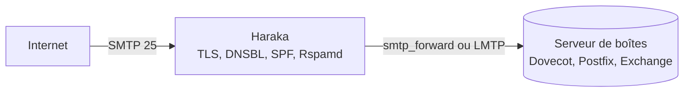

**Haraka** est un serveur SMTP écrit en **Node.js**, très performant grâce à son modèle asynchrone et entièrement piloté par des **greffons**. Il ne stocke pas de boîtes aux lettres : on l'utilise comme **filtre entrant** à fort volume devant Postfix, Dovecot ou Exchange, ou comme **relais sortant** avec signature DKIM et limitation de débit.



## Installation

```bash
sudo apt install nodejs npm build-essential
sudo npm install -g Haraka
sudo haraka -i /etc/haraka              # crée l'arborescence de configuration
sudo useradd -r -s /usr/sbin/nologin haraka
```

```ini /etc/systemd/system/haraka.service
[Unit]
Description=Haraka SMTP
After=network-online.target

[Service]
ExecStart=/usr/bin/haraka -c /etc/haraka
Restart=on-failure

[Install]
WantedBy=multi-user.target
```

Dans `config/smtp.ini`, indiquer `user=haraka` et `group=haraka` pour que Haraka abandonne les droits root après avoir ouvert le port 25.

## Configuration

| Fichier (`/etc/haraka/config/`) | Rôle |
| --- | --- |
| `smtp.ini` | Adresses et ports d'écoute (`listen=[::0]:25,[::0]:587`), nombre de processus, utilisateur |
| `me` | Nom d'hôte annoncé (doit correspondre au PTR) |
| `plugins` | **Liste ordonnée** des greffons actifs |
| `host_list` | Domaines acceptés en réception |
| `smtp_forward.ini` | Serveur de destination des messages acceptés |
| `tls.ini` + `tls_key.pem`, `tls_cert.pem` | Certificat TLS |

```text /etc/haraka/config/plugins
# Ordre = ordre d'exécution
tls
helo.checks
dns-list
spf
rcpt_to.in_host_list
data.headers
rspamd
dkim_sign
limit
queue/smtp_forward
```

```ini /etc/haraka/config/smtp_forward.ini
host=10.0.0.20
port=25
enable_tls=true
```

```ini /etc/haraka/config/dns-list.ini
zones=zen.spamhaus.org, bl.spamcop.net
```

## Greffons utiles

| Greffon | Rôle |
| --- | --- |
| `tls` | STARTTLS |
| `dns-list` | Listes noires DNS |
| `spf`, `dkim` (vérification), `dkim_sign` | Authentification des messages |
| `rspamd`, `spamassassin`, `clamd` | Anti-spam, antivirus |
| `auth/flat_file`, `auth/auth_proxy` | Authentification des clients en soumission (port 587) |
| `limit` | Limites de connexions et de débit |
| `queue/smtp_forward`, `queue/lmtp`, `queue/smtp_proxy` | Remise des messages acceptés |
| `access` | Listes blanches et noires (adresses, domaines) |

## Exploitation

```bash
journalctl -u haraka -f
swaks --to alice@exemple.fr --server mx.exemple.fr    # test d'envoi
```

Un greffon personnalisé est un module JavaScript dans `plugins/` exposant des fonctions `hook_*` (`hook_rcpt`, `hook_data_post`…) ; c'est ainsi qu'on ajoute une règle propre à l'organisation.

Voir aussi : [[02-postal|Postal]] et les pages Postfix et Rspamd du wiki. Commandes : [[90-aide-memoire|aide-mémoire]].
