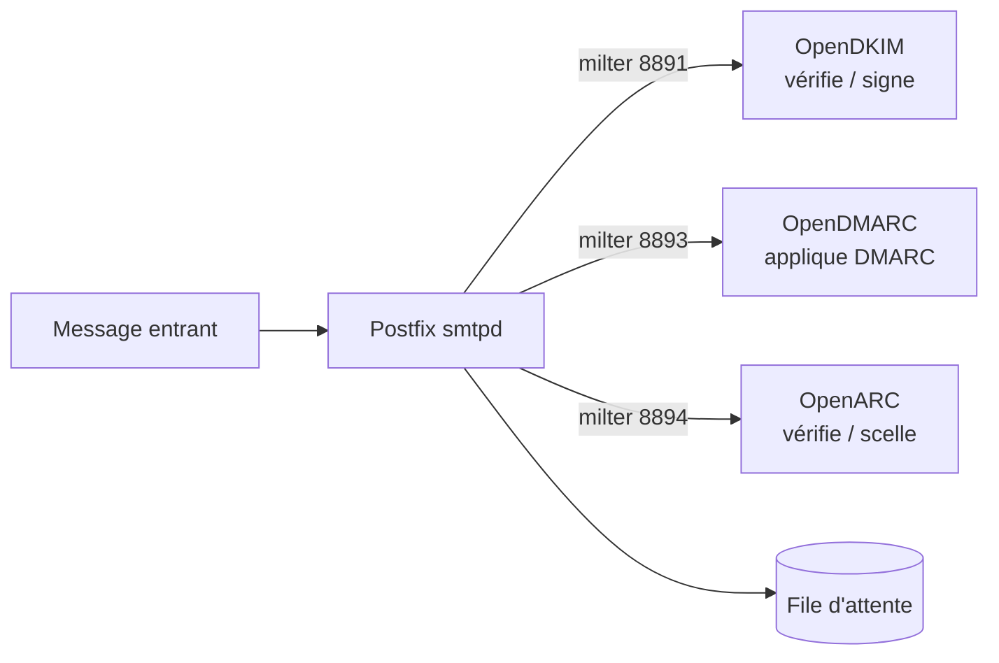

Les **milters** sont des filtres que Postfix appelle pendant la réception d'un message. OpenDKIM, OpenDMARC et OpenARC implémentent chacun un mécanisme d'authentification. Les notions (SPF, DKIM, DMARC, ARC, enregistrements DNS) sont expliquées dans la page [[01-postfix/06-spf-dkim-dmarc|SPF, DKIM et DMARC]] ; ici, la mise en œuvre détaillée.

> [!TIP]
> **Rspamd** regroupe signature DKIM et ARC, vérification SPF/DKIM/DMARC, rapports DMARC et anti-spam en un seul service (voir la page Rspamd du wiki). Les milters autonomes restent utiles sur un serveur existant ou minimaliste.



## OpenDKIM

```bash
sudo apt install opendkim opendkim-tools
sudo mkdir -p /etc/opendkim/keys/exemple.fr
sudo opendkim-genkey -b 2048 -d exemple.fr -s s2026 -D /etc/opendkim/keys/exemple.fr
sudo chown -R opendkim: /etc/opendkim && sudo chmod 700 /etc/opendkim/keys
sudo cat /etc/opendkim/keys/exemple.fr/s2026.txt     # enregistrement TXT s2026._domainkey à publier
```

```text /etc/opendkim.conf
Syslog                  yes
UMask                   007
UserID                  opendkim
Mode                    sv
Canonicalization        relaxed/simple
OversignHeaders         From
SignatureAlgorithm      rsa-sha256
KeyTable                refile:/etc/opendkim/key.table
SigningTable            refile:/etc/opendkim/signing.table
ExternalIgnoreList      refile:/etc/opendkim/trusted.hosts
InternalHosts           refile:/etc/opendkim/trusted.hosts
Socket                  inet:8891@localhost
PidFile                 /run/opendkim/opendkim.pid
```

```text /etc/opendkim/key.table
s2026._domainkey.exemple.fr   exemple.fr:s2026:/etc/opendkim/keys/exemple.fr/s2026.private
```

```text /etc/opendkim/signing.table
*@exemple.fr          s2026._domainkey.exemple.fr
```

```text /etc/opendkim/trusted.hosts
127.0.0.1
::1
10.0.0.0/8
```

```bash
sudo systemctl restart opendkim
sudo opendkim-testkey -d exemple.fr -s s2026 -vvv        # « key OK » attendu
```

**Rotation** : générer une clé avec un nouveau sélecteur (`s2027`), la publier, attendre la propagation DNS, basculer `key.table` et `signing.table`, puis retirer l'ancien enregistrement quelques jours plus tard.

## OpenDMARC

```bash
sudo apt install opendmarc
```

```text /etc/opendmarc.conf
AuthservID              mx.exemple.fr
TrustedAuthservIDs      mx.exemple.fr
Socket                  inet:8893@localhost
UserID                  opendmarc
IgnoreHosts             /etc/opendkim/trusted.hosts
IgnoreAuthenticatedClients true
RejectFailures          false
SPFSelfValidate         true
HistoryFile             /run/opendmarc/opendmarc.dat
Syslog                  true
```

- `Mode sv` : OpenDKIM signe (s) les messages sortants et vérifie (v) les messages entrants. `RejectFailures true` applique la politique `p=reject` des domaines expéditeurs ; `SPFSelfValidate` fait calculer SPF par OpenDMARC si aucun résultat n'est présent.
- OpenDMARC lit les résultats SPF et DKIM (en-têtes `Authentication-Results` d'OpenDKIM et de policyd-spf, ou son propre calcul) et en déduit le résultat **DMARC**.
- Commencer avec `RejectFailures false` : les échecs sont seulement signalés dans l'en-tête, le temps de vérifier qu'aucun message légitime n'est concerné.
- **Rapports agrégés** : le fichier d'historique s'importe dans une base MariaDB (`opendmarc-import`) et `opendmarc-reports` envoie les rapports aux domaines qui les demandent (tâche cron quotidienne).

## OpenARC

**ARC** préserve les résultats d'authentification quand un message traverse un intermédiaire qui le modifie (liste de diffusion, transfert, passerelle anti-spam).

```text /etc/openarc.conf
Domain          exemple.fr
Selector        s2026
KeyFile         /etc/opendkim/keys/exemple.fr/s2026.private
Mode            sv
Socket          inet:8894@localhost
AuthservID      mx.exemple.fr
Canonicalization relaxed/relaxed
SignHeaders     to,subject,message-id,date,from,mime-version,dkim-signature,arc-authentication-results
```

> [!WARNING]
> OpenARC n'a jamais dépassé le stade bêta et n'évolue plus guère. Pour ARC en production, préférer **Rspamd** (module `arc`).

## Brancher sur Postfix

```bash
sudo postconf -e "milter_default_action = accept"
sudo postconf -e "milter_protocol = 6"
sudo postconf -e "smtpd_milters = inet:localhost:8891, inet:localhost:8893, inet:localhost:8894"
sudo postconf -e "non_smtpd_milters = inet:localhost:8891"      # signer aussi les messages locaux (sendmail)
sudo systemctl reload postfix
```

L'ordre compte : **DKIM** avant **DMARC**, qui a besoin de son résultat. `milter_default_action = accept` évite de bloquer la messagerie si un milter est arrêté (au prix de messages non signés pendant la panne).

## Tester

```bash
swaks --to test@exemple.org --from alice@exemple.fr --server localhost
grep -E "opendkim|opendmarc" /var/log/mail.log | tail
```

Envoyer un message vers une boîte Gmail ou vers un service de test (mail-tester, `check-auth@verifier.port25.com`) et vérifier `dkim=pass`, `spf=pass`, `dmarc=pass` dans les en-têtes.

Voir aussi : [[02-policyd-spf-postgrey|policyd-spf et Postgrey]]. Commandes : [[90-aide-memoire|aide-mémoire]].
