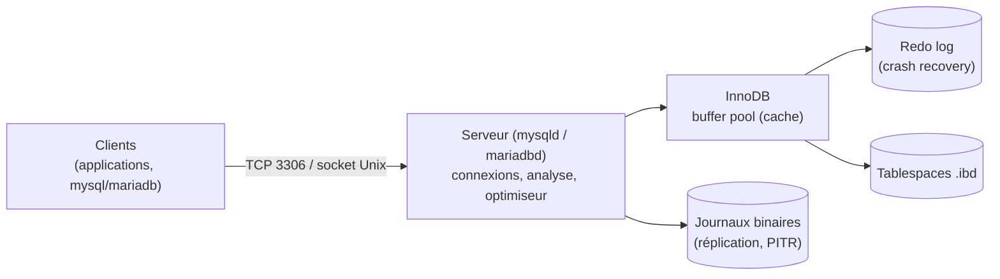

**MySQL** (Oracle) et **MariaDB** (fork créé en 2009 par l'auteur original de MySQL) sont les SGBD relationnels libres les plus déployés pour les applications web (WordPress, Nextcloud, GLPI, Zabbix, Centreon…). Ils partagent le protocole, le langage SQL de base, le moteur **InnoDB** et la plupart des outils ; ils ont toutefois **divergé** depuis MariaDB 10 / MySQL 8, et un remplacement de l'un par l'autre n'est plus transparent.

## Différences principales

| Sujet | MariaDB | MySQL |
| --- | --- | --- |
| Éditeur, licence | MariaDB Foundation / plc — GPLv2 (MaxScale sous BSL) | Oracle — GPLv2 (Community) + éditions Enterprise commerciales |
| **Haute disponibilité** | **Galera Cluster** intégré (multi-maître synchrone) | **Group Replication / InnoDB Cluster** (MySQL Shell, MySQL Router) |
| Réplication | GTID au format `domaine-serveur-séquence` | GTID au format `UUID:séquence` |
| Authentification par défaut | `mysql_native_password`, `unix_socket` pour root ; `ed25519`, PARSEC | `caching_sha2_password` ; `mysql_native_password` désactivé par défaut en 8.4 |
| Moteurs | InnoDB, Aria, ColumnStore, MyRocks, Spider, S3 | InnoDB (+ HeatWave en cloud) |
| JSON | Alias de `LONGTEXT` avec contrôle | Type binaire natif |
| Outils de sauvegarde physique | `mariadb-backup` (inclus) | Percona XtraBackup, MySQL Enterprise Backup, clone |
| Proxy / routage | MaxScale | MySQL Router ; ProxySQL pour les deux |
| Noms des commandes | `mariadb`, `mariadb-dump`, `mariadb-admin` (anciens noms `mysql*` dépréciés) | `mysql`, `mysqldump`, `mysqladmin`, `mysqlsh` |

## Versions

| Produit | Branches | Remarques |
| --- | --- | --- |
| MariaDB | 10.6, 10.11, 11.4, 11.8 (LTS) | 10.11 : Debian 12, Ubuntu 24.04 ; 11.8 : Debian 13 ; TLS actif par défaut depuis 11.4 |
| MySQL | 8.0 (fin de support avril 2026), **8.4 LTS**, 9.x (*Innovation*) | 8.0 : Ubuntu 24.04, RHEL 9 ; dépôt Oracle pour 8.4 |

Debian ne fournit pas MySQL Server (MariaDB à la place) : utiliser le dépôt APT d'Oracle.

## Architecture du serveur

| Élément | Rôle |
| --- | --- |
| **Buffer pool** | Cache des pages de données et d'index en mémoire : paramètre le plus important |
| **Redo log** | Journal des modifications : récupération après un arrêt brutal |
| Undo | Versions anciennes des lignes (MVCC, transactions) |
| **Binlog** | Journal des transactions validées : réplication, restauration à un instant donné |
| Tablespaces | Un fichier `.ibd` par table (`innodb_file_per_table`) |

## Ports

| Port | Usage |
| --- | --- |
| **3306** | Protocole client classique |
| 33060 | X Protocol (MySQL Shell, document store) |
| 33061 | Group Replication (MySQL) |
| 4567 (TCP/UDP), 4568, 4444 | Galera : réplication, IST, SST (MariaDB) |
| 6446 / 6447 | MySQL Router : lecture-écriture / lecture seule |

## Que choisir ?

| Situation | Recommandation |
| --- | --- |
| Application qui supporte les deux, distribution Debian | MariaDB (paquets de la distribution) |
| Application certifiée MySQL 8 (fonctions JSON, CTE spécifiques, éditeur) | MySQL 8.4 LTS |
| Cluster multi-maître synchrone simple | MariaDB Galera |
| Cluster géré par un outil intégré (Shell, Router) | MySQL InnoDB Cluster |
| Besoin de fonctions avancées (types, extensions, requêtes complexes) | Envisager [[02-postgresql/01-presentation\|PostgreSQL]] |

## Suite du parcours

1. [[02-installation|Installation (Linux, Windows, macOS, Docker)]]
2. [[03-configuration-base|Configuration : my.cnf, InnoDB, journaux]]
3. [[04-utilisateurs-securite|Comptes, privilèges et sécurité]]
4. [[05-sauvegarde-restauration|Sauvegarde et restauration]]
5. [[06-replication|Réplication asynchrone et semi-synchrone]]
6. [[07-haute-disponibilite|Haute disponibilité : Galera, InnoDB Cluster, proxys]]
7. [[08-performances-exploitation-depannage|Performances, exploitation et dépannage]]
