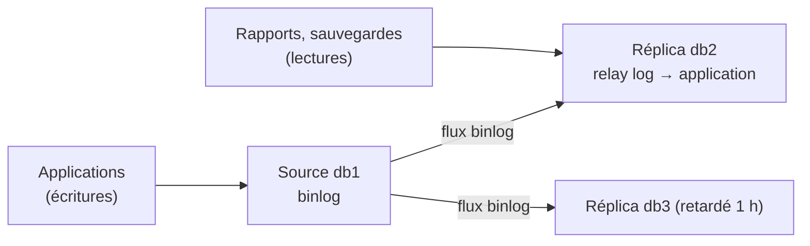

## Principe



| Usage | Bénéfice |
| --- | --- |
| Lecture répartie | Rapports et requêtes lourdes sur un réplica |
| Sauvegardes | Réalisées sur un réplica sans charger la source |
| Reprise après sinistre | Réplica dans un autre site, promotion manuelle ou par un outil |
| Réplica retardé | Filet de sécurité contre une erreur humaine (`DROP` rejoué une heure plus tard) |

La réplication asynchrone **n'est pas** une haute disponibilité automatique : voir [[07-haute-disponibilite]].

## Configuration commune

```mycnf Source (db1)
[mysqld]
server_id                = 11
log_bin                  = binlog
binlog_format            = ROW
# MySQL uniquement :
gtid_mode                = ON
enforce_gtid_consistency = ON
```

```mycnf Réplica (db2)
[mysqld]
server_id                = 12
log_bin                  = binlog            # utile pour chaîner ou promouvoir
relay_log                = relay-bin
read_only                = ON
super_read_only          = ON                # MySQL (MariaDB : read_only suffit, sauf privilège READ_ONLY ADMIN)
# MySQL uniquement :
gtid_mode                = ON
enforce_gtid_consistency = ON
```

```sql
-- Sur la source : compte de réplication
CREATE USER 'repl'@'10.0.30.%' IDENTIFIED BY 'MotDePasseRepl' REQUIRE SSL;
GRANT REPLICATION SLAVE ON *.* TO 'repl'@'10.0.30.%';
```

## Initialiser le réplica

| Méthode | Commande |
| --- | --- |
| Sauvegarde physique | `mariadb-backup --backup --slave-info` / `xtrabackup --backup` puis restauration sur le réplica ; position GTID dans `xtrabackup_binlog_info` |
| Plugin clone (MySQL) | `CLONE INSTANCE FROM 'clone'@'db1':3306 IDENTIFIED BY '…';` |
| Dump logique | `mariadb-dump --master-data=1 --gtid` / `mysqldump --source-data=1` (petites bases) |

## Démarrer la réplication

### MySQL 8 (≥ 8.0.23)

```sql
CHANGE REPLICATION SOURCE TO
  SOURCE_HOST = 'db1.corp.exemple.fr',
  SOURCE_USER = 'repl',
  SOURCE_PASSWORD = 'MotDePasseRepl',
  SOURCE_AUTO_POSITION = 1,
  SOURCE_SSL = 1;
START REPLICA;
SHOW REPLICA STATUS\G
```

### MariaDB

```sql
-- Après restauration d'une sauvegarde : positionner le GTID relevé
SET GLOBAL gtid_slave_pos = '0-11-48213';
CHANGE MASTER TO
  MASTER_HOST = 'db1.corp.exemple.fr',
  MASTER_USER = 'repl',
  MASTER_PASSWORD = 'MotDePasseRepl',
  MASTER_USE_GTID = slave_pos,
  MASTER_SSL = 1;
START SLAVE;              -- MariaDB ≥ 10.5 accepte aussi START REPLICA
SHOW SLAVE STATUS\G
```

## Surveiller

| Champ (`SHOW REPLICA STATUS`) | Attendu |
| --- | --- |
| `Replica_IO_Running` / `Slave_IO_Running` | `Yes` (réception des binlogs) |
| `Replica_SQL_Running` / `Slave_SQL_Running` | `Yes` (application) |
| `Seconds_Behind_Source` / `Seconds_Behind_Master` | Proche de 0 |
| `Last_IO_Error`, `Last_SQL_Error` | Vides |
| `Retrieved_Gtid_Set` / `Executed_Gtid_Set` | Progression |

Alertez sur l'arrêt d'un des deux processus et sur un retard supérieur à quelques minutes. `pt-heartbeat` (Percona Toolkit) mesure le retard réel plus précisément.

## Semi-synchrone

La source attend qu'au moins un réplica ait **reçu** la transaction avant de confirmer le `COMMIT` : pas de perte de transaction validée en cas de bascule.

```sql
-- MariaDB (intégré)
SET GLOBAL rpl_semi_sync_master_enabled = ON;      -- sur la source
SET GLOBAL rpl_semi_sync_slave_enabled = ON;       -- sur le réplica (puis STOP/START SLAVE IO_THREAD)
-- MySQL (greffons)
INSTALL PLUGIN rpl_semi_sync_source SONAME 'semisync_source.so';
SET PERSIST rpl_semi_sync_source_enabled = ON;
SET PERSIST rpl_semi_sync_source_timeout = 1000;    -- repli en asynchrone après 1 s sans accusé
```

## Réplica retardé et filtres

```sql
CHANGE REPLICATION SOURCE TO SOURCE_DELAY = 3600;     -- MySQL
CHANGE MASTER TO MASTER_DELAY = 3600;                 -- MariaDB
```

```mycnf
[mysqld]
replicate-do-db         = app            # ne répliquer que certaines bases (à manier avec précaution en ROW)
replicate-ignore-table  = app.journal_temporaire
```

## Corriger une erreur de réplication

| Erreur | Cause | Réaction |
| --- | --- | --- |
| `1062 Duplicate entry` | Écriture directe sur le réplica, divergence | Identifier l'origine ; la donnée du réplica est **suspecte** |
| `1032 Can't find record` | Ligne absente sur le réplica | Idem |
| `Got fatal error 1236 … could not find first log file` | Binlogs purgés sur la source avant lecture | Réinitialiser le réplica depuis une nouvelle sauvegarde |
| `Access denied for user 'repl'` | Compte, mot de passe, TLS | Vérifier `REQUIRE SSL`, `SOURCE_SSL` |

```sql
-- Ignorer UNE transaction (dernier recours, en connaissance de cause)
-- MySQL (GTID) : injecter une transaction vide avec le GTID fautif
STOP REPLICA;
SET GTID_NEXT = '3e11fa47-71ca-11e1-9e33-c80aa9429562:1234';
BEGIN; COMMIT;
SET GTID_NEXT = 'AUTOMATIC';
START REPLICA;
-- MariaDB
STOP SLAVE; SET GLOBAL sql_slave_skip_counter = 1; START SLAVE;
```

Après une erreur, vérifiez la cohérence avec `pt-table-checksum` / `pt-table-sync` ; en cas de doute, **reconstruisez** le réplica.
