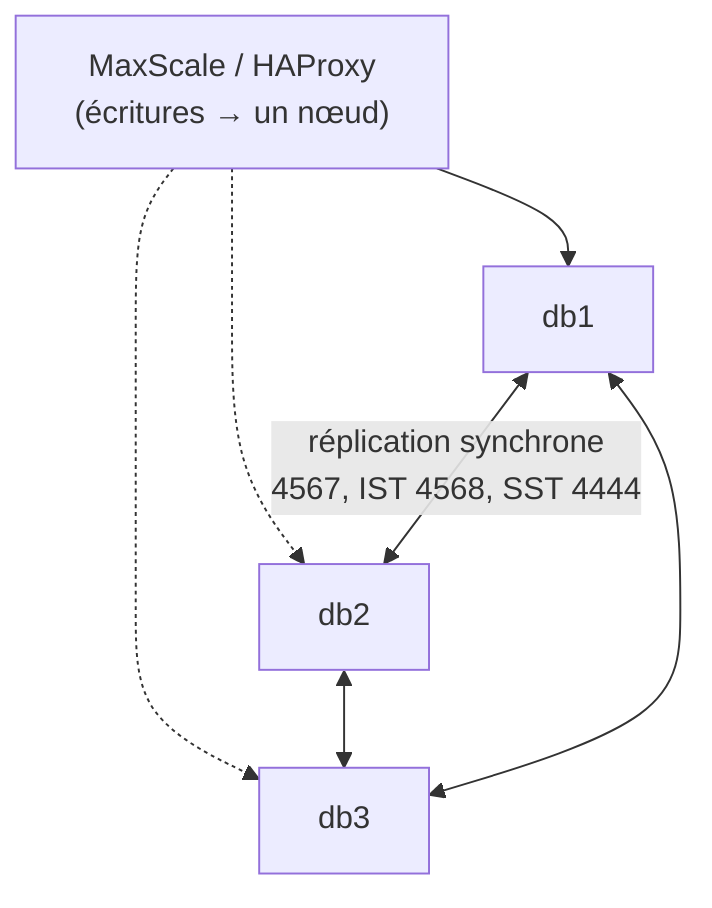

## Panorama

| Architecture | Produit | Écritures | Bascule | Perte de données à la bascule |
| --- | --- | --- | --- | --- |
| Source/réplica + outil de bascule (Orchestrator, MaxScale) | Les deux | Un nœud | Automatique (outil) | Possible en asynchrone, nulle en semi-synchrone |
| **Galera Cluster** | MariaDB (inclus), Percona XtraDB Cluster | Tous les nœuds (en pratique : un seul) | Immédiate | Aucune (réplication synchrone par certification) |
| **InnoDB Cluster** (Group Replication) | MySQL | Un nœud (mode *single-primary*) | Automatique | Aucune (consensus) |

Toutes ces architectures demandent **au moins trois nœuds** (ou deux + un arbitre) pour éviter le *split-brain*.

## MariaDB Galera Cluster



```mycnf /etc/mysql/mariadb.conf.d/60-galera.cnf (db1)
[galera]
wsrep_on                 = ON
wsrep_provider           = /usr/lib/galera/libgalera_smm.so
wsrep_cluster_name       = "cluster-prod"
wsrep_cluster_address    = "gcomm://10.0.30.11,10.0.30.12,10.0.30.13"
wsrep_node_address       = 10.0.30.11
wsrep_node_name          = db1
wsrep_sst_method         = mariabackup
wsrep_sst_auth           = sst:MotDePasseSST
binlog_format            = ROW
default_storage_engine   = InnoDB
innodb_autoinc_lock_mode = 2
bind-address             = 0.0.0.0
```

```bash
sudo apt install mariadb-server galera-4 mariadb-backup
# Premier nœud uniquement : amorcer le cluster
sudo galera_new_cluster
# Autres nœuds : démarrage normal (synchronisation complète SST depuis un donneur)
sudo systemctl start mariadb
```

```sql
-- Compte utilisé pour le transfert d'état (SST)
CREATE USER 'sst'@'localhost' IDENTIFIED BY 'MotDePasseSST';
GRANT RELOAD, PROCESS, LOCK TABLES, BINLOG MONITOR ON *.* TO 'sst'@'localhost';

SHOW STATUS LIKE 'wsrep_cluster_size';           -- 3
SHOW STATUS LIKE 'wsrep_cluster_status';         -- Primary
SHOW STATUS LIKE 'wsrep_local_state_comment';    -- Synced
SHOW STATUS LIKE 'wsrep_ready';                  -- ON
```

### Redémarrer après un arrêt complet

1. Sur chaque nœud, lire `/var/lib/mysql/grastate.dat` (`seqno`) ou exécuter `galera_recovery`.
2. Sur le nœud ayant le **seqno le plus élevé**, positionner `safe_to_bootstrap: 1`, puis `galera_new_cluster`.
3. Démarrer les autres nœuds normalement.

> [!WARNING]
> Amorcer (`galera_new_cluster`) un nœud qui n'a pas les dernières transactions fait **perdre** celles-ci, et amorcer deux nœuds crée deux clusters divergents.

### Arbitre (garbd)

Avec deux nœuds de données dans deux sites, ajoutez un **arbitre** dans un troisième site pour garder le quorum : `garbd --group=cluster-prod --address="gcomm://10.0.30.11,10.0.40.11"`.

### Limites de Galera

| Limite | Conséquence |
| --- | --- |
| InnoDB uniquement | Pas de MyISAM/Aria répliqué |
| Clé primaire obligatoire sur chaque table | Sinon performances et cohérence dégradées |
| Conflits de certification | Écritures simultanées sur la même ligne via deux nœuds → `Deadlock` au `COMMIT` : écrire sur **un seul nœud** |
| Grosses transactions | Toutes les transactions sont répliquées avant validation : découper les traitements massifs |
| Latence | Chaque `COMMIT` attend le réseau : éviter les liens WAN lents entre nœuds |

## MySQL InnoDB Cluster

```bash
# Sur chaque serveur : préparer l'instance (MySQL Shell)
mysqlsh --uri admin@db1:3306 -- dba configure-instance
```

```javascript
// mysqlsh admin@db1:3306
var cluster = dba.createCluster('prod');
cluster.addInstance('admin@db2:3306', {recoveryMethod: 'clone'});
cluster.addInstance('admin@db3:3306', {recoveryMethod: 'clone'});
cluster.status();
cluster.setPrimaryInstance('admin@db2:3306');      // bascule planifiée
```

```bash
# MySQL Router sur chaque serveur d'application
sudo mysqlrouter --bootstrap admin@db1:3306 --user=mysqlrouter --conf-use-sockets
sudo systemctl enable --now mysqlrouter
# Applications : 127.0.0.1:6446 (lecture-écriture), 6447 (lecture seule)
```

| Composant | Rôle |
| --- | --- |
| Group Replication | Consensus (Paxos) entre les membres, élection du primaire |
| MySQL Shell (AdminAPI) | Création, ajout de membres, état, bascule |
| MySQL Router | Dirige les connexions vers le primaire / les secondaires |
| ClusterSet | Cluster de secours dans un autre site (réplication asynchrone entre clusters) |

## Proxys et répartition

| Outil | Points forts |
| --- | --- |
| **MaxScale** (MariaDB) | Séparation lecture/écriture, surveillance et **bascule automatique** (`mariadbmon`), Galera ; licence BSL au-delà de certains usages |
| **ProxySQL** | Les deux produits ; règles de routage des requêtes, pool de connexions, cache, bascule |
| **HAProxy** + keepalived | Simple répartiteur TCP avec contrôle de santé ; voir [[01-haproxy/01-presentation\|HAProxy]] |

```haproxy Extrait HAProxy pour Galera (écritures sur un seul nœud)
listen galera-ecritures
    bind 10.0.30.10:3306
    mode tcp
    option mysql-check user haproxy_check
    server db1 10.0.30.11:3306 check
    server db2 10.0.30.12:3306 check backup
    server db3 10.0.30.13:3306 check backup
```

Pour Galera, un contrôle plus fin (`clustercheck` exposé en HTTP, vérifiant `wsrep_local_state = 4`) évite d'envoyer du trafic vers un nœud en cours de synchronisation.
