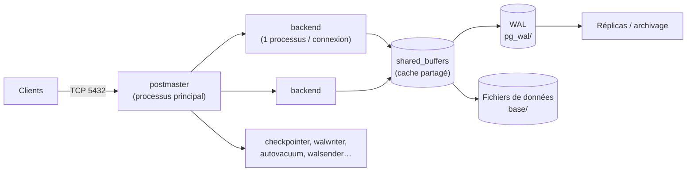

**PostgreSQL** est le SGBD relationnel libre le plus avancé : très conforme au standard SQL, transactionnel jusque dans le DDL, extensible (types, index, langages, extensions), robuste. Il est aujourd'hui le choix par défaut de nombreux logiciels d'infrastructure (GitLab, Netbox, Keycloak, Zabbix, Odoo, Mattermost…).

## Points forts

| Domaine | Exemples |
| --- | --- |
| SQL avancé | CTE récursives, fonctions de fenêtrage, `MERGE`, `JSONB` indexé, types tableaux et plages |
| Index | B-tree, Hash, GIN (texte intégral, JSONB), GiST, SP-GiST, BRIN (très grandes tables triées) |
| Extensions | **PostGIS** (géographie), **TimescaleDB** (séries temporelles), **pgvector** (vecteurs/IA), `pg_stat_statements`, `pgaudit`, `pg_partman` |
| Réplication | Physique (streaming) et **logique** (publication/abonnement) |
| Sécurité | Rôles, privilèges fins, **Row Level Security**, authentification SCRAM, Kerberos, LDAP, certificats |

## Architecture

| Notion | Description |
| --- | --- |
| **Instance** (*cluster*) | Un serveur PostgreSQL : un répertoire de données, un port, plusieurs bases |
| **Base** | Isolée des autres (pas de requête inter-bases directe) |
| **Schéma** | Espace de noms dans une base (`public` par défaut) |
| **Rôle** | Utilisateur ou groupe (même objet) |
| **WAL** | Journal des écritures : durabilité, réplication, restauration à un instant donné |
| **MVCC** | Chaque modification crée une nouvelle version de ligne ; les lecteurs ne bloquent pas les écrivains |
| **VACUUM** | Nettoie les versions mortes et prévient le rebouclage des identifiants de transaction (géré par l'*autovacuum*) |

> [!NOTE]
> Un processus par connexion : quelques centaines de connexions actives au maximum. Au-delà, utilisez un **pooler** (PgBouncer) — voir [[06-replication-haute-disponibilite]].

## Versions

Une version majeure par an (septembre), maintenue **5 ans**. Les mises à jour **mineures** (correctifs) sont binaire-compatibles ; changer de version majeure nécessite `pg_upgrade` ou une migration logique.

| Version | Distribution (exemples) |
| --- | --- |
| 13 | RHEL 9 (flux par défaut) — fin de support novembre 2025 |
| 15 | Debian 12 |
| 16 | Ubuntu 24.04 |
| 17 | Debian 13 ; dépôts PGDG |
| 18 | Dépôts PGDG (septembre 2025) |

Les dépôts communautaires **PGDG** (apt.postgresql.org, yum.postgresql.org) fournissent toutes les versions supportées pour chaque distribution.

## Écosystème

| Besoin | Outils |
| --- | --- |
| Administration graphique | pgAdmin 4, DBeaver |
| Sauvegarde | `pg_dump`, `pg_basebackup`, **pgBackRest**, Barman, WAL-G |
| Haute disponibilité | **Patroni** (+ etcd), repmgr, pg_auto_failover |
| Pool de connexions | **PgBouncer**, Pgpool-II |
| Supervision | `pg_stat_statements`, postgres_exporter, pgwatch, check_postgres |

## Suite du parcours

1. [[02-installation|Installation (Linux, Windows, macOS, Docker)]]
2. [[03-configuration-acces|Configuration et contrôle d'accès (postgresql.conf, pg_hba.conf, TLS)]]
3. [[04-roles-privileges-securite|Rôles, privilèges et sécurité]]
4. [[05-sauvegarde-pitr|Sauvegarde et restauration à un instant donné]]
5. [[06-replication-haute-disponibilite|Réplication, haute disponibilité et pool de connexions]]
6. [[07-performances-maintenance|Performances et maintenance (VACUUM, index, EXPLAIN)]]
7. [[08-exploitation-depannage|Exploitation, mises à niveau et dépannage]]
