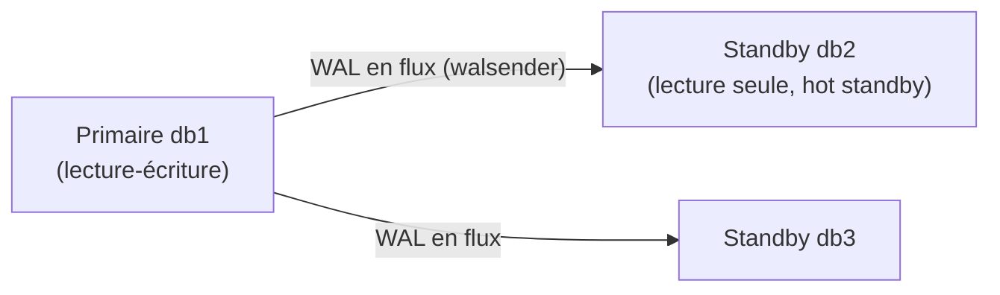
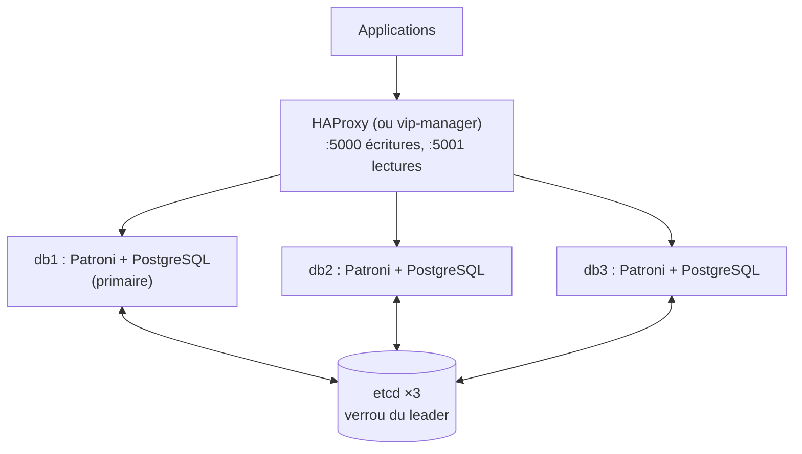

## Réplication physique en flux



### Sur le primaire

```pgconf
wal_level = replica
max_wal_senders = 10
max_replication_slots = 10
wal_keep_size = 1GB
hot_standby = on
```

```sql
CREATE ROLE replicateur WITH REPLICATION LOGIN PASSWORD 'MotDePasseRepl';
```

```pghba
hostssl replication replicateur 10.0.30.22/32 scram-sha-256
hostssl replication replicateur 10.0.30.23/32 scram-sha-256
```

### Sur le standby

```bash
sudo systemctl stop postgresql@17-main
sudo -u postgres rm -rf /var/lib/postgresql/17/main/*
sudo -u postgres pg_basebackup -h db1.corp.exemple.fr -U replicateur -D /var/lib/postgresql/17/main \
     -X stream -C -S slot_db2 -R -P
sudo systemctl start postgresql@17-main
```

`-R` écrit `standby.signal` et `primary_conninfo` ; `-C -S` crée un **slot de réplication** qui garantit que le primaire conserve les WAL nécessaires au standby.

### Vérifier

```sql
-- Primaire
SELECT client_addr, state, sync_state, write_lag, replay_lag FROM pg_stat_replication;
SELECT slot_name, active, pg_size_pretty(pg_wal_lsn_diff(pg_current_wal_lsn(), restart_lsn)) AS wal_retenu
FROM pg_replication_slots;
-- Standby
SELECT pg_is_in_recovery(), pg_last_wal_replay_lsn(), now() - pg_last_xact_replay_timestamp() AS retard;
```

> [!WARNING]
> Un **slot inactif** (standby arrêté ou supprimé) fait conserver les WAL indéfiniment sur le primaire jusqu'à **remplir le disque**. Supprimez les slots inutiles (`SELECT pg_drop_replication_slot('slot_db2');`) et limitez avec `max_slot_wal_keep_size`.

### Réplication synchrone

```pgconf
synchronous_standby_names = 'ANY 1 (db2, db3)'      # au moins un des deux confirme
synchronous_commit = on                              # remote_apply : lecture immédiate sur le standby
```

Chaque `COMMIT` attend la confirmation d'un standby : aucune perte de transaction validée, au prix de la latence. Avec un seul standby synchrone, sa panne **bloque** les écritures.

### Promotion manuelle

```bash
sudo -u postgres psql -c "SELECT pg_promote();"     # ou pg_ctlcluster 17 main promote
```

L'ancien primaire doit être reconstruit (ou resynchronisé avec `pg_rewind`) avant de redevenir standby.

## Réplication logique

Réplique les **modifications de tables choisies** (et non l'instance entière), entre versions majeures différentes :

```sql
-- Source (wal_level = logical)
CREATE PUBLICATION pub_app FOR TABLES IN SCHEMA app;
-- Cible (schéma créé au préalable, ex. pg_dump --schema-only)
CREATE SUBSCRIPTION sub_app CONNECTION 'host=db1 dbname=app user=replicateur password=…' PUBLICATION pub_app;
SELECT * FROM pg_stat_subscription;
```

Usages : **mise à niveau majeure** quasi sans interruption, consolidation de bases, alimentation d'un entrepôt de données. Les séquences et le DDL ne sont pas répliqués.

## Haute disponibilité avec Patroni

**Patroni** pilote PostgreSQL sur chaque nœud et utilise un magasin de consensus (**etcd**, Consul, ZooKeeper) pour élire le primaire et basculer automatiquement.



```yaml /etc/patroni/patroni.yml (db1, extrait)
scope: pg-prod
name: db1
restapi:
  listen: 10.0.30.21:8008
  connect_address: 10.0.30.21:8008
etcd3:
  hosts: 10.0.30.31:2379,10.0.30.32:2379,10.0.30.33:2379
bootstrap:
  dcs:
    ttl: 30
    loop_wait: 10
    maximum_lag_on_failover: 1048576
    postgresql:
      use_pg_rewind: true
      parameters:
        wal_level: replica
        hot_standby: "on"
        max_wal_senders: 10
        max_replication_slots: 10
postgresql:
  listen: 10.0.30.21:5432
  connect_address: 10.0.30.21:5432
  data_dir: /var/lib/postgresql/17/main
  bin_dir: /usr/lib/postgresql/17/bin
  authentication:
    replication:
      username: replicateur
      password: MotDePasseRepl
    superuser:
      username: postgres
      password: MotDePasseSuper
  pg_hba:
    - hostssl replication replicateur 10.0.30.0/24 scram-sha-256
    - hostssl all all 10.0.20.0/24 scram-sha-256
```

```bash
patronictl -c /etc/patroni/patroni.yml list
patronictl -c /etc/patroni/patroni.yml switchover --leader db1 --candidate db2   # bascule planifiée
patronictl -c /etc/patroni/patroni.yml edit-config                                  # paramètres communs
```

```haproxy HAProxy : diriger vers le primaire via l'API REST de Patroni
listen postgres-ecritures
    bind *:5000
    option httpchk GET /primary
    http-check expect status 200
    default-server inter 3s fall 3 rise 2 on-marked-down shutdown-sessions
    server db1 10.0.30.21:5432 maxconn 200 check port 8008
    server db2 10.0.30.22:5432 maxconn 200 check port 8008
    server db3 10.0.30.23:5432 maxconn 200 check port 8008
```

| Alternative | Remarque |
| --- | --- |
| **repmgr** | Gestion de la réplication et bascule (démon `repmgrd`), sans magasin externe |
| pg_auto_failover | Nœud « moniteur » qui orchestre la bascule |
| Opérateurs Kubernetes | CloudNativePG, Crunchy, Zalando (Patroni) |

## Pool de connexions : PgBouncer

```ini /etc/pgbouncer/pgbouncer.ini
[databases]
app = host=127.0.0.1 port=5432 dbname=app

[pgbouncer]
listen_addr = 10.0.30.21
listen_port = 6432
auth_type = scram-sha-256
auth_file = /etc/pgbouncer/userlist.txt
pool_mode = transaction
max_client_conn = 2000
default_pool_size = 40
```

| `pool_mode` | Usage |
| --- | --- |
| `session` | Connexion serveur dédiée pendant toute la session client (compatible avec tout) |
| **`transaction`** | Connexion serveur rendue après chaque transaction : des milliers de clients sur quelques dizaines de connexions (attention aux fonctions de session : `SET`, verrous consultatifs, requêtes préparées selon la version) |
| `statement` | Par requête (pas de transactions multi-instructions) |
