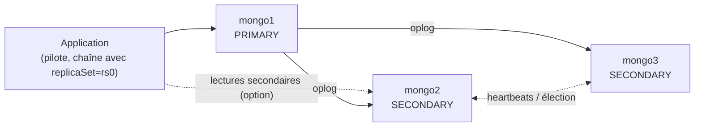
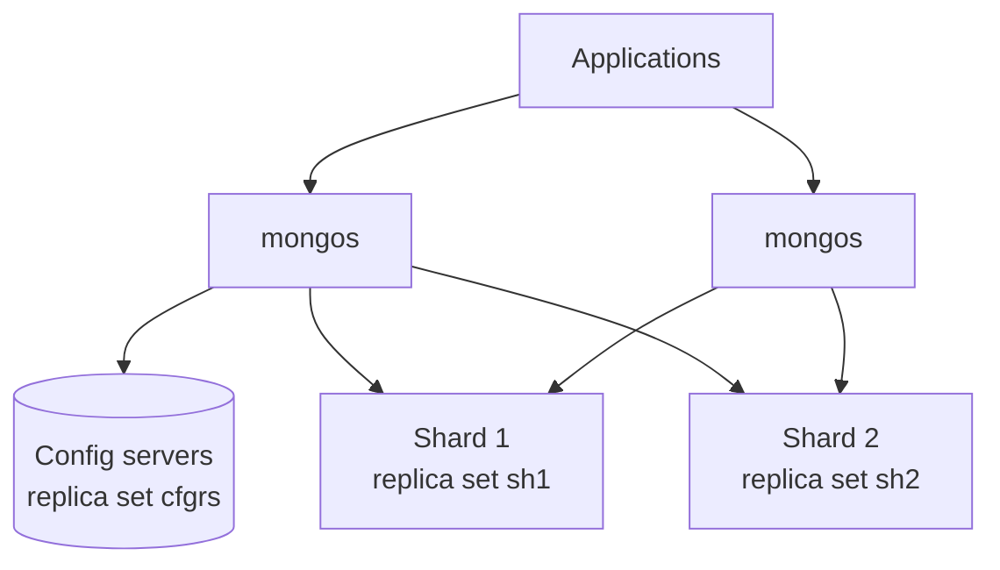

## Replica set



Un replica set compte un **nombre impair** de membres votants (3 ou 5) ; la majorité est nécessaire pour élire un primaire et accepter les écritures `majority`.

### Authentification interne

```bash
openssl rand -base64 756 | sudo tee /etc/mongodb/keyfile >/dev/null
sudo chmod 400 /etc/mongodb/keyfile && sudo chown mongodb:mongodb /etc/mongodb/keyfile
# Copier le même fichier sur tous les membres (ou utiliser des certificats x.509 : clusterAuthMode: x509)
```

```yaml /etc/mongod.conf (tous les membres)
replication:
  replSetName: rs0
security:
  authorization: enabled
  keyFile: /etc/mongodb/keyfile
net:
  bindIp: 127.0.0.1,10.0.30.41
```

### Initialiser

```javascript
// mongosh sur mongo1 (exception localhost si aucun utilisateur n'existe encore)
rs.initiate({
  _id: "rs0",
  members: [
    { _id: 0, host: "mongo1.corp.exemple.fr:27017", priority: 2 },
    { _id: 1, host: "mongo2.corp.exemple.fr:27017", priority: 1 },
    { _id: 2, host: "mongo3.corp.exemple.fr:27017", priority: 1 }
  ]
})
rs.status()
rs.conf()
rs.stepDown()                          // bascule volontaire du primaire
rs.add("mongo4.corp.exemple.fr:27017")
```

### Types de membres

| Membre | Configuration | Usage |
| --- | --- | --- |
| Prioritaire | `priority: 2` | Préféré comme primaire (site principal) |
| Non éligible | `priority: 0` | Site de secours, ne devient jamais primaire |
| **Caché** | `priority: 0, hidden: true` | Sauvegardes, analyses : invisible des applications |
| **Retardé** | `priority: 0, hidden: true, secondaryDelaySecs: 3600` | Filet contre les erreurs humaines |
| Arbitre | `rs.addArb(…)` | Vote sans données : **déconseillé** (affaiblit les écritures `majority`) |

### Chaîne de connexion, écritures et lectures

```text
mongodb://app_inventaire:…@mongo1.corp.exemple.fr,mongo2.corp.exemple.fr,mongo3.corp.exemple.fr/inventaire?replicaSet=rs0&tls=true&authSource=inventaire&w=majority&readPreference=primaryPreferred
```

| Paramètre | Valeurs |
| --- | --- |
| *Write concern* `w` | `1` (primaire seul), **`majority`** (défaut récent : majorité des membres, aucune perte à la bascule) |
| *Read preference* | `primary` (défaut), `primaryPreferred`, `secondary`, `secondaryPreferred`, `nearest` |
| *Read concern* | `local`, `majority`, `linearizable` |

Les pilotes découvrent automatiquement la topologie et suivent le nouveau primaire après une élection (quelques secondes).

## Sharding



| Composant | Configuration |
| --- | --- |
| Config servers | Replica set avec `sharding.clusterRole: configsvr` |
| Shards | Replica sets avec `sharding.clusterRole: shardsvr` |
| `mongos` | `sharding.configDB: cfgrs/cfg1:27019,cfg2:27019,cfg3:27019` |

```javascript
// mongosh connecté à un mongos
sh.addShard("sh1/sh1-a.corp.exemple.fr:27018,sh1-b.corp.exemple.fr:27018,sh1-c.corp.exemple.fr:27018")
sh.addShard("sh2/sh2-a.corp.exemple.fr:27018,sh2-b.corp.exemple.fr:27018,sh2-c.corp.exemple.fr:27018")
sh.enableSharding("telemetrie")
sh.shardCollection("telemetrie.mesures", { equipementId: "hashed" })
sh.status()
db.mesures.getShardDistribution()
```

### Clé de partition

| Critère | Explication |
| --- | --- |
| Cardinalité élevée | Beaucoup de valeurs distinctes pour répartir les données |
| Fréquence équilibrée | Pas de valeur « chaude » qui concentre les écritures |
| Pas de croissance monotone seule | Un horodatage seul envoie toutes les insertions vers le même shard (utiliser `hashed` ou une clé composée) |
| Alignée sur les requêtes | Les requêtes contenant la clé ciblent un seul shard ; sinon diffusion à tous |

Depuis MongoDB 5.0, la clé peut être modifiée (`reshardCollection`), mais l'opération est lourde : choisissez-la soigneusement. Le **balanceur** déplace automatiquement les plages de données entre shards (`sh.getBalancerState()`, fenêtres de fonctionnement configurables).
