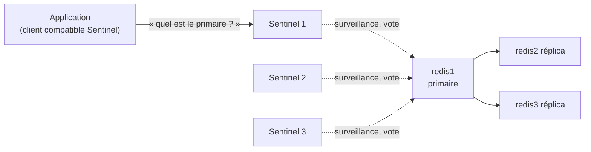

## Choisir une architecture

| Architecture | Données | Bascule automatique | Usage |
| --- | --- | --- | --- |
| Instance seule (+ persistance) | Tient dans un serveur | Non | Cache, développement |
| Primaire + réplicas | Tient dans un serveur | Non (manuelle) | Lectures réparties, copie chaude |
| **Sentinel** | Tient dans un serveur | **Oui** | Haute disponibilité classique |
| **Cluster** | Réparties sur plusieurs primaires | **Oui** | Gros volumes, débit d'écriture élevé |

## Réplication

```redis Réplica (redis2) — redis.conf
replicaof 10.0.30.51 6379
masteruser replication
masterauth MotDePasseRepl
replica-read-only yes
repl-diskless-sync yes
```

```bash
redis-cli -h redis2 --user admin --askpass INFO replication
# role:slave, master_link_status:up, master_last_io_seconds_ago, slave_repl_offset
redis-cli -h redis1 --user admin --askpass INFO replication      # connected_slaves, offsets
```

La réplication est **asynchrone** : des écritures acquittées peuvent être perdues lors d'une bascule. `WAIT 1 100` (attendre qu'un réplica ait reçu les écritures) réduit ce risque au cas par cas ; `min-replicas-to-write` refuse les écritures si trop peu de réplicas sont connectés.

## Sentinel



```redis /etc/redis/sentinel.conf (sur 3 serveurs, port 26379)
port 26379
sentinel monitor principal 10.0.30.51 6379 2
sentinel auth-user principal replication
sentinel auth-pass principal MotDePasseRepl
sentinel down-after-milliseconds principal 5000
sentinel failover-timeout principal 60000
sentinel parallel-syncs principal 1
```

| Paramètre | Rôle |
| --- | --- |
| `monitor <nom> <ip> <port> <quorum>` | Primaire surveillé ; `quorum` = nombre de Sentinels qui doivent constater la panne |
| `down-after-milliseconds` | Délai avant de considérer le primaire injoignable |
| `parallel-syncs` | Réplicas resynchronisés simultanément après bascule |

```bash
sudo systemctl enable --now redis-sentinel
redis-cli -p 26379 SENTINEL get-master-addr-by-name principal
redis-cli -p 26379 SENTINEL replicas principal
redis-cli -p 26379 SENTINEL failover principal          # bascule manuelle
```

Les applications utilisent un **client compatible Sentinel** (adresse des Sentinels + nom `principal`) pour toujours trouver le primaire. Sentinel **réécrit** sa configuration et celle des instances lors des bascules : laissez-lui les droits d'écriture sur ces fichiers. Prévoyez au moins **3 Sentinels** sur des machines distinctes.

## Redis Cluster

Les clés sont réparties sur **16384 emplacements** (*hash slots*) partagés entre les primaires ; chaque primaire a ses réplicas.

```redis redis.conf (chaque nœud)
cluster-enabled yes
cluster-config-file nodes-6379.conf
cluster-node-timeout 5000
cluster-require-full-coverage no
appendonly yes
```

```bash
# 6 nœuds : 3 primaires + 3 réplicas
redis-cli --cluster create \
  10.0.30.61:6379 10.0.30.62:6379 10.0.30.63:6379 \
  10.0.30.64:6379 10.0.30.65:6379 10.0.30.66:6379 \
  --cluster-replicas 1 --user admin --askpass

redis-cli -c -h 10.0.30.61 CLUSTER INFO           # cluster_state:ok
redis-cli -c -h 10.0.30.61 CLUSTER NODES
redis-cli --cluster check 10.0.30.61:6379
redis-cli --cluster add-node 10.0.30.67:6379 10.0.30.61:6379
redis-cli --cluster rebalance 10.0.30.61:6379
```

| Notion | Détail |
| --- | --- |
| `-c` | Mode cluster de `redis-cli` (suit les redirections `MOVED` / `ASK`) |
| Étiquette de hachage `{…}` | `panier:{alice}` et `commandes:{alice}` sur le même emplacement : opérations multi-clés possibles |
| `CROSSSLOT` | Erreur d'une commande multi-clés portant sur des emplacements différents |
| Bus du cluster | Port + 10000 (16379) ouvert entre tous les nœuds |
| Bases numérotées | Une seule base (0) en mode cluster |

Les applications doivent utiliser un **client compatible cluster**.
