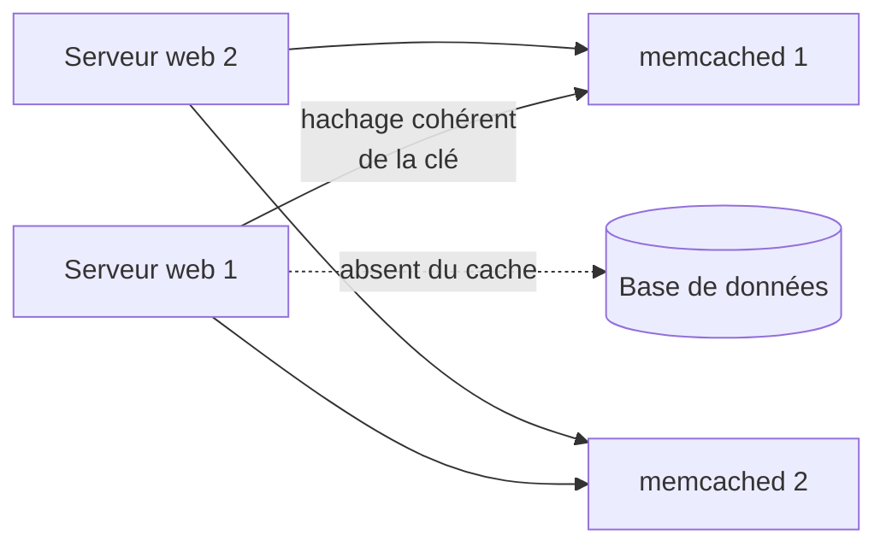

**Memcached** est un cache **clé-valeur en mémoire**, volontairement minimaliste : pas de persistance, pas de réplication, pas de structures complexes. Il décharge les bases de données et les applications en conservant le résultat de requêtes ou de calculs coûteux (sessions PHP, cache Django, MediaWiki, WordPress…).

## Principe



| Caractéristique | Détail |
| --- | --- |
| Données | Clé (≤ 250 octets) → valeur (≤ 1 Mo par défaut), durée d'expiration |
| Mémoire | Allocation par **slabs** (classes de tailles), éviction **LRU** quand la mémoire est pleine |
| Distribution | Les **clients** répartissent les clés entre serveurs (hachage cohérent *ketama*) ; les serveurs s'ignorent entre eux |
| Perte d'un nœud | Seule sa part du cache est perdue ; l'application relit la base |
| Protocole | Texte (ASCII) ou méta-commandes ; port **11211** |

## Memcached ou Redis ?

| Critère | Memcached | [[04-redis/01-presentation-installation\|Redis / Valkey]] |
| --- | --- | --- |
| Usage | Cache simple et très rapide, multithread | Cache + structures de données, files, pub/sub |
| Persistance, réplication | Non | Oui |
| Authentification | SASL ou fichier (optionnels) | ACL |
| Exploitation | Très simple | Plus riche |

## Installation

```bash
# Debian / Ubuntu
sudo apt install memcached libmemcached-tools
# RHEL / Rocky / Alma
sudo dnf install memcached
# macOS
brew install memcached && brew services start memcached
# Docker
docker run -d --name memcached -p 127.0.0.1:11211:11211 memcached:1.6 -m 1024
sudo systemctl enable --now memcached
```

Windows : pas de version officielle (portages non maintenus) ; utilisez WSL, Docker ou un serveur Linux.

## Configuration

```text /etc/memcached.conf (Debian)
-d
logfile /var/log/memcached.log
-m 2048
-p 11211
-u memcache
-l 127.0.0.1,10.0.30.71
-c 4096
-t 4
-I 2m
-U 0
```

```ini /etc/sysconfig/memcached (RHEL)
PORT="11211"
USER="memcached"
MAXCONN="4096"
CACHESIZE="2048"
OPTIONS="-l 127.0.0.1,10.0.30.71 -U 0 -t 4"
```

| Option | Rôle |
| --- | --- |
| `-m` | Mémoire du cache (Mo) |
| `-c` | Connexions simultanées maximales |
| `-t` | Threads de traitement (≈ nombre de cœurs alloués) |
| `-I` | Taille maximale d'un objet (défaut 1 Mo) |
| `-l` | Adresses d'écoute |
| `-U 0` | **UDP désactivé** (défaut depuis 1.5.6) |
| `-S` | Authentification SASL (protocole binaire) |
| `-Y fichier` | Authentification par fichier `utilisateur:motdepasse` (protocole texte) |
| `-Z` + `-o ssl_chain_cert=…,ssl_key=…` | TLS (si compilé avec la prise en charge) |

```bash
sudo systemctl restart memcached
memcstat --servers=127.0.0.1         # (memcached-tool 127.0.0.1:11211 stats)
```

## Raccorder les applications

| Application | Configuration |
| --- | --- |
| PHP (sessions) | `session.save_handler = memcached`, `session.save_path = "10.0.30.71:11211,10.0.30.72:11211"` |
| Django | `CACHES = {"default": {"BACKEND": "django.core.cache.backends.memcached.PyMemcacheCache", "LOCATION": ["10.0.30.71:11211", "10.0.30.72:11211"]}}` |
| WordPress | Extension de cache objet (Memcached) |
| Nginx | Module `memcached_pass` (lecture de pages préparées par l'application) |

Utilisez la **même liste de serveurs, dans le même ordre**, sur tous les clients : sinon chaque client cherche les clés au mauvais endroit.

## Suite

[[02-exploitation-securite|Exploitation, sécurité et dépannage]]
