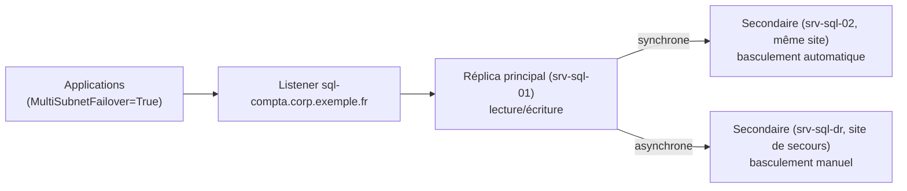

## Choisir une solution

| Solution | Protège | RPO / RTO | Édition |
| --- | --- | --- | --- |
| **Instance de cluster de basculement** (FCI) | L'instance (panne de serveur) — stockage **partagé** unique | 0 / ~1 min | Standard (2 nœuds), Enterprise |
| **Groupe de disponibilité** (AG) | Un ensemble de bases, chaque réplica a **sa copie** | 0 (synchrone) / quelques secondes | Enterprise ; **AG de base** en Standard (1 base, 2 réplicas, pas de lecture sur le secondaire) |
| Copie des journaux de transaction (*log shipping*) | Bases, vers un site de secours | Minutes / manuel | Toutes (sauf Express) |
| Réplication (transactionnelle, fusion) | Distribution de données, pas la HA | — | Selon le type |
| Sauvegardes + restauration | Tout | Heures | Toutes |

Une **FCI** dépend d'un stockage partagé ([[05-clustering/01-cluster-basculement|cluster Windows]] + SAN ou S2D) ; un **AG** n'a pas de stockage partagé et permet des copies sur un autre site.

## Groupes de disponibilité Always On



| Notion | Description |
| --- | --- |
| Réplica | Instance SQL Server hébergeant une copie des bases du groupe |
| Mode **synchrone** | Validation après durcissement du journal sur le secondaire : pas de perte, latence ajoutée (même site) |
| Mode **asynchrone** | Pas d'attente : perte possible, distance illimitée (site de secours) |
| **Listener** | Nom DNS + adresse(s) IP qui suivent le réplica principal |
| Secondaire lisible | Requêtes de rapport, sauvegardes, CHECKDB sur le secondaire (Enterprise ; licences à prévoir) |
| Cluster sous-jacent | Cluster de basculement Windows (WSFC) sans stockage partagé, ou Pacemaker sous Linux, ou aucun (type de cluster *NONE* : pas de basculement automatique) |

### Mise en place (résumé)

1. Cluster Windows sur les nœuds (sans disque), **témoin** de partage ou cloud ([[05-clustering/01-cluster-basculement|clustering]]).
2. Sur chaque instance : *Activer les groupes de disponibilité Always On* (Gestionnaire de configuration), redémarrage.
3. Points de terminaison de mise en miroir (port **5022**), même compte de service ou certificats.
4. Bases en mode **Complet** avec une sauvegarde complète.
5. Création du groupe (assistant SSMS, T-SQL ou dbatools) avec **amorçage automatique** ou par sauvegarde/restauration.
6. Création du **listener** (port 1433), droits du CNO du cluster pour créer l'objet ordinateur.

```tsql
-- Sur le principal
CREATE AVAILABILITY GROUP AG_Compta
WITH (AUTOMATED_BACKUP_PREFERENCE = SECONDARY, DB_FAILOVER = ON)
FOR DATABASE Compta, Paie
REPLICA ON
  N'SRV-SQL-01' WITH (ENDPOINT_URL = N'TCP://srv-sql-01.corp.exemple.fr:5022', AVAILABILITY_MODE = SYNCHRONOUS_COMMIT, FAILOVER_MODE = AUTOMATIC, SEEDING_MODE = AUTOMATIC, SECONDARY_ROLE (ALLOW_CONNECTIONS = READ_ONLY)),
  N'SRV-SQL-02' WITH (ENDPOINT_URL = N'TCP://srv-sql-02.corp.exemple.fr:5022', AVAILABILITY_MODE = SYNCHRONOUS_COMMIT, FAILOVER_MODE = AUTOMATIC, SEEDING_MODE = AUTOMATIC, SECONDARY_ROLE (ALLOW_CONNECTIONS = READ_ONLY)),
  N'SRV-SQL-DR' WITH (ENDPOINT_URL = N'TCP://srv-sql-dr.site2.exemple.fr:5022', AVAILABILITY_MODE = ASYNCHRONOUS_COMMIT, FAILOVER_MODE = MANUAL, SEEDING_MODE = AUTOMATIC);
ALTER AVAILABILITY GROUP AG_Compta ADD LISTENER N'sql-compta' (WITH IP ((N'10.0.20.60', N'255.255.255.0'), (N'10.60.20.60', N'255.255.255.0')), PORT = 1433);

-- Sur chaque secondaire
ALTER AVAILABILITY GROUP AG_Compta JOIN;
ALTER AVAILABILITY GROUP AG_Compta GRANT CREATE ANY DATABASE;
```

```powershell
# dbatools
New-DbaAvailabilityGroup -Primary srv-sql-01 -Secondary srv-sql-02 -Name AG_Compta -Database Compta -ClusterType Wsfc -SeedingMode Automatic -IPAddress 10.0.20.60 -Confirm:$false
```

### Ce qui n'est pas répliqué

Les **connexions**, travaux **Agent**, serveurs liés, certificats, opérateurs et configurations d'instance ne font **pas** partie du groupe : synchronisez-les (`Copy-DbaLogin`, `Copy-DbaAgentJob` de dbatools), ou utilisez un **groupe de disponibilité autonome** (*contained AG*, 2022+) qui embarque connexions et travaux.

### Clients

- Chaîne de connexion vers le **listener**, avec `MultiSubnetFailover=True` (sites multiples : tentative parallèle sur toutes les IP) et `ApplicationIntent=ReadOnly` pour la lecture sur secondaire (routage en lecture seule à configurer).
- DNS : `RegisterAllProvidersIP` et TTL court (le listener multi-sous-réseaux enregistre toutes ses IP).

### Basculement

```tsql
-- Basculement planifié (réplica synchrone et synchronisé), à exécuter sur le futur principal
ALTER AVAILABILITY GROUP AG_Compta FAILOVER;
-- Basculement forcé (sinistre, asynchrone : perte de données possible)
ALTER AVAILABILITY GROUP AG_Compta FORCE_FAILOVER_ALLOW_DATA_LOSS;
```

## Copie des journaux de transaction

Sauvegarde du journal sur le principal → copie vers un partage → restauration sur le secondaire en `NORECOVERY` ou `STANDBY` (lecture entre deux restaurations). Simple, robuste, idéal pour un site de secours ou un serveur de rapports décalé. Basculement **manuel** : restaurer les derniers journaux `WITH RECOVERY`, rediriger les applications.

## Linux

AG sous Linux avec **Pacemaker** (ressource `ocf:mssql:ag`, paquet `mssql-server-ha`) ; FCI avec stockage partagé (iSCSI, NFS). Les principes restent identiques, l'orchestration du basculement est assurée par Pacemaker.

## Supervision et problèmes fréquents

```tsql
SELECT ag.name, ar.replica_server_name, ars.role_desc, ars.synchronization_health_desc, drs.database_id,
       drs.synchronization_state_desc, drs.log_send_queue_size, drs.redo_queue_size
FROM sys.dm_hadr_availability_replica_states ars
JOIN sys.availability_replicas ar ON ar.replica_id = ars.replica_id
JOIN sys.availability_groups ag ON ag.group_id = ars.group_id
LEFT JOIN sys.dm_hadr_database_replica_states drs ON drs.replica_id = ars.replica_id;
```

| Symptôme | Cause | Solution |
| --- | --- | --- |
| Secondaire `NOT SYNCHRONIZING` | Point de terminaison 5022 filtré, compte de service sans droit `CONNECT` | Pare-feu, `GRANT CONNECT ON ENDPOINT::Hadr_endpoint TO [CORP\gmsa-sql02$]` |
| Création du listener refusée | CNO du cluster sans droit de créer un objet ordinateur | Droits sur l'OU ou VCO pré-créé |
| Applications longues à se reconnecter | Pas de `MultiSubnetFailover`, TTL DNS long | Option dans la chaîne de connexion, `HostRecordTTL` |
| Journal qui grossit sur le principal | Secondaire en retard ou suspendu (`log_reuse_wait_desc = AVAILABILITY_REPLICA`) | Reprendre la synchronisation, retirer un réplica abandonné |
| Connexions refusées après basculement | Connexions (logins) ou SID différents sur le nouveau principal | `Copy-DbaLogin` avec SID, groupe autonome |
| Travaux Agent qui tournent sur le secondaire | Travaux non conditionnés au rôle | Tester `sys.fn_hadr_is_primary_replica` dans le travail |
