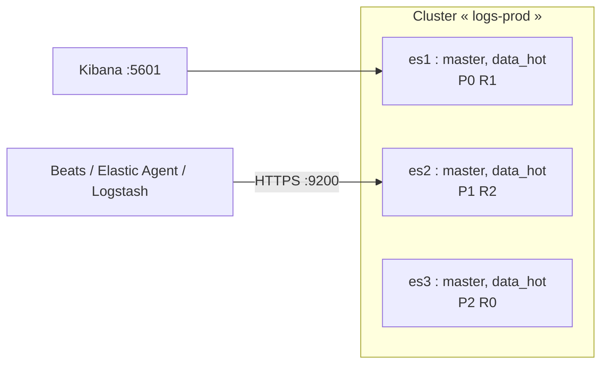

**Elasticsearch** est un moteur de recherche et d'analyse distribué fondé sur Apache Lucene. Il indexe des documents JSON et les rend interrogeables en quasi temps réel : recherche plein texte, journaux et métriques (pile ELK), observabilité, sécurité (SIEM), recherche applicative.

## Concepts

| Notion | Description |
| --- | --- |
| **Index** | Ensemble de documents (équivalent d'une table) ; souvent un index par jour/mois pour les journaux, ou un **data stream** |
| **Document** | Objet JSON identifié par `_id` |
| **Mapping** | Schéma des champs (types `keyword`, `text`, `date`, `long`, `ip`…) |
| **Shard** | Fragment d'un index (index Lucene) ; **primaire** ou **réplique** (copie sur un autre nœud) |
| **Nœud** | Instance Elasticsearch avec des **rôles** (`master`, `data_hot`, `data_warm`, `data_cold`, `ingest`, `ml`…) |
| **Cluster** | Ensemble de nœuds de même `cluster.name` |
| État | **green** (tout alloué), **yellow** (répliques non allouées), **red** (shards primaires manquants) |



## Pile Elastic

| Composant | Rôle |
| --- | --- |
| **Kibana** | Interface : exploration, tableaux de bord, administration, Dev Tools |
| **Elastic Agent** / Fleet | Agent unifié (journaux, métriques, sécurité) piloté centralement |
| Beats (Filebeat, Metricbeat, Winlogbeat…) | Collecteurs légers spécialisés |
| [[02-logstash/01-presentation-installation\|Logstash]] | Pipeline de collecte et de transformation |

## Licences et versions

- Versions **8.x** (sécurité activée par défaut) et **9.x** (2025).
- Licence : Elastic License 2.0 / SSPL, et depuis 2024 **AGPLv3** en option. La licence gratuite *Basic* inclut la sécurité de base (TLS, utilisateurs, rôles) ; LDAP/Active Directory, SAML, ML avancé nécessitent un abonnement.
- Alternative entièrement libre (Apache 2.0) : [[02-opensearch/01-presentation-installation|OpenSearch]].

## Ports

| Port | Usage |
| --- | --- |
| **9200** | API REST (HTTPS) |
| 9300 | Transport entre nœuds (TLS) |
| 5601 | Kibana |

## Installation

### Debian / Ubuntu

```bash
wget -qO - https://artifacts.elastic.co/GPG-KEY-elasticsearch | sudo gpg --dearmor -o /usr/share/keyrings/elasticsearch-keyring.gpg
echo "deb [signed-by=/usr/share/keyrings/elasticsearch-keyring.gpg] https://artifacts.elastic.co/packages/8.x/apt stable main" \
  | sudo tee /etc/apt/sources.list.d/elastic-8.x.list
sudo apt update && sudo apt install elasticsearch
# La sortie affiche le mot de passe du superutilisateur « elastic » : le noter
sudo systemctl daemon-reload && sudo systemctl enable --now elasticsearch
```

### RHEL / Rocky / Alma

```ini /etc/yum.repos.d/elasticsearch.repo
[elasticsearch]
name=Elasticsearch repository for 8.x packages
baseurl=https://artifacts.elastic.co/packages/8.x/yum
gpgcheck=1
gpgkey=https://artifacts.elastic.co/GPG-KEY-elasticsearch
enabled=0
type=rpm-md
```

```bash
sudo rpm --import https://artifacts.elastic.co/GPG-KEY-elasticsearch
sudo dnf install --enablerepo=elasticsearch elasticsearch
sudo systemctl enable --now elasticsearch
```

### Windows, macOS, Docker

| Plate-forme | Installation |
| --- | --- |
| Windows | Archive ZIP ; `bin\elasticsearch.bat` (premier démarrage, mot de passe affiché), puis service : `bin\elasticsearch-service.bat install` |
| macOS | Archive `tar.gz` (darwin-aarch64 / x86_64) ou Docker |
| Docker | `docker run -d --name es01 -p 9200:9200 -m 2GB docker.elastic.co/elasticsearch/elasticsearch:8.15.0` (mot de passe : `elasticsearch-reset-password` dans le conteneur) |

### Vérifier

```bash
curl --cacert /etc/elasticsearch/certs/http_ca.crt -u elastic https://localhost:9200
curl --cacert /etc/elasticsearch/certs/http_ca.crt -u elastic "https://localhost:9200/_cat/health?v"
sudo /usr/share/elasticsearch/bin/elasticsearch-reset-password -u elastic        # nouveau mot de passe
```

## Réglages système (Linux)

| Réglage | Valeur |
| --- | --- |
| `vm.max_map_count` | `262144` (sinon refus de démarrer en mode production) |
| Swap | Désactivé, ou `bootstrap.memory_lock: true` |
| Descripteurs de fichiers | ≥ 65535 (fourni par l'unité systemd) |
| Tas JVM | Calculé automatiquement ; sinon `-Xms`/`-Xmx` identiques, ≤ 50 % de la RAM et < 31 Go (`/etc/elasticsearch/jvm.options.d/heap.options`) |

```bash
echo 'vm.max_map_count = 262144' | sudo tee /etc/sysctl.d/90-elasticsearch.conf && sudo sysctl --system
```

## Kibana

```bash
sudo apt install kibana
sudo /usr/share/elasticsearch/bin/elasticsearch-create-enrollment-token -s kibana
sudo /usr/share/kibana/bin/kibana-setup --enrollment-token <jeton>
sudo systemctl enable --now kibana
```

```kibana /etc/kibana/kibana.yml (extrait)
server.host: "10.0.30.80"
server.publicBaseUrl: "https://kibana.corp.exemple.fr"
```

Publiez Kibana derrière un reverse proxy HTTPS ou activez `server.ssl.*`.

## Suite du parcours

1. [[02-configuration-cluster-securite|Cluster, configuration et sécurité]]
2. [[03-index-mappings-ilm|Index, mappings, modèles, ILM et requêtes]]
3. [[04-snapshots-exploitation-depannage|Snapshots, exploitation et dépannage]]
