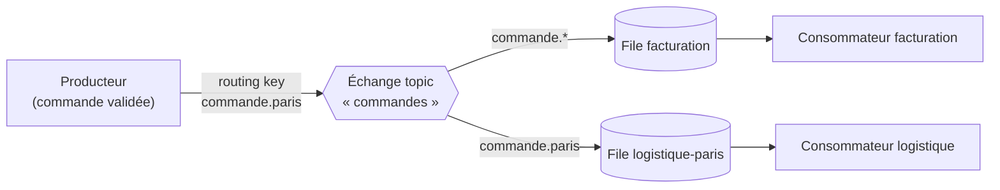

**RabbitMQ** est un courtier de messages (*message broker*) : les applications **publient** des messages qu'il **achemine** vers des files, d'où d'autres applications les **consomment** de façon asynchrone et fiable. Il découple les services, absorbe les pics de charge et répartit le travail.

## Modèle AMQP



| Notion | Description |
| --- | --- |
| **Vhost** | Espace isolé (échanges, files, droits) : un par application ou environnement |
| **Échange** | Reçoit les messages et les route selon son type et les liaisons |
| **File** | Stocke les messages jusqu'à leur consommation |
| **Liaison** (*binding*) | Règle échange → file (avec clé de routage) |
| Accusé (*ack*) | Le consommateur confirme le traitement ; sinon le message est redistribué |
| *Prefetch* | Nombre de messages non acquittés confiés à un consommateur |
| Confirmation de publication | Le courtier confirme au producteur la prise en charge |

| Type d'échange | Routage |
| --- | --- |
| `direct` | Clé de routage exacte |
| `fanout` | Toutes les files liées (diffusion) |
| `topic` | Motifs (`commande.*`, `journaux.#`) |
| `headers` | Selon les en-têtes du message |

| Type de file | Usage |
| --- | --- |
| Classique | File simple sur un nœud |
| **Quorum** | Répliquée (Raft) sur plusieurs nœuds : **à utiliser pour les données importantes** |
| Stream | Journal en ajout seul, relecture possible (proche de Kafka) |

## Versions et protocoles

- **4.x** (2024-2025) : suppression des files classiques « miroir » (remplacées par les files quorum), AMQP 1.0 natif, Khepri pour les métadonnées.
- Protocoles par greffons : **MQTT**, **STOMP**, WebSocket, **Streams**.
- Erlang/OTP requis (version compatible avec la version de RabbitMQ).

## Ports

| Port | Usage |
| --- | --- |
| **5672** / 5671 | AMQP / AMQPS |
| **15672** | Interface de gestion et API HTTP |
| 25672, 4369 | Communication entre nœuds, epmd |
| 15692 | Métriques Prometheus |
| 1883 / 8883, 61613, 5552 | MQTT, STOMP, Streams (si activés) |

## Installation

### Debian / Ubuntu

```bash
# Paquets de la distribution (simples, parfois anciens)
sudo apt install rabbitmq-server
# Versions récentes : dépôts de l'équipe RabbitMQ (Erlang + serveur), script fourni dans la documentation officielle
sudo systemctl enable --now rabbitmq-server
sudo rabbitmq-diagnostics status
```

### RHEL / Rocky / Alma

Installez **Erlang** (RPM `rabbitmq/erlang-rpm`) puis le RPM `rabbitmq-server` depuis les dépôts de l'équipe RabbitMQ :

```bash
sudo dnf install erlang rabbitmq-server       # dépôts RabbitMQ configurés au préalable
sudo systemctl enable --now rabbitmq-server
sudo firewall-cmd --permanent --add-port={5671,5672,15672}/tcp && sudo firewall-cmd --reload
```

### Windows, macOS, Docker

| Plate-forme | Installation |
| --- | --- |
| Windows | Installer Erlang/OTP puis l'installateur RabbitMQ (service Windows) ; commandes dans `sbin\` (`rabbitmqctl.bat`) |
| macOS | `brew install rabbitmq && brew services start rabbitmq` |
| Docker | `docker run -d --name rabbitmq -p 5672:5672 -p 15672:15672 -e RABBITMQ_DEFAULT_USER=admin -e RABBITMQ_DEFAULT_PASS='…' rabbitmq:4-management` |

## Interface de gestion

```bash
sudo rabbitmq-plugins enable rabbitmq_management rabbitmq_prometheus
sudo rabbitmqctl add_user admin 'MotDePasseLong!'
sudo rabbitmqctl set_user_tags admin administrator
sudo rabbitmqctl set_permissions -p / admin ".*" ".*" ".*"
sudo rabbitmqctl delete_user guest
```

Interface : `http://serveur:15672` (à publier en HTTPS). Le compte `guest` n'est utilisable que depuis `localhost` : supprimez-le.

## Suite du parcours

1. [[02-configuration-securite|Configuration, vhosts, droits et TLS]]
2. [[03-cluster-files-quorum|Cluster, files quorum, fédération et Shovel]]
3. [[04-exploitation-depannage|Exploitation et dépannage]]
