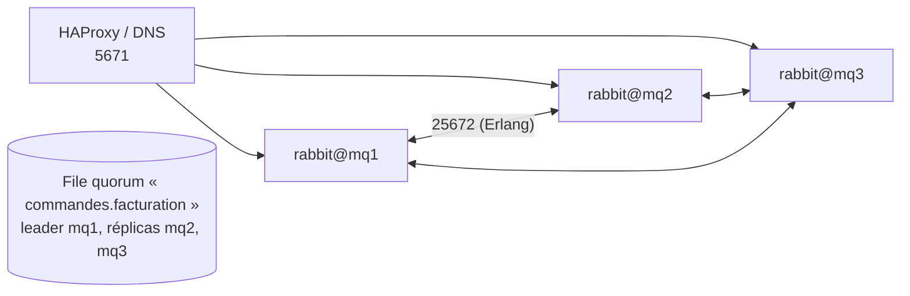

## Cluster



Un cluster RabbitMQ partage les **métadonnées** (utilisateurs, vhosts, échanges, liaisons) ; les **messages** d'une file ne sont répliqués que pour les files **quorum** et les **streams**. Prévoyez **3 ou 5 nœuds** dans le même site (faible latence).

### Prérequis

- Résolution des noms courts et longs entre nœuds (`rabbit@mq1`).
- **Même cookie Erlang** sur tous les nœuds : `/var/lib/rabbitmq/.erlang.cookie` (mode 400, propriétaire `rabbitmq`).
- Ports 4369, 25672 et 35672-35682 (outils CLI) ouverts entre nœuds.
- Versions de RabbitMQ et d'Erlang compatibles.

### Jonction manuelle

```bash
# Sur mq2 puis mq3
sudo rabbitmqctl stop_app
sudo rabbitmqctl reset
sudo rabbitmqctl join_cluster rabbit@mq1
sudo rabbitmqctl start_app
sudo rabbitmqctl cluster_status
```

### Découverte par configuration

```rabbitmq /etc/rabbitmq/rabbitmq.conf (tous les nœuds)
cluster_formation.peer_discovery_backend = classic_config
cluster_formation.classic_config.nodes.1 = rabbit@mq1
cluster_formation.classic_config.nodes.2 = rabbit@mq2
cluster_formation.classic_config.nodes.3 = rabbit@mq3
cluster_partition_handling = pause_minority
```

| `cluster_partition_handling` | Comportement en cas de coupure réseau |
| --- | --- |
| **`pause_minority`** | Les nœuds du côté minoritaire se mettent en pause : cohérence préservée (recommandé avec 3+ nœuds) |
| `autoheal` | Choisit un gagnant à la fin de la partition, redémarre les perdants |
| `ignore` | Aucune action : risque d'incohérence |

## Files quorum

```bash
# Déclarées par l'application (argument x-queue-type=quorum) ou imposées par le vhost :
sudo rabbitmqctl add_vhost /commandes --default-queue-type quorum
sudo rabbitmq-queues quorum_status "commandes.facturation" --vhost /commandes
sudo rabbitmq-queues add_member "commandes.facturation" rabbit@mq4 --vhost /commandes
sudo rabbitmq-queues rebalance quorum         # répartir les leaders entre nœuds
```

| Propriété | Détail |
| --- | --- |
| Réplication | Raft : une écriture est confirmée par la majorité des réplicas |
| Tolérance | 3 réplicas → perte d'un nœud tolérée ; 5 → deux |
| Messages poison | `delivery-limit` + file de lettres mortes |
| Remplace | Les files classiques « miroir » (supprimées en 4.0) |

## Répartir les connexions

```haproxy
listen rabbitmq-amqps
    bind 10.0.30.100:5671
    mode tcp
    balance leastconn
    option tcp-check
    server mq1 10.0.30.101:5671 check
    server mq2 10.0.30.102:5671 check
    server mq3 10.0.30.103:5671 check
```

Les clients peuvent aussi recevoir la liste des nœuds et se reconnecter automatiquement (option de la plupart des bibliothèques).

## Entre sites : fédération et Shovel

Le cluster ne doit **pas** s'étendre sur un lien WAN. Pour relier des sites :

| Mécanisme | Principe | Usage |
| --- | --- | --- |
| **Fédération** (échanges ou files) | Un courtier aval s'abonne à un échange/une file d'un courtier amont | Diffusion multi-sites, agences |
| **Shovel** | Déplace les messages d'une file source vers une destination (même ou autre courtier) | Migration, pont point à point |

```bash
sudo rabbitmq-plugins enable rabbitmq_federation rabbitmq_federation_management
sudo rabbitmqctl set_parameter -p /commandes federation-upstream siege \
  '{"uri": "amqps://federation:…@mq-siege.corp.exemple.fr:5671/%2Fcommandes", "expires": 3600000}'
sudo rabbitmqctl set_policy -p /commandes federer-commandes '^commandes$' '{"federation-upstream": "siege"}' --apply-to exchanges

sudo rabbitmq-plugins enable rabbitmq_shovel rabbitmq_shovel_management
sudo rabbitmqctl set_parameter -p /commandes shovel vers-archive \
  '{"src-uri": "amqp://", "src-queue": "commandes.archive", "dest-uri": "amqps://shovel:…@mq-archive:5671", "dest-queue": "commandes.archive"}'
sudo rabbitmqctl shovel_status
```
