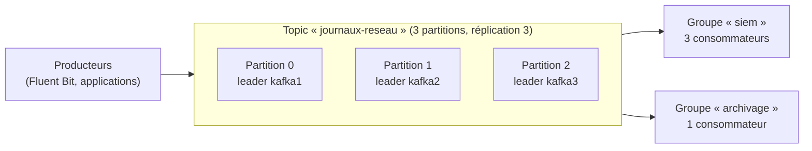

**Apache Kafka** est un **journal d'événements distribué** : les producteurs ajoutent des messages à des **topics**, conservés pendant une durée définie, que de nombreux consommateurs lisent chacun à leur rythme. Il sert à collecter des journaux et des métriques à grande échelle, à alimenter des pipelines de données, à synchroniser des systèmes (capture de changements des bases), et à bâtir des architectures orientées événements.

## Concepts



| Notion | Description |
| --- | --- |
| **Topic** | Flux nommé de messages (clé, valeur, en-têtes, horodatage) |
| **Partition** | Sous-journal ordonné ; unité de parallélisme et de répartition |
| **Offset** | Position d'un message dans une partition |
| **Broker** | Serveur Kafka qui héberge des partitions |
| **Réplication** | Chaque partition a un **leader** et des **suiveurs** ; l'**ISR** (*in-sync replicas*) liste les copies à jour |
| **Groupe de consommateurs** | Les partitions sont réparties entre les membres du groupe ; chaque groupe lit tout le topic |
| Rétention | Par durée ou taille (messages conservés même après lecture), ou **compaction** (dernière valeur par clé) |
| **KRaft** | Consensus interne (contrôleurs) remplaçant ZooKeeper |

L'ordre n'est garanti qu'**au sein d'une partition** : les messages de même clé vont dans la même partition.

## Kafka ou RabbitMQ ?

| Critère | Kafka | [[03-rabbitmq/01-presentation-installation\|RabbitMQ]] |
| --- | --- | --- |
| Modèle | Journal persistant, relecture possible | File : message supprimé après acquittement |
| Débit | Très élevé (millions de messages/s en cluster) | Élevé |
| Routage | Par topic/partition | Riche (échanges, motifs, en-têtes) |
| Usages | Flux de données, journaux, CDC, analyse | Tâches, intégration applicative, RPC |

## Versions

- **Kafka 4.0** (2025) : **KRaft uniquement** (ZooKeeper supprimé), Java 17 requis pour les brokers. La 3.9 est la dernière version avec ZooKeeper (migration vers KRaft à faire avant de passer en 4.x).
- Distributions : Apache Kafka (archive), Confluent Platform, Strimzi (Kubernetes), Redpanda (compatible, réécrit en C++).

## Ports

| Port | Usage |
| --- | --- |
| **9092** | Clients (listener `PLAINTEXT`, `SSL`, `SASL_SSL` selon la configuration) |
| 9093 | Contrôleurs KRaft |

## Installation (Linux)

Kafka est distribué en **archive** (pas de paquets officiels dans les distributions) :

```bash
sudo apt install openjdk-17-jre-headless          # ou java-17-openjdk-headless (RHEL)
sudo useradd -r -m -d /opt/kafka -s /usr/sbin/nologin kafka
curl -LO https://downloads.apache.org/kafka/4.0.0/kafka_2.13-4.0.0.tgz
sudo tar -xzf kafka_2.13-4.0.0.tgz -C /opt/kafka --strip-components=1
sudo mkdir -p /var/lib/kafka && sudo chown -R kafka: /opt/kafka /var/lib/kafka
```

### Nœud unique (test) en KRaft

```bash
cd /opt/kafka
KAFKA_CLUSTER_ID="$(bin/kafka-storage.sh random-uuid)"
sudo -u kafka bin/kafka-storage.sh format --standalone -t "$KAFKA_CLUSTER_ID" -c config/server.properties
```

```ini /etc/systemd/system/kafka.service
[Unit]
Description=Apache Kafka
After=network-online.target

[Service]
User=kafka
Environment="KAFKA_HEAP_OPTS=-Xms2g -Xmx2g"
ExecStart=/opt/kafka/bin/kafka-server-start.sh /opt/kafka/config/server.properties
ExecStop=/opt/kafka/bin/kafka-server-stop.sh
Restart=on-failure
LimitNOFILE=100000

[Install]
WantedBy=multi-user.target
```

```bash
sudo systemctl daemon-reload && sudo systemctl enable --now kafka
```

### Docker, Windows, macOS

| Plate-forme | Installation |
| --- | --- |
| Docker | `docker run -d --name kafka -p 9092:9092 apache/kafka:4.0.0` (nœud unique KRaft prêt à l'emploi) |
| macOS | `brew install kafka && brew services start kafka` |
| Windows | Scripts `bin\windows\*.bat` utilisables pour le développement ; en production, Linux (ou WSL / conteneurs) |

## Premiers essais

```bash
cd /opt/kafka
bin/kafka-topics.sh --bootstrap-server localhost:9092 --create --topic essais --partitions 3 --replication-factor 1
bin/kafka-topics.sh --bootstrap-server localhost:9092 --describe --topic essais
bin/kafka-console-producer.sh --bootstrap-server localhost:9092 --topic essais
bin/kafka-console-consumer.sh --bootstrap-server localhost:9092 --topic essais --from-beginning --group test
bin/kafka-consumer-groups.sh --bootstrap-server localhost:9092 --describe --group test
```

## Suite du parcours

1. [[02-cluster-configuration|Cluster KRaft et configuration des brokers]]
2. [[03-securite-sasl-tls-acl|Sécurité : TLS, SASL et ACL]]
3. [[04-exploitation-depannage|Exploitation, écosystème et dépannage]]
