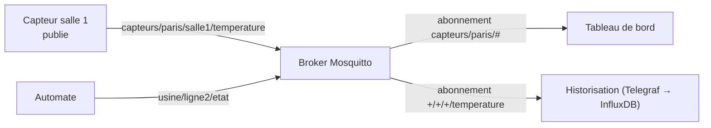

**MQTT** est un protocole de messagerie léger de type **publication/abonnement**, conçu pour les objets connectés, capteurs, automates et réseaux peu fiables. **Eclipse Mosquitto** est le broker MQTT libre le plus répandu : léger (quelques Mo de RAM), il convient aussi bien à un Raspberry Pi qu'à un serveur.

## Concepts MQTT



| Notion | Description |
| --- | --- |
| **Topic** | Chemin hiérarchique : `capteurs/paris/salle1/temperature` |
| Jokers | `+` (un niveau), `#` (tous les niveaux suivants) — en abonnement uniquement |
| **QoS 0 / 1 / 2** | Au plus une fois / au moins une fois / exactement une fois |
| **Message retenu** | Dernière valeur conservée et envoyée immédiatement aux nouveaux abonnés |
| **Testament** (LWT) | Message publié par le broker si un client disparaît sans se déconnecter |
| Session persistante | Abonnements et messages QoS ≥ 1 conservés pendant la déconnexion du client |
| MQTT 5 | Propriétés utilisateur, expiration des messages, abonnements partagés, codes de raison |

| Port | Usage |
| --- | --- |
| **1883** | MQTT |
| **8883** | MQTT sur TLS |
| 8080 / 8081 (au choix) | MQTT sur WebSocket (applications web) |

## Installation

| Plate-forme | Installation |
| --- | --- |
| Debian / Ubuntu | `sudo apt install mosquitto mosquitto-clients` |
| RHEL / Rocky / Alma | `sudo dnf install epel-release && sudo dnf install mosquitto` |
| Windows | Installateur de mosquitto.org (service *Mosquitto Broker*, `C:\Program Files\mosquitto\mosquitto.conf`) |
| macOS | `brew install mosquitto && brew services start mosquitto` |
| Docker | `docker run -d -p 1883:1883 -p 8883:8883 -v ./config:/mosquitto/config eclipse-mosquitto:2` |

> [!NOTE]
> Depuis **Mosquitto 2.0**, sans configuration explicite, le broker n'écoute **que sur localhost** (« local only mode ») et un listener déclaré refuse les clients anonymes par défaut.

## Configuration sécurisée

```mosquitto /etc/mosquitto/conf.d/local.conf
per_listener_settings false
allow_anonymous false
password_file /etc/mosquitto/passwd
acl_file /etc/mosquitto/acl

# MQTT local (applications sur le serveur)
listener 1883 127.0.0.1

# MQTT sur TLS pour les objets et applications distants
listener 8883
cafile /etc/mosquitto/certs/ca.crt
certfile /etc/mosquitto/certs/broker.crt
keyfile /etc/mosquitto/certs/broker.key
tls_version tlsv1.2
# require_certificate true              # mTLS : certificat client obligatoire
# use_identity_as_username true

# WebSocket sur TLS
listener 8081
protocol websockets
cafile /etc/mosquitto/certs/ca.crt
certfile /etc/mosquitto/certs/broker.crt
keyfile /etc/mosquitto/certs/broker.key

persistence true
persistence_location /var/lib/mosquitto/
log_dest file /var/log/mosquitto/mosquitto.log
log_type error
log_type warning
log_type notice
connection_messages true
max_inflight_messages 20
max_queued_messages 1000
```

### Comptes

```bash
sudo mosquitto_passwd -c /etc/mosquitto/passwd capteur-salle1      # -c : crée le fichier (une seule fois)
sudo mosquitto_passwd /etc/mosquitto/passwd tableau-de-bord
sudo mosquitto_passwd -b /etc/mosquitto/passwd telegraf 'MotDePasse'   # non interactif
sudo chown mosquitto: /etc/mosquitto/passwd && sudo chmod 600 /etc/mosquitto/passwd
```

### ACL

```text /etc/mosquitto/acl
# Chaque capteur n'écrit que sous son propre nom (%u = identifiant, %c = client id)
pattern write capteurs/+/%u/#

user tableau-de-bord
topic read capteurs/#
topic read usine/#

user telegraf
topic read #

user automate-ligne2
topic readwrite usine/ligne2/#
```

```bash
sudo systemctl restart mosquitto        # (ou kill -HUP pour recharger mots de passe et ACL)
```

Pour une gestion dynamique (comptes, rôles, ACL modifiables sans redémarrage), le greffon **Dynamic Security** se pilote avec `mosquitto_ctrl`.

## Clients en ligne de commande

```bash
# S'abonner (TLS, authentifié)
mosquitto_sub -h mqtt.corp.exemple.fr -p 8883 --cafile ca.crt -u tableau-de-bord -P '…' -t 'capteurs/#' -v
# Publier une valeur retenue en QoS 1
mosquitto_pub -h mqtt.corp.exemple.fr -p 8883 --cafile ca.crt -u capteur-salle1 -P '…' \
  -t 'capteurs/paris/capteur-salle1/temperature' -m '21.4' -q 1 -r
```

## Suite

[[02-ponts-exploitation|Ponts, exploitation et dépannage]]
