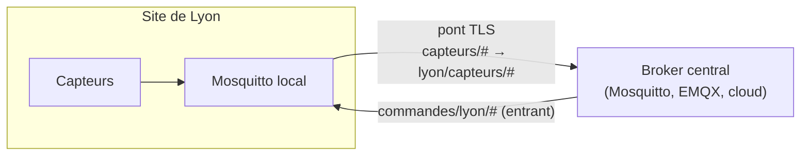

## Ponts entre brokers

Un **pont** (*bridge*) relie un broker local (site, usine) à un broker central : les topics choisis sont transmis dans un sens ou dans les deux.



```mosquitto /etc/mosquitto/conf.d/pont.conf (broker du site)
connection pont-central
address mqtt-central.corp.exemple.fr:8883
bridge_cafile /etc/mosquitto/certs/ca.crt
bridge_protocol_version mqttv311
remote_clientid site-lyon
remote_username site-lyon
remote_password MotDePasseSite
cleansession false
restart_timeout 10 60
# topic <motif> <sens> <qos> <préfixe local> <préfixe distant>
topic capteurs/# out 1 "" lyon/
topic commandes/lyon/# in 1 "" ""
```

| Sens | Effet |
| --- | --- |
| `out` | Du broker local vers le distant |
| `in` | Du distant vers le local |
| `both` | Les deux (attention aux boucles) |

`cleansession false` et QoS 1 permettent de mettre en file les messages pendant une coupure du lien.

## Haute disponibilité

Mosquitto ne gère **pas de cluster** : un broker = un serveur. Options :

| Besoin | Solution |
| --- | --- |
| Redémarrage rapide | Supervision + redémarrage automatique (systemd `Restart=always`) |
| Bascule | Deux serveurs avec IP virtuelle (keepalived) ; les clients se reconnectent (sessions perdues sans stockage partagé) |
| Cluster, très grand nombre de connexions | Broker distribué : [[06-emqx/01-presentation-installation\|EMQX]], HiveMQ, VerneMQ |

## Statistiques $SYS

```bash
mosquitto_sub -h localhost -u admin -P '…' -t '$SYS/#' -v | grep -E 'clients/connected|messages/(received|sent)|load/messages'
```

| Topic | Information |
| --- | --- |
| `$SYS/broker/clients/connected` | Clients connectés |
| `$SYS/broker/messages/received`, `sent` | Volumes |
| `$SYS/broker/load/messages/received/1min` | Débit moyen |
| `$SYS/broker/store/messages/count` | Messages stockés (sessions persistantes) |
| `$SYS/broker/version`, `uptime` | Version, durée de fonctionnement |

L'accès à `$SYS` se contrôle par ACL (`topic read $SYS/#` pour le compte de supervision).

## Intégrations

| Outil | Usage |
| --- | --- |
| **Telegraf** (`inputs.mqtt_consumer`) → InfluxDB / Prometheus | Historisation des mesures — voir [[09-telegraf/01-presentation-configuration\|Telegraf]] |
| Node-RED | Flux de traitement graphiques |
| Home Assistant | Domotique (découverte MQTT) |
| Zigbee2MQTT | Passerelle Zigbee → MQTT |

## Problèmes fréquents

| Message / symptôme | Cause | Solution |
| --- | --- | --- |
| `Starting in local only mode` dans le journal | Aucun `listener` configuré (Mosquitto 2) | Déclarer un `listener` et l'authentification |
| `Connection Refused: not authorised` | Compte inconnu, mot de passe, `allow_anonymous false` | `mosquitto_passwd`, droits du fichier de mots de passe |
| Connecté mais aucun message reçu | ACL qui interdit la lecture/écriture (refus silencieux) | Vérifier `acl_file`, journaux en `log_type all` temporairement |
| `Error: A TLS error occurred` / `certificate verify failed` | AC non fournie au client, nom d'hôte ≠ certificat | `--cafile`, certificat avec le bon SAN |
| `Address already in use` | Autre broker ou service sur le port | `ss -ltnp 'sport = :1883'` |
| Clients déconnectés puis reconnectés en boucle | Deux clients avec le même *client id* | Identifiants uniques |
| Messages perdus pendant une déconnexion | QoS 0 ou session non persistante | QoS 1, `cleansession false` / *session expiry* MQTT 5 |
| Mémoire en hausse | Nombreuses sessions persistantes avec messages en attente | `max_queued_messages`, `persistent_client_expiration` |
