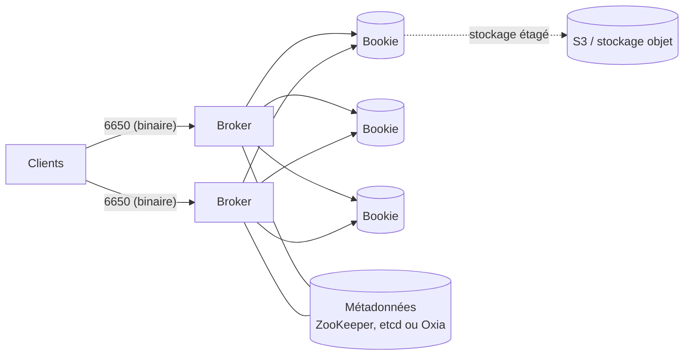

## Apache RocketMQ

Né chez Alibaba, **RocketMQ** (Java, Apache 2.0) vise les applications transactionnelles à fort volume (commerce, paiement) : messages **ordonnés**, **différés**, **transactionnels**, consommation par **groupes**.

| Composant | Rôle | Port |
| --- | --- | --- |
| **NameServer** | Annuaire : quels courtiers hébergent quels topics | 9876 |
| **Broker** | Stocke les messages (CommitLog) et les sert | 10911 |
| **Proxy** (RocketMQ 5) | Point d'accès sans état (gRPC, remoting) pour les clients | 8081 (gRPC) |
| Dashboard | Interface web de supervision | 8080 (selon déploiement) |

```bash
# Archive binaire, Java 8 ou plus
unzip rocketmq-all-5.*-bin-release.zip -d /opt && cd /opt/rocketmq-all-5.*-bin-release
nohup sh bin/mqnamesrv > ~/namesrv.log 2>&1 &
nohup sh bin/mqbroker -n localhost:9876 --enable-proxy > ~/broker.log 2>&1 &

export NAMESRV_ADDR=localhost:9876
sh bin/mqadmin clusterList
sh bin/mqadmin updateTopic -n localhost:9876 -c DefaultCluster -t Commandes
sh bin/mqadmin topicList
sh bin/mqadmin consumerProgress -g groupe-facturation       # retard d'un groupe
sh bin/tools.sh org.apache.rocketmq.example.quickstart.Producer   # test
```

| Type de message | Usage |
| --- | --- |
| Normal | Cas général |
| **Ordonné** (FIFO par clé) | Étapes d'une commande traitées dans l'ordre |
| **Différé** / planifié | Relance après un délai (paiement non confirmé) |
| **Transactionnel** | Message validé seulement si la transaction locale réussit (semi-message puis confirmation) |

## Apache Pulsar

**Pulsar** (Java, Apache 2.0, issu de Yahoo) sépare le **calcul** (courtiers sans état) et le **stockage** (**BookKeeper**) : on ajoute des courtiers ou des nœuds de stockage indépendamment, sans rééquilibrage lourd des données.



| Notion | Détail |
| --- | --- |
| **Multi-locataire** | `persistent://tenant/namespace/topic` ; quotas, politiques et droits par tenant et namespace |
| Abonnements | **Exclusive**, **Failover**, **Shared** (répartition comme une file), **Key_Shared** (ordre par clé) |
| Rétention | Durée et taille par namespace ; **stockage étagé** des anciens segments vers S3 |
| Géoréplication | Réplication native entre grappes de plusieurs régions |
| Pulsar Functions | Traitements légers sur les flux, exécutés par Pulsar |
| Pulsar IO | Connecteurs sources et destinations (bases, Kafka, Elasticsearch…) |
| Compatibilité | Protocole Kafka (KoP), MQTT (MoP), AMQP via greffons |

```bash
# Mode autonome (essai)
docker run -d --name pulsar -p 6650:6650 -p 8080:8080 apachepulsar/pulsar:latest bin/pulsar standalone

docker exec -it pulsar bin/pulsar-admin tenants create acme
docker exec -it pulsar bin/pulsar-admin namespaces create acme/app
docker exec -it pulsar bin/pulsar-admin namespaces set-retention acme/app --time 7d --size 10G
docker exec -it pulsar bin/pulsar-admin topics create-partitioned-topic persistent://acme/app/evenements -p 4
docker exec -it pulsar bin/pulsar-client produce persistent://acme/app/evenements -m "bonjour" -n 10
docker exec -it pulsar bin/pulsar-client consume persistent://acme/app/evenements -s abonnement-test -n 0
docker exec -it pulsar bin/pulsar-admin topics stats persistent://acme/app/evenements
```

En production, Pulsar se déploie surtout sur **Kubernetes** (chart Helm officiel) : plusieurs composants (courtiers, bookies, métadonnées, proxy) à dimensionner.

## Choisir

| Besoin | Choix |
| --- | --- |
| Journal d'événements, écosystème le plus large | Kafka (page dédiée du wiki) |
| Multi-locataire, géoréplication, rétention longue sur S3 | **Pulsar** |
| Messages transactionnels et différés à fort volume | **RocketMQ** |
| Applications Java JMS, multi-protocole | [[01-activemq-classic-artemis\|ActiveMQ Artemis]] |
| Files de travail simples, routage AMQP | RabbitMQ |

Commandes : [[90-aide-memoire|aide-mémoire]].
