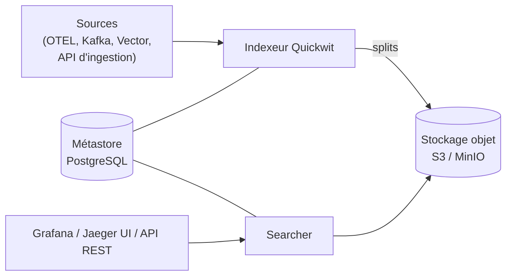

**Quickwit** indexe et recherche des **journaux et des traces** directement sur un **stockage objet** (S3, MinIO, GCS, Azure) : le calcul et le stockage sont séparés, ce qui permet une recherche en moins d'une seconde sur des téraoctets à un coût très bas, sans grappe à dimensionner comme [[01-elasticsearch/01-presentation-installation|Elasticsearch]]. Il vise l'**observabilité** (remplaçant économique d'ELK pour les logs), sert de **backend de traces Jaeger** et s'intègre à [[06-supervision/18-tracage-distribue/02-tempo|OpenTelemetry]] et [[06-supervision/03-grafana/01-presentation-installation|Grafana]].



## Composants

| Composant | Rôle |
| --- | --- |
| **Indexer** | Reçoit les documents, construit les *splits* (fichiers d'index) et les pousse sur l'objet |
| **Searcher** | Exécute les requêtes en lisant les *splits* sur l'objet (sans état, s'horizontalise) |
| **Metastore** | Index, *splits*, points de reprise des sources — fichier (mono-nœud) ou **PostgreSQL** (production) |
| **Control plane** / **Janitor** | Planification des indexations ; nettoyage (rétention, *garbage collection*) |

En mono-nœud, tout tourne dans un seul processus (`quickwit run`) ; en production, on sépare indexeurs et searchers avec un métastore PostgreSQL partagé.

## Installation

```bash
# Binaire
curl -L https://install.quickwit.io | sh && cd quickwit-*/
./quickwit run                                 # tout-en-un ; REST 7280, gRPC 7281
```

```bash
# Docker
docker run -d --name quickwit -p 7280:7280 -p 7281:7281 \
  -v $PWD/qwdata:/quickwit/qwdata quickwit/quickwit run
```

Kubernetes : chart Helm `quickwit`. Configuration par `quickwit.yaml` ou variables `QW_*` (`QW_METASTORE_URI=postgres://…`, `QW_DEFAULT_INDEX_ROOT_URI=s3://bucket/indexes`, identifiants S3).

## Créer un index et ingérer

```yaml index-logs.yaml
version: 0.8
index_id: logs
doc_mapping:
  mode: dynamic
  field_mappings:
    - { name: timestamp, type: datetime, input_formats: [unix_timestamp], fast: true }
    - { name: service, type: text, tokenizer: raw, fast: true }
    - { name: severity, type: text, tokenizer: raw }
    - { name: message, type: text, tokenizer: default, record: position }
  timestamp_field: timestamp
indexing_settings:
  commit_timeout_secs: 30
retention:
  period: 30 days
  schedule: daily
```

```bash
./quickwit index create --index-config index-logs.yaml
# Ingestion locale (NDJSON : un document JSON par ligne)
./quickwit index ingest --index logs --input-path journaux.ndjson
# Ingestion continue via l'API REST (bulk)
curl -X POST http://localhost:7280/api/v1/logs/ingest -H 'Content-Type: application/x-ndjson' --data-binary @journaux.ndjson
```

Sources continues : **Kafka**, **Pulsar**, **Kinesis**, l'**API d'ingestion**, ou l'agent **Vector**/**OpenTelemetry** (Quickwit expose un récepteur OTLP).

## Rechercher

```bash
# CLI
./quickwit index search --index logs --query 'severity:ERROR AND service:api' --max-hits 20

# API REST (langage de requête proche de Lucene ; filtre temporel par start/end)
curl "http://localhost:7280/api/v1/logs/search?query=severity:ERROR&start_timestamp=1764000000&max_hits=20" | jq '.num_hits'

# Agrégations (compatibles avec un sous-ensemble de l'API Elasticsearch)
curl -X POST "http://localhost:7280/api/v1/logs/search" -H 'Content-Type: application/json' -d '{
  "query": "service:api",
  "aggs": { "par_severite": { "terms": { "field": "severity" } } }
}'
```

- **Grafana** : source de données Quickwit (plugin) pour les tableaux de bord de journaux.
- **Jaeger** : Quickwit expose l'API gRPC Jaeger → l'UI Jaeger lit les traces stockées dans Quickwit (`QW_ENABLE_JAEGER_ENDPOINT=true`).
- **API Elasticsearch** : un sous-ensemble (`_search`, `_bulk`) facilite la migration d'outils existants.

## Exploitation

```bash
./quickwit index list
./quickwit index describe --index logs            # taille, nombre de documents, splits
./quickwit split list --index logs                # fichiers d'index sur l'objet
./quickwit index gc --index logs                  # nettoyage des splits obsolètes
./quickwit index clear --index logs               # vider sans supprimer la définition
```

- **Dimensionnement** : les searchers se multiplient pour la montée en charge (ils sont sans état) ; un cache local accélère les requêtes répétées.
- **Rétention** : définie dans la configuration d'index (le janitor supprime les *splits* expirés sur l'objet).
- **Métastore** : PostgreSQL en production (sauvegarde classique) ; les données elles‑mêmes vivent sur l'objet (versionné/répliqué côté stockage).

Face à Elasticsearch/OpenSearch, Quickwit est **spécialisé append-only** (journaux, traces, événements) : pas de mises à jour document par document ni de recherche transactionnelle, mais un coût et une exploitation très inférieurs à gros volume.

Voir aussi : [[01-meilisearch-typesense-sonic|Meilisearch et Typesense]] (recherche applicative) et [[02-solr-manticore-zinc-tantivy|Solr et Manticore]]. Commandes : [[90-aide-memoire|aide-mémoire]].
